# 图书馆智能客服系统 · 逻辑流程图（设计规范版）

> **目录**（点击可跳转，详细至二级标题）

- [0. 系统总体分层（全链路视角）](#toc-1)
- [1. 一次对话的完整生命周期（时序）](#toc-2)
- [2. 接入网关层（请求边界与基础设施防护）](#toc-3)
  - [2.1 请求链路与模块划分](#toc-4)
  - [2.2 中间件与依赖注入顺序](#toc-5)
  - [2.3 认证：解析 JWT，构建 CurrentUser](#toc-6)
  - [2.4 鉴权依赖（RBAC + 会话归属）](#toc-7)
  - [2.5 JWT 签发与刷新（Redis 白名单 + refresh 轮换）](#toc-8)
  - [2.6 限流（IP 级认证前 + 用户级认证后，Redis 分桶）](#toc-9)
  - [2.7 熔断降级（下游 LLM / 知识库 / 借阅系统）](#toc-10)
  - [2.8 统一异常处理（全链路横切，统一 JSON）](#toc-11)
  - [2.9 对接图书馆 SSO 建议](#toc-12)
  - [2.10 安全注意事项](#toc-13)
- [3. 对话编排主流程（核心调度逻辑）](#toc-14)
  - [3.1 安全守卫拦截的具体机制（四层架构）](#toc-15)
- [4. 意图识别与通道路由（重构方案）](#toc-16)
  - [4.0 目标架构总览](#toc-17)
  - [4.0.1 加权关键词分类器（意图识别第一信号）](#toc-17b)
  - [4.1 路由决策器设计（六步顺序）](#toc-18)
  - [4.2 四层兜底体系](#toc-19)
  - [4.3 统一后处理层（替代原 K）](#toc-20)
  - [4.4 迁移步骤（四阶段，每阶段可回滚）](#toc-21)
- [5. 业务通道 —— 多轮槽位填充（以座位预约为例，重构方案）](#toc-22)
  - [5.0 目标架构总览](#toc-23)
  - [5.1 阶段模型 Stage（替代两态判断）](#toc-24)
  - [5.2 流程重新设计](#toc-25)
  - [5.3 约束模型](#toc-26)
  - [5.4 风险分级（配置化，不硬编码）](#toc-27)
  - [5.5 状态外置与并发控制](#toc-28)
  - [5.6 事务化提交（六步 + 四类结果）](#toc-29)
  - [5.7 兜底体系（八类）](#toc-30)
- [6. 业务通道 —— 续借（对象集合识别 + 逐本资格校验 + 批量事务化提交）](#toc-31)
  - [6.1 阶段模型 Stage](#toc-32)
  - [6.2 完整流程（九段）](#toc-33)
  - [6.3 状态存储 / 幂等 / 并发控制](#toc-34)
  - [6.4 对象识别优先级 / 校验顺序 / 展示话术](#toc-35)
  - [6.5 兜底体系（八类）](#toc-36)
  - [6.6 一句话总结](#toc-37)
- [7. FAQ 快答通道 + 语义缓存（重构为知识层：意图理解 + 多路召回 + 置信度驱动）](#toc-38)
  - [7.1 完整流程（九段）](#toc-39)
  - [7.2 兜底体系（八类）](#toc-40)
  - [7.3 一句话总结](#toc-41)
- [8. 知识问答通道（RAG）+ 低置信度处理（重构为五层推理引擎：问题理解 + 策略规划 + 多源获取 + 答案合成 + 校验输出）](#toc-42)
  - [8.1 五层架构](#toc-43)
  - [8.2 完整流程（九段）](#toc-44)
  - [8.3 兜底体系（八类）](#toc-45)
  - [8.4 一句话总结](#toc-46)
- [9. 通用对话兜底与人工转接（捕获 + 共情 + 承认不确定 + 安全分级 + 给出路 + 通用模型 + 转人工 + 升级判断 + 学习回流）](#toc-47)
  - [9.1 三层架构](#toc-48)
  - [9.2 完整流程（九段）](#toc-49)
  - [9.3 兜底体系（八类）](#toc-50)
  - [9.4 一句话总结](#toc-51)
- [10. 检索层：混合检索管道重构为搜索代理（核心算法逻辑：信息需求理解 + 搜索规划 + 迭代搜索 + 推理综合 + 反思输出）](#toc-52)
  - [10.1 流程图](#toc-53)
  - [10.2 五层架构](#toc-54)
  - [10.3 完整流程（五段）](#toc-55)
  - [10.4 十类兜底体系](#toc-56)
  - [10.5 一句话总结](#toc-57)
- [11. 知识库索引构建（启动 / 运维流程）](#toc-58)
  - [11.1 流程图](#toc-59)
  - [11.2 六层架构](#toc-60)
  - [11.3 完整流程（十段）](#toc-61)
  - [11.4 十二类兜底体系](#toc-62)
  - [11.5 一句话总结](#toc-63)
- [12. 查询改写与多轮指代消解](#toc-64)
  - [12.1 上次分析的局限与本次定位](#toc-65)
  - [12.2 从"查询改写模块"到"查询理解代理"](#toc-66)
  - [12.3 一句话总结](#toc-67)
- [13. 安全层、权限层与登录升级](#toc-68)
  - [13.1 从"简化示意"到"访问控制中枢"](#toc-69)
  - [13.2 一句话总结](#toc-70)
- [14. 流式响应事件模型](#toc-71)
  - [14.1 上次分析的局限](#toc-72)
  - [14.2 从"文本分块管道"到"流式事件编排层"](#toc-73)
  - [14.3 一句话总结](#toc-74)
- [15. 全链路一图总览（名词版）](#toc-75)
- [16. 模块关系与职责边界总表](#toc-76)
  - [16.1 模块职责与调用关系总表](#toc-77)
  - [16.2 分层与包含关系](#toc-78)
  - [16.3 横切层清单](#toc-79)
  - [16.4 看似重复、实则不同切面（不是冗余）](#toc-80)
  - [16.5 需重点对齐的两处边界](#toc-81)


> 本版采用**设计层面的通用名词**描述，不绑定具体实现代码，用于梳理与纠正全链路设计逻辑。
> 关键抽象：客户端层、接入网关层、对话编排层、意图识别、查询改写、对话状态追踪、业务处理层、知识问答（RAG）层、检索层、生成层、安全层、权限层、会话管理层、存储层。

---

<a id="toc-1"></a>
## 0. 系统总体分层（全链路视角）

```mermaid
flowchart TD
    subgraph CL[客户端层]
        W1[Web 前端 / 触屏一体机<br/>含公共设备模式 X-Public-Device] --> GW
    end

    subgraph GW[接入网关层 main.py]
        M1[认证鉴权 get_current_user] --> M2[限流 RateLimitMiddleware]
        M2 --> M3[CORS / 跨域]
        M3 --> M4[统一异常处理 register_exception_handlers]
        M4 --> M5[熔断降级 CircuitBreaker<br/>大模型 / 知识库 / 借阅系统]
    end

    subgraph ORCH[对话编排层 ChatServiceV2]
        O1[对话编排引擎 process] --> O2[安全守卫 check_injection]
        O2 --> O3[会话状态判定 多轮 DST]
        O3 --> O4[意图识别 加权分类 IntentClassifier]
        O4 --> O5[查询改写 意图增强 + 指代消解]
        O5 --> O6[通道路由 + 权限/登录升级判定]
    end

    subgraph CH[四通道]
        C1[业务处理通道 business<br/>座位预约 / 续借 / 查书 / 人工转接]
        C2[知识问答通道 RAG]
        C3[FAQ 快答通道 faq_fast<br/>语义缓存 + 知识块匹配]
        C4[LLM 闲聊兜底 chat_llm<br/>unknown 意图 + LLM 可用]
    end

    subgraph SUP[支撑层]
        S1[检索层: 混合检索<br/>BM25 稀疏 + Chroma 稠密向量(BGE-M3) + Cross-Encoder 重排]
        S2[生成层: 大模型 / 模板生成]
        %% 检索层：BM25=rank_bm25；稠密向量=Chroma(BGE-M3)；重排=bge-reranker-v2-m3。生成层：DeepSeek-V3(线上)/Qwen2.5-72B(私有化)
        S3[业务服务层: 馆藏 / 借阅 / 座位]
        S4[知识库管理 knowledge_service]
        S5[安全脱敏 / Prompt 注入防护]
        S6[权限管理 RBAC + 登录升级]
        S7[会话管理 SessionManager]
        S8[缓存 FAQ 语义缓存 faq_cache]
    end

    subgraph STORE[存储层]
        D1[(Chroma 向量库 · BGE-M3)] 
        D2[(关系库)]
        D3[(缓存库 Redis)]
        D4[(知识文档)]
    end

    GW --> ORCH
    O6 --> CH
    C1 --> S3
    C1 --> S6
    C2 --> S1
    C2 --> S2
    C3 --> S8
    C3 --> S4
    C3 --> C2
    C4 --> S2
    S1 --> D1
    S1 --> D4
    S2 --> D1
    S3 --> D2
    S4 --> D1
    S7 --> D2
    S7 --> D3
```

> 与旧版差异（已按当前代码校正）：① 检索层不再是"搜索代理"，而是 RAG 混合检索器（`app/rag/retriever.py`：BM25 + Chroma向量(BGE-M3) + Cross-Encoder 重排），原 Module 10/12 的"迭代搜索代理"设计尚未落地；③ 通道由"三通道 + 通用兜底"改为实际运行的四通道，其中 `chat_llm` 是 unknown 意图且 LLM 可用时的 LLM 闲聊兜底。

---

<a id="toc-2"></a>
## 1. 一次对话的完整生命周期（时序）

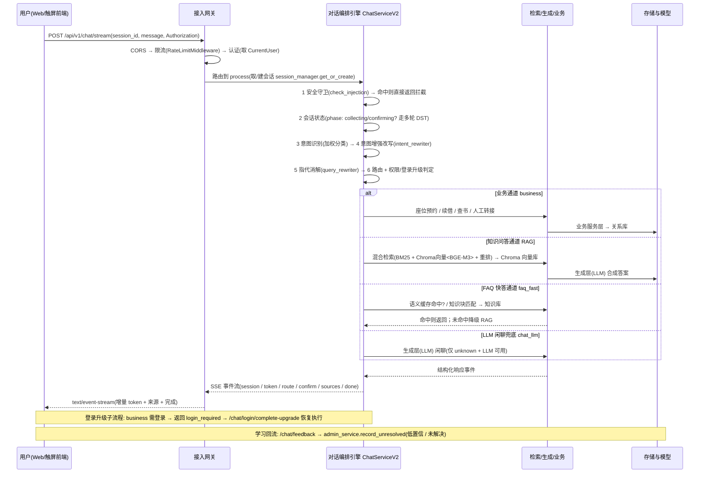

---

<a id="toc-3"></a>
## 2. 接入网关层（请求边界与基础设施防护）

> **技术选型**：FastAPI + JWT（HS256 单体 / **RS256 推荐用于 SSO 多服务**）+ Redis（限流分桶、refresh 白名单、会话归属）+ `pybreaker`/`tenacity`（熔断）。网关只解决"请求能否进来、是谁、有无权限、别被打挂"，业务语义交给下游（见 Module 3）。

<a id="toc-4"></a>
### 2.1 请求链路与模块划分

```mermaid
flowchart TD
    Req[用户发来请求] --> CORS{这个网页来源在允许名单里吗?}
    CORS -->|是跨域来源且允许| C204[预检请求直接回 204 放行<br/>并带上"允许跨域"的响应头<br/>（浏览器放行，正式请求才发出）]
    CORS -->|不在名单 / 没带来源| CERR[不回"允许跨域"的响应头<br/>→ 浏览器判定跨域失败、拦住请求<br/>（正式请求根本没发出，服务器不处理）]
    C204 --> MW[全局中间件: 生成请求编号 + 记审计日志 + 统一异常兜底]
    MW -.->|未匹配异常 · 兜底中的兜底| E500[未知异常 → 500 + 请求编号 + 记日志]
    MW --> IP[入口 IP 限流  认证前]
    IP -->|登录类请求| L0[登录端点: 收账号 + 密码]
    IP -->|其他请求| AUTHCHK{请求带了身份令牌吗?}
    AUTHCHK -->|没带| GUEST[当作游客(匿名) 直接进入]
    AUTHCHK -->|带了| PARSE[解析令牌: 拆成 头部 / 内容 / 印章 三段]
    PARSE --> ALG{头部声明的算法 = 系统配置算法?}
    ALG -->|不一致| E401[401 未认证]
    ALG -->|一致| SIG[用公钥或密钥 重算印章并比对]
    SIG -->|不匹配| E401
    SIG -->|匹配| EXP{过期时间 晚于 当前时间?}
    EXP -->|已过期| E401
    EXP -->|未过期| TYP{令牌类型是访问令牌?}
    TYP -->|是刷新令牌| E401
    TYP -->|是访问令牌| SETU[提取 用户编号 + 角色, 挂到请求上]
    SETU --> ATW{访问令牌在缓存白名单?}
    ATW -->|否 已注销 / 改密| E401
    ATW -->|是| AZ[权限判定依赖: 要求已登录 / 要求管理员 / 要求会话归属本人]
    GUEST --> AZ
    AZ -->|游客 / 越权| E403[403 无权限]
    AZ --> RL[用户级限流: 按用户编号 + 接口 Redis 分桶]
    RL -->|超过频率| E429[429 请求太频繁 + 稍后重试]
    RL --> SESS[取出或新建会话]
    SESS --> ORCH[对话编排层 → 第3模块]
    ORCH --> CB[下游熔断降级: 大模型 / 知识库 / 借阅系统]
    CB -->|服务挂了| E503[503 服务降级 + 安抚话术]
    CB --> RES[返回响应]

    subgraph LOGINP[登录端点 /auth/login · 防暴力破解]
        L0 --> L1{该账号 + IP 登录失败 未超限 / 未锁定?}
        L1 -->|已锁定| LLOCK[429/403 账号临时锁定 + 稍后重试]
        L1 -->|未锁定| L2[校验账号密码]
        L2 -->|失败| L3[失败计数 +1 达阈值则锁定] --> LERR[401 认证错误]
        L2 -->|成功| LOK[签发 access + refresh<br/>刷新令牌入白名单 → 返回]
    end
```

#### 2.1.1 访问令牌过期后如何"换发"新令牌（刷新流程）

前面 2.5 只说了"登录发两枚、刷新换一对"，这里把"拿刷新令牌换新访问令牌"的**具体步骤**展开。核心思路：**刷新令牌是长期钥匙，但每次用都要先在缓存白名单里"报个到"，用过一次就作废重发，防止被人偷走反复用。**

```mermaid
flowchart TD
    A[前端发现访问令牌已过期<br/>调接口收到 401] --> B[前端拿刷新令牌<br/>调专用刷新接口]
    B --> C[服务端解析刷新令牌<br/>拆三段 → 算法核对 → 验签 → 过期核对 → 类型必须是"刷新"]
    C -->|解析失败 / 类型不是刷新| R401[401 要求重新登录]
    C -->|解析通过| D{缓存白名单里有<br/>这个刷新令牌编号吗?}
    D -->|没有 已注销或已轮换过| R401
    D -->|有| E[轮换: 删除旧刷新令牌编号<br/>使旧令牌立刻作废]
    E --> F[签发全新一对令牌<br/>新访问令牌 15分钟 类型"访问"<br/>+ 新刷新令牌 7天 类型"刷新"]
    F --> G[把新刷新令牌编号<br/>写入缓存白名单 7天]
    G --> H[返回两枚新令牌给前端]
    H --> I[前端更新本地存储<br/>用新访问令牌继续调接口]
```

**逐步说明：**

1. **发现过期**：前端拿访问令牌调接口，服务端按 2.1 链路走到"过期核对"判已过期，回 401。前端识别到"令牌失效"，不再重试原请求。
2. **调刷新接口**：前端拿**刷新令牌**（不是访问令牌）去调一个专用接口。注意这一下走的还是 2.1 那条链路，但刷新接口只认刷新令牌，所以请求里带的是刷新令牌。
3. **解析刷新令牌**：和访问令牌一样拆解校验——算法核对 → 验签 → 过期核对（7 天还没到才算数）→ **类型必须是"刷新"**（拿访问令牌来换会直接 401）。任意一步不过都要求重新登录。
4. **查缓存白名单**：解析通过后，拿刷新令牌里的唯一编号去缓存库查白名单键。查不到说明它**已被注销、或上一轮已经换过**（编号被删了），判定失效、要求重新登录。这一关就是"能否吊销"的关键。
5. **轮换（旧令牌立刻作废）**：查到了，先**删掉旧刷新令牌编号**。这样旧的刷新令牌马上失效——即便它被偷走，小偷拿着它来换也只能拿到"已作废"的结果。
6. **签发新一对**：重新生成全新的访问令牌（15 分钟，"访问"）+ 刷新令牌（7 天，"刷新"）。
7. **登记新令牌**：把**新**刷新令牌的编号写入缓存白名单，有效期 7 天，供下一轮刷新用。
8. **回传前端**：两枚新令牌返回，前端更新本地存储，用新访问令牌继续原来的业务请求，用户全程无感。

**为什么这样安全：** 刷新令牌寿命长达 7 天，一旦泄露危害大；所以系统不靠"令牌本身能不能验签"来保它，而是额外用缓存白名单做"总开关"——能随时注销（删白名单键），且每次换发都轮换、旧令牌即时作废，偷到也只能用一次。这也正是 2.5 和 2.10 强调"刷新令牌每次轮换 + 缓存白名单、支持注销"的原因。

#### 2.1.2 权限判定依赖怎么实现（基于角色权限 + 会话归属）

这一关（对应 2.4）在代码里就是**三个普通校验函数 + 框架的依赖机制**。前置条件是 2.3 认证中间件已经把用户对象挂到请求对象的状态区里（含"用户编号"和"角色"两个字段）。三个函数就是从中取出来比对，不满足就抛「禁止访问异常」，被 2.8 统一异常兜底成 403。

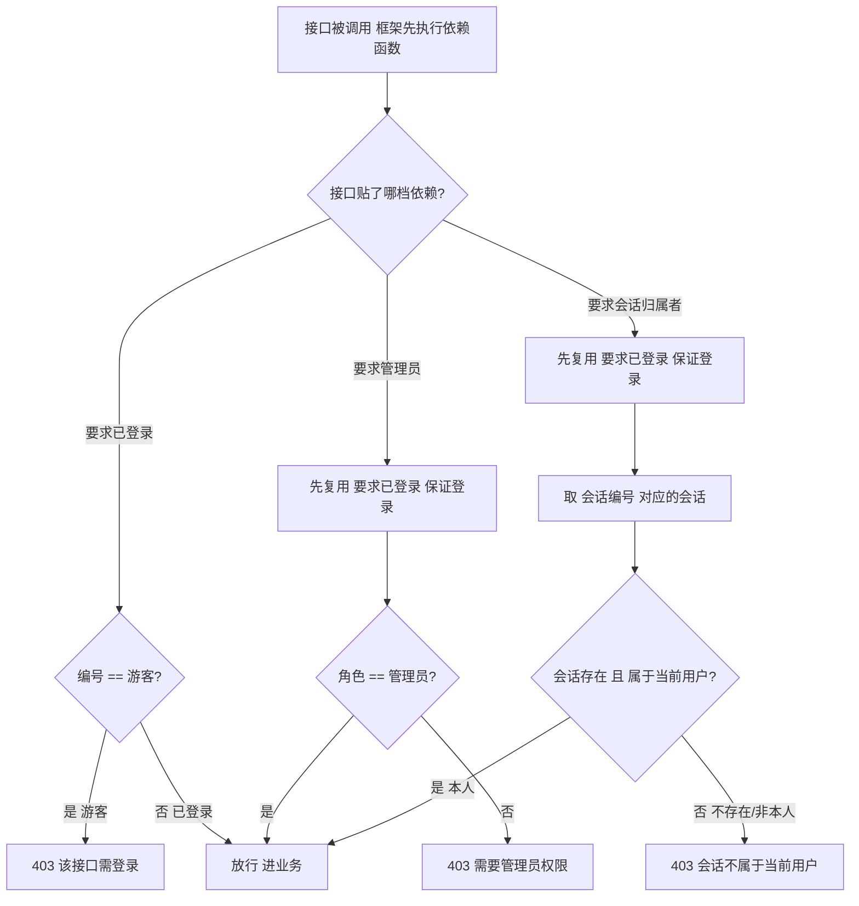

**三个函数的代码骨架（用文字说明）：**

1. **校验已登录**：接收请求对象，从请求对象的状态区里取出当前用户；如果这个用户的用户编号等于「游客」（说明仍是匿名状态），就抛出「禁止访问异常」，提示「该接口需登录」；否则把当前用户返回出去。
2. **校验管理员**：先调用「校验已登录」保证用户已登录，拿到当前用户；再判断这个用户的角色是不是「管理员」，不是就抛出「禁止访问异常」，提示「需要管理员权限」；是就返回用户。
3. **校验会话归属者**：接收会话编号和请求对象，先调用「校验已登录」保证已登录；再根据会话编号去存储里取出那条会话记录；如果会话不存在，或者会话存的用户编号和当前用户编号对不上，就抛出「禁止访问异常」，提示「会话不属于当前用户」；否则把这条会话返回出去。

**接口怎么"贴"这层门禁（用文字说明）：** 接口定义时，用框架的依赖声明写明要过哪一档校验，框架会自动在业务代码之前先把对应的校验函数跑一遍。例如：
- 某个「我的借阅」接口，在定义时挂上「校验已登录」作为依赖，表示这个接口要求用户先登录。
- 某个「后台配置」接口，在定义时挂上「校验管理员」作为依赖，表示这个接口要求用户是管理员。

**关键点：**
- 「校验管理员」和「校验会话归属者」都**先调用「校验已登录」**，保证"已登录"是前提，再叠加额外条件——这就是 2.4 那句"先满足已登录"的实现方式（依赖嵌套）。
- 三档抛出的都是同一种「禁止访问异常」，由统一的异常处理器统一转成「403 加 错误码、提示、请求编号」的标准结构。业务接口里**不需要自己写判断逻辑去拼 403**。
- 按 2.2 顺序，权限校验这三档，跑在「用户级限流」之前——先确认你够不够格，再查你调不调得起。
- **易错提醒（落地务必锁死）：** ① 角色的取值约定要统一（比如都用「管理员」这几个字），防止大小写或写法不一致，导致该拦的没拦、该放的被误杀；对接单点登录时按映射规则处理；② 「校验会话归属者」里，用户编号与会话的归属字段必须来自同一套体系（令牌里的用户标识，与会话里存的用户编号要能对上），否则会出现误杀或越权；③ 查会话时，存储层一旦出错，要显式转成「禁止访问异常」，别让错误漏出去变成 500 服务器错误；④ 认证中间件必须按 2.2 顺序先跑，否则请求对象上的用户会是空的，校验函数一取就直接崩溃。

<a id="toc-5"></a>
### 2.2 中间件与依赖注入顺序

- **中间件（全局，按注册顺序）**：`CORSMiddleware`（必须最前，OPTIONS 直接 204，不碰认证）→ `RequestID/审计/异常中间件` → `IP 限流中间件` → `AuthMiddleware`（跳过 OPTIONS，构建 `request.state.user`）。
- **CORS 怎么判断放行还是拦住**：中间件会看请求里带来的"来源网页域名"，对照我们预先配置的"允许来源名单"。域名在名单里 → 直接回 204 放行，并带上"允许跨域"的响应头（浏览器这才放正式请求进来）；**域名不在名单（或没带来源）→ 就不带这个响应头，浏览器会判定跨域失败、把正式请求拦在门外，服务器根本收不到**（注意：这是浏览器自己拦的，不是服务器返回 4xx 错误）。生产环境要把允许名单写成具体的前端域名，别图省事用 `*` 通配（那样谁都能跨域调你接口）。
- **依赖（路由级 `Depends`）**：`require_user` / `require_admin` / `require_session_owner` → `用户级限流依赖` → 业务处理器。认证前做 IP 限流、认证后做用户级限流，互不干扰。

<a id="toc-6"></a>
### 2.3 认证：解析 JWT，构建 CurrentUser

**令牌解析**：把令牌按"."拆成"头部 / 内容 / 印章"三段，拆不出三段直接判格式错误。随后依次做三件事：① 算法核对——令牌头部声明的加密算法必须和系统配置完全一致，否则拒绝（专门防"无算法"伪造和"算法混淆"两类攻击）；② 验签——按配置算法，用公钥（非对称场景）或密钥（对称场景）对"头部.内容"重新算一枚印章，和令牌自带的印章比对，不一致即判签名失败；③ 过期核对——把内容里的过期时间与服务器当前时间比较，已过期即失效（若令牌没写过期时间，按"早已过期"处理）。三步全过才返回令牌内容。

**当前用户对象**：封装"用户编号"和"角色"两个信息，并提供两个判断：是游客（编号等于 guest）、是管理员（角色等于 admin）。

**认证中间件（每个请求都会过）**：预检请求直接跳过、不认证；默认把来访者当成"游客"（匿名），**没带令牌不报错、直接以游客身份放行**。若请求头带了身份令牌，则解析它：令牌类型必须是"访问令牌"（若有人拿刷新令牌来调接口，判"请使用 access token"）；通过后再取出用户编号、角色、以及令牌唯一编号（用于注销），挂到本次请求上。任意环节失败都返回 401 未认证（并带上请求编号）。无论无令牌还是验证成功，都会带着身份信息进入下一层。

<a id="toc-7"></a>
### 2.4 鉴权依赖（RBAC + 会话归属）

**权限判定（路由级，依赖注入触发，在认证之后做）**——三档检查：
- 要求已登录：当前身份若是游客，直接返回 403 无权限（提示"该接口需登录"）。
- 要求管理员：先满足"已登录"，再看角色是否管理员，不是则返回 403（提示"需要管理员权限"）。
- 要求会话归属本人：先满足"已登录"，再取出对应会话，若会话不存在或不属于当前用户，返回 403（提示"会话不属于当前用户"）。

<a id="toc-8"></a>
### 2.5 JWT 签发与刷新（Redis 白名单 + refresh 轮换）

**令牌签发与刷新（依赖 Redis 白名单 + 刷新令牌轮换）**：
- 访问令牌：签发时写入用户编号、角色、类型固定为"访问"、一个随机唯一编号，过期时间 = 当前时间 + 15 分钟（即寿命 15 分钟）；**同时把它的唯一编号存入缓存白名单（有效期同为 15 分钟）**，请求时除验签与过期核对外还要查该白名单——编号不在（用户注销或改密使其失效）即判 401 未认证（对应 2.1 图中"访问令牌在缓存白名单"判定）。
- 刷新令牌：写入用户编号、角色、类型固定为"刷新"、一个随机唯一编号，过期时间 = 当前时间 + 7 天；同时把它的唯一编号存入 Redis 白名单，有效期同为 7 天。
- 登录：先用账号密码校验（生产接 SSO，见 2.9），失败返回认证错误；成功则签发访问令牌和刷新令牌，并把刷新令牌的唯一编号写入 Redis 白名单，返回两种令牌。
- **登录防暴力破解**：登录失败按"账号 + 来源 IP"双维度计数（不只用 IP 限流，防分布式撞库）；同一账号连续失败达阈值（如 5 次）即临时锁定并返回 429/403（带"稍后重试"），或触发验证码 / 二次校验；锁定按账号维度独立计时，到期自动恢复（对应 2.1 图中"登录端点 /auth/login · 防暴力破解"支线）。
- 刷新：用刷新令牌换新令牌对。先解析刷新令牌，类型必须标为"刷新"；再查 Redis 白名单，若该编号已被删除（说明注销或已轮换）则失效、要求重新登录；通过后**删除旧刷新令牌编号（轮换，使旧令牌立刻作废）**，签发全新的一对访问/刷新令牌，并把新刷新令牌编号写入白名单。

<a id="toc-9"></a>
### 2.6 限流（IP 级认证前 + 用户级认证后，Redis 分桶）

**限流（Redis 分桶，固定窗口计数）**：
- 通用计数：以"桶名"为键在 Redis 自增计数；第一次计数时给该键设过期时间（等于统计窗口）；若计数超过上限，抛出限流错误，并重试时间取该键剩余存活时间。
- IP 级（认证前）：对每个"来源 IP + 接口路径"单独计数，规则为 **60 秒内最多 60 次**；预检请求跳过不计。用于还不知道用户身份时就挡掉匿名滥用。
- 用户级（认证后）：对每个"用户编号 + 接口路径"单独计数，规则为 **60 秒内最多 30 次**。用于知道身份后约束单个账号的调用频率。
- 超限统一抛限流错误 → 429 + 稍后重试头（见 2.8）。

超限统一抛出 `RateLimitError` → 429 + `Retry-After`（见 2.8）。

<a id="toc-10"></a>
### 2.7 熔断降级（下游 LLM / 知识库 / 借阅系统）

**熔断降级（保护下游 大模型 / 知识库 / 借阅系统）**：为三个下游各设一个熔断器，规则如下：
- 大模型熔断器：连续失败 **5 次**则打开（停止调用），**30 秒**后尝试恢复；
- 知识库熔断器：同样连续 5 次失败打开、30 秒后恢复；
- 借阅系统熔断器：连续失败 **3 次**打开、**20 秒**后恢复。
调用大模型时若熔断器已打开，则抛出下游错误，由统一异常转为 503 + 降级话术，让编排层改用兜底回答（也可改用重试机制做"先重试、失败再降级"）。

<a id="toc-11"></a>
### 2.8 统一异常处理（全链路横切，统一 JSON）

**统一异常处理（全链路兜底，响应格式统一）**：定义四类语义错误——认证错误、无权限错误、限流错误（携带重试时间）、下游错误，分别映射为：
- 认证错误 → **401**，响应体含提示与请求编号；
- 无权限错误 → **403**；
- 限流错误 → **429**，并在响应头带回"稍后重试"时间；
- 下游错误 → **503**。
所有响应统一形状：{ 状态码, 提示信息, 请求编号 }。未匹配到的未知异常也统一回 **500** + 友好提示 + 请求编号（即 2.1 中"兜底中的兜底"）。
所有响应统一形如 `{ "code": <int>, "message": <str>, "request_id": <str> }`。

<a id="toc-12"></a>
### 2.9 对接图书馆 SSO 建议

- **推荐 OIDC（OAuth2 + IdP）**；旧系统可用 SAML。SSO 是 IdP，我们的 JWT 是**会话凭证**。
- 流程：`/sso/login` 重定向到图书馆统一身份认证 → `/sso/callback` 用 `code` 换 `id_token` → 映射声明（`sub`=SSO 主体、`role` 取 IdP 的 group/role 断言）→ 签发我们的 access+refresh（refresh jti 入 Redis 白名单）。
- **RS256 更合适**：资源服务用 IdP 公钥验签，无需共享私钥；`alg` 固定为 `RS256` 防止算法混淆。
- 读者/馆员均经 SSO 登录，游客可不登录进入 `/chat`（受限功能在业务层经 Module 13 登录升级再要 token）。

<a id="toc-13"></a>
### 2.10 安全注意事项

- **HS256 vs RS256**：单体服务 HS256 够用但密钥须进 Vault 并定期轮换；多服务/接 SSO 用 **RS256**（公钥验证、私钥仅签发端持有）。
- **防 `alg=none` / 算法混淆**：`decode_token` 中显式比对 `header.alg == 配置算法`，绝不接受 `none` 或意外算法。
- **JWT 不放敏感信息**：仅携带 `sub / role / type / jti / exp`，不塞密码、手机号、身份证等（脱敏见 Module 3 安全守卫与 Module 13）。
- **密钥管理**：生产禁用硬编码，走环境变量/Vault；access 15min、refresh 7天且每次轮换 + Redis 白名单，支持注销（删 `rt:{jti}`）。
- **匿名会话登录后合并**：登录成功后，将 `guest` 会话（`session_id`）的历史与状态迁移到该用户会话，避免对话上下文丢失（见 Module 3 会话状态判定）。

> 总体分层见 Module 0，单次生命周期时序见 Module 1，内容级安全（prompt 注入等）由 Module 3 安全守卫负责，受限功能的"登录升级"见 Module 13。

---

<a id="toc-14"></a>
## 3. 对话编排主流程（核心调度逻辑）

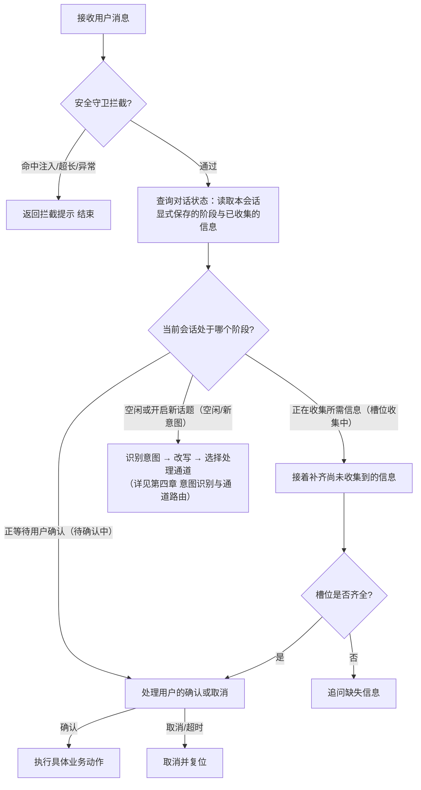

**设计要点**
- 编排引擎先"安检"再"状态判定"再"识别/改写"，保证安全与多轮上下文优先于意图分类。
- 意图识别方法、四类通道、登录绑定、冲突消解等细节见 **Module 4** 展开，本模块只保留端到端骨架。
- 多轮对话通过"对话状态"显式管理，而非仅拼接历史文本。

---

<a id="toc-15"></a>
### 3.1 安全守卫拦截的具体机制（四层架构）

安全守卫位于编排引擎最前端，采用 **L1 正则快速过滤 + L2 语义向量检索 + L3 轻量分类器 + L4 大模型自检复核** 的四层防御。L1 负责低成本、确定性的拦截；L1 漏过的变体/语义化攻击由 L2 兜底；L2 仍难判的灰区由 L3 自动细分类消化；L3 仍不确定的极小灰区由 L4 大模型复核终裁。任一层命中即拦截，全部放行才进入后续编排。

> **L3 选型（本版已替换）**：原设计为"微调中文全词掩码模型（RoBERTa-wwm，约 1 亿参数）"，实现后改为 **字符 n-gram TF-IDF + 逻辑回归四分类**。两者运行时契约一致（`predict_proba` 四类概率 + 双阈值），替换不影响 L2/L4 与下游编排；替换理由见 3.1.4 第 6 点。

```mermaid
flowchart TD
    A[用户原始消息] --> P[预处理：统一编码格式、清除隐藏字符、还原混淆变形、生成多个分析视图]

    subgraph L1 [第一层 正则快速过滤]
        direction TB
        P --> V[多个视图同时扫描全部正则规则]
        V --> S1[扫描指令覆盖类模板]
        V --> S2[扫描数据泄露类模板]
        V --> S3[扫描角色切换类模板]
        S1 --> D1{是否命中任一类?}
        S2 --> D1
        S3 --> D1
    end
    D1 -->|命中| BLK[拦截：返回安全提示并写入审计日志]
    D1 -->|未命中| L2IN[将原始输入送往第二层]

    subgraph L2 [第二层 语义向量检索]
        direction TB
        L2IN --> E1[用多语言向量模型编码为向量]
        E1 --> F[在攻击模板库中检索最相近样本并取前几名]
        F --> LS1[计算语义相似度得分]
        F --> LS2[计算第一名与第二名的差距]
        F --> LS3[叠加辅助信号：关键词重叠、长度异常、第一层模糊分]
        LS1 --> C[多信号加权融合得分]
        LS2 --> C
        LS3 --> C
        C --> T2{按得分分四档}
    end
    T2 -->|得分高且差距大（>0.8）| BLK
    T2 -->|得分很低（<0.6）| OK[放行：进入会话状态判定]
    T2 -->|处于中间灰区（0.6-0.8）| L3IN[将输入送往第三层]

    subgraph L3 [第三层 轻量分类器 · 双阈值判定]
        direction TB
        L3IN --> E3A[加载轻量分类器（joblib 常驻内存，CPU 亚毫秒推理）]
        E3A --> E3B[特征化：字符二至四元组 TF-IDF 向量化（中文免分词）]
        E3B --> E3C[线性分类：四分类逻辑回归输出四类概率]
        E3C --> E3E[输出结果：正常/指令覆盖/数据泄露/角色切换 各自概率]
        E3E --> P1{正常类概率 ≥ 0.90?}
        P1 -->|是(把握足够正常)| OK
        P1 -->|否| P2{攻击类概率 ≥ 0.85?}
        P2 -->|是(把握足够攻击)| BLK
        P2 -->|否(两头都不够高)| L4IN[中间灰区 · 将输入送往第四层]
    end

    subgraph L4 [第四层 大模型自检复核]
        direction TB
        L4IN --> E4A[组装安全审查提示词: 任务说明 + 三类攻击定义/示例 + 待审输入 + 强制结构化输出]
        E4A --> E4B[本地大模型推理研判: 角色锚定 · 不被输入带偏 · 安全优先]
        E4B --> E4C[输出结构化结论: 是否攻击 / 类别 / 理由]
        E4C --> E4D{结论可解析?}
        E4D -->|可解析| T4{is_attack 为真?（安全优先: 不确定倾向判攻击）}
        E4D -->|失败或超时 3秒| OKR[先放行但记录并加入待人工审核队列]
    end
    T4 -->|是攻击（含不确定时）| BLK[拦截：返回安全提示并写入审计日志]
    T4 -->|非攻击| OK[放行：进入会话状态判定]

    BLK --> ENDZ[返回安全提示]
    OK --> NEXT[进入后续编排：会话状态判定]
    OKR --> NEXT

    subgraph BUILD [离线构建：第三层分类器训练链路（与上方运行时分离）]
        direction TB
        B0[数据采集: 红队攻击集 / L2灰区日志 / L1命中日志 / 正常客服日志] --> B1[标注: 三类攻击关键词粗标→人工抽检]
        B1 --> B2[增强与划分: 同义替换增强, 七成训练/一成五验证/一成五测试]
        B2 --> B3[训练: 字符2-4gram TF-IDF + 逻辑回归四分类]
        B3 --> B4[评估与双阈值: 综合指标/攻击召回/误报率, 双阈值扫描]
        B4 --> B5[导出: joblib 模型 + 阈值配置]
        B5 --> BM[(产物: 模型文件 + 阈值配置)]
    end
    BM -->|运行时加载| E3A

    style L1 fill:#eaf3ff,stroke:#9ecbff,stroke-width:1px,color:#1a3c6e
    style L2 fill:#eafaea,stroke:#9ed99e,stroke-width:1px,color:#1a5e1a
    style L3 fill:#fff7e6,stroke:#ffd591,stroke-width:1px,color:#874d00
    style L4 fill:#f9f0ff,stroke:#d3adf7,stroke-width:1px,color:#531dab
    style BUILD fill:#fff1f0,stroke:#ffa39e,stroke-width:1px,color:#a8071a
```

#### 3.1.1 L1：正则快速过滤

保留现有正则引擎，但**增加预处理环节以对抗混淆绕过**。

**1. 预处理：去混淆与归一化**
- 对输入做 Unicode 归一化、去除零宽字符/不可见字符、还原常见混淆变形（如全角/半角、同形字符、插入分隔符），消除"绕过正则"的伪装。
- 目的：让后续正则匹配在"干净视图"上进行，避免攻击者用编码/插入字符逃过规则。

**2. 多视图并行匹配**
- 预处理后生成多个**分析视图**（如归一化视图、去混淆视图、去空白视图等），所有正则规则**同时扫描每个视图**。
- 任一视图命中即视为命中，扩大覆盖而不降低速度。

**3. 三类模板库与扫描逻辑**
- 指令覆盖型（否定/改写既有指令）、数据泄露型（套取系统内部信息）、角色切换型（诱导脱离客服角色）。
- 命中任一类别 → 直接拦截，记录命中类别与具体模式；全部未命中 → 将**原始输入**（而非预处理后的文本）传递给 L2，保留语义完整性。

#### 3.1.2 L2：语义向量检索（优化后的相似度判定）

L1 漏过的"语义等价但字面不同"的攻击，由语义层兜底。判定不再依赖"单向量相似度 + 固定阈值"，而采用 **多信号融合打分 + 相对边际 + 自适应阈值**。

**1. 编码与检索**
- **模型选型：BGE-M3**，将用户输入编码为 1024 维向量，兼顾中英双语与语义泛化。
- **检索**：FAISS 最近邻检索攻击模板库，取 Top-K 候选及其相似度分数。

**2. 多信号融合打分（替代单相似度）**
综合分由多条信号加权得到，比单向量更鲁棒：
- **语义相似度**（主权重）：与最相似攻击模板的余弦分。
- **相对边际**（Top1 − Top2）：差距大说明"明确命中某一类"，差距小说明"模棱两可"，后者倾向灰区。
- **辅助信号**：关键词/实体重叠度、长度异常度、L1 的"模糊命中分"（L1 没拦但接近规则时，可下调 L2 阈值）。

**3. 四档判定与阈值（起点建议）**
BGE-M3 归一化余弦分布参考：同义≈0.85+，近义≈0.6–0.85，无关≈0.2–0.45。
- 综合分 ≥ **0.80** 且边际大 → `L2_BLOCK` 拦截（上线初期调高，宁漏勿误杀）。
- 综合分 **0.72–0.80** 或边际偏小 → `L2_REVIEW`（送第三层）。
- 综合分 **0.6–0.72** 边缘区间 → 送第三层再判（防漏放，不在此直接放行）。
- 综合分 **< 0.6** 高置信正常 → 直接放行，不进第三层（省成本）。
- **按攻击类别分阈值**：指令覆盖类（措辞固定）可用高阈值；角色切换类（表述发散）需更低阈值，否则大量漏报。

**4. 自适应阈值**
- 阈值随时段、流量、历史误报率浮动：灰区误报率连续偏高 → 上抬放行阈值；攻击高发时段 → 下压 BLOCK 阈值。
- **复核闭环**：`L2_REVIEW` 与 `L2_BLOCK` 的确认结果回流（见 3.1.3），定期统计每类模板的误报/漏报曲线，自动建议阈值与模板增删，是 L2 效果持续演进的核心。

#### 3.1.3 L2：攻击模板库构建与持续更新

模板库是 L2 检测效果的核心变量。

**模板规模**：每类攻击建议准备 **50–100 条**模板，覆盖不同表述方式（同义替换、句式变换、编码混淆等语义变体）。

**模板来源**
- 公开数据集：中文提示注入基准数据集、聚合多源安全研究的数据集。
- 中文提示注入语料库：按攻击面分类的中文语料资产。
- 自有攻击日志：从客服系统历史记录中提取被拦截或可疑的输入。
- 人工构造：针对三类攻击的语义变体补充。

**持续更新机制**
- **日志回流**：`L2_REVIEW` 与 `L2_BLOCK` 的输入定期人工审核，确认恶意的加入模板库。（日志回流建议 PostgreSQL 表 + 定时任务，量大改 Kafka）
- **版本管理**：模板库按版本管理，每次更新后重新构建 FAISS 索引。
- **灰度测试**：新模板先在小流量验证误报率，再全量上线。（灰度建议网关按 userId 哈希百分比分流，异常一键回退双层）

**FAISS 索引构建与检索**：模板库编码为向量后批量写入 FAISS 索引；线上对用户输入向量执行最近邻检索，输出 Top-K 相似模板及分数供阈值判定。

#### 3.1.4 L3：轻量分类器（字符 n-gram + 线性模型）

> **选型说明（本版已替换）**：L3 原设计为"微调中文全词掩码模型（RoBERTa-wwm，约 1 亿参数）"，实现后改为 **字符 n-gram TF-IDF + 逻辑回归四分类**。两者运行时契约完全一致（`predict_proba` 输出四类概率 + 双阈值判定），替换不影响 L2/L4 与下游编排；替换理由见本节第 6 点。第 5 点仍保留"离线构建链路"，它与运行时流水线是两个阶段，请勿混为一谈。

L2 灰区与边缘放行的输入，由轻量级分类器自动细分类，消化大部分灰区，避免全部堆给人工或大模型。

**1. 数据准备**
- 四类标签：正常、指令覆盖、数据泄露、角色切换。
- 数据来源：红队攻击集、L2 灰区日志、L1 正则命中日志（高质量正样本）、正常客服问法（意图集 300 条 + 检索集 200 条，覆盖借书/还书/续借/罚款/开放时间/证件办理）。
- 负样本不少于正样本两倍，覆盖完整意图分布；攻击侧用同义替换做语义变体增强；按七成训练、一成五验证、一成五测试划分，且三类攻击在三个集合中均有分布。

**2. 模型与训练**
- 特征：字符 2–4 元组 TF-IDF（`char_wb`、sublinear_tf、最大六万维），中文免分词、零外部依赖。
- 分类器：多项逻辑回归（C=4.0、class_weight=balanced、max_iter=2000）。
- 成本：训练秒级、模型约五兆（joblib）、CPU 推理亚毫秒；不依赖显卡，也不需要下载预训练权重。

**3. 评估与双阈值**
- 目标（非当前实测）：综合指标不低于零点九、攻击类召回不低于零点九二、攻击类精确不低于零点八八、误报率不高于百分之三；召回优先于精确。当前数据量下攻击类 OOD 召回未达该目标（800 条未见攻击批次留出：L1 单独 0.319 → L1–L3 级联 0.4800），差距归因于训练语料规模与口语改写覆盖，而非阈值。
- 双阈值：正常类概率不低于零点九判为正常放行；攻击类概率不低于零点八五判为攻击拦截；中间灰区送第四层。放行门槛高于拦截门槛，因漏报代价高于误报。验证集扫描阈值组合取综合指标最大且误报不破百分之三。
- 实测口径：5 折交叉验证 accuracy 0.9853±0.0069 / macro-F1 0.9846（训练集含同义变体，变体与模板同源，**不能当作 OOD 泛化指标**）；级联整体指标见 3.1.7 第 3 条与《实验评测结论与面试话术》。

**4. 服务化与衔接**
- joblib 常驻内存，对外提供 `predict_proba(text) → 四类概率`，与任意分类模型接口一致，换实现不动流水线。
- 第二层未拦截的输出（含灰区与边缘）都转发给第三层，第二层已拦截的不进第三层。

**5. 离线构建链路（与运行时分离）**
分类器需先走一遍离线训练，产物（模型文件 + 阈值配置）再交给运行时加载。构建时链路如下：


训练与部署分阶段推进（优先级由上至下）：
- 阶段一：数据采集与标注（约 1–2 天，依赖 L2 已运行、有日志积累）。
- 阶段二：训练分类器并调优阈值（秒级训练 + 半天阈值扫描）。
- 阶段三：与 L2 衔接联调（约半天，模型文件落盘即可生效）。
- 若资源有限，**先只做 L3**：不依赖显卡、CPU 可跑、延迟亚毫秒，且能直接消化 L2 的灰区输出；L4 可等 L3 运行一段时间、积累更多灰区日志后再补。
- 模型需定期重训：每季度用新测试集回归，指标下降超百分之五或发现明显漏报即触发重训；L4 人工确认的新样本回流进训练集。轻量模型训练是秒级，可直接在发布流程里跑脚本，无需专门的调度平台。

**6. 为什么不用微调（选型结论）**
- **收益无法验证**：本场景的语义变体主要由 L2 模板库召回，L3 只做灰区细分类；离线留出实验里 L3 每折仅多拦 1–2 条，微调的增益在这批数据上无法被证实。
- **成本是确定的**：微调需要数百兆预训练权重 + GPU 数十分钟，冷启动、模型分发、ONNX 导出都增加运维面；轻量模型训练秒级、约五兆、零外部依赖。
- **可解释**：线性模型可直接看 n-gram 权重，便于规则回流与误报排障；神经网络需额外上 SHAP。
- **可平滑替换**：接口一致，后续数据量与资源上来后，可换回 RoBERTa-wwm 四分类头（或多语言分类头），L2/L4 与编排层不改。

#### 3.1.5 L4：大模型自检复核

仅处理第三层灰区（通常不超过总量百分之五至十），作为最后一道语义兜底。

**1. 触发与选型**
- 第三层输出处于灰区概率区间时触发。
- 选用本地部署的中等规模对话大模型（约七十亿参数，单卡约十四吉字节显存，延迟一至三秒，建议 Qwen2.5-7B-Instruct 本地部署），通过高性能推理引擎（建议 vLLM 生产 / Ollama 开发）提供兼容接口；资源有限可用更小模型；用户输入含借书证号、姓名等个人信息，推荐本地部署以避免外传隐私风险。

**2. 复核提示词**
- 四段式：先说明安全审查任务、再给出三类攻击的明确定义与示例、再放入待审查输入、最后强制输出结构化结论。
- 技巧：角色锚定、明确不被用户输入影响、安全优先（不确定时倾向判攻击）、只输出结构化结果。

**3. 解析与降级**
- 清理可能存在的格式标记后解析结论；解析失败或超时（三秒）时先放行但记录并加入待审核队列，不阻塞用户；同一用户短时多次超时则临时提升风险等级。

**4. 延迟优化**
- 用缓存对相似输入直接返回（过期一小时）；同批多个灰区可批量送入提升吞吐；超时或调用失败按放行但记录处理。

#### 3.1.6 四层衔接与统一裁决

**统一裁决结果**：拦截 / 放行 / 复核（转下一层）。

**短路规则**：任一层给出拦截立即返回，不再进入后续层；任一层高置信放行立即放行，只有不确定才下沉。

**逐层流转**：
1. 第一层命中 → 直接拦截。
2. 第二层：高置信拦截直接拦；相似度很低（低于零点六）直接放行；零点六至零点八（含灰区）送第三层。
3. 第三层：高置信攻击拦截；高置信正常放行；灰区送第四层。
4. 第四层：终裁拦截或放行；失败/超时放行但记录并待审。

**设计原则**：第一二层解决快而确定的已知威胁，第三层解决自动细分类与灰区规模化，第四层解决最难判的语义灰区兜底；层级越往后成本越高、触发率越低。

#### 3.1.7 兜底与弥补清单

以下为当前方案仍缺口或需加固之处，建议一并补齐：

1. **延迟预算与早停监控**：非第四层均值 10–30ms（主要成本在 L2 的向量编码）、含第四层 1–3s 是目标值。需设监控告警：第四层触发率大于百分之五或均值超阈 → 提示第三层可能漂移，而非放任。（监控告警建议 Prometheus + Grafana + Alertmanager）
2. **第四层语义缓存防投毒**：相似度缓存可能被攻击者用近义样本刷出错误结论。建议仅缓存确认样本（语义缓存建议复用 Chroma 集合，相似度 ≥0.98）；攻击类结论缓存需更严格相似度或加人工抽检；缓存写入走审核队列。
3. **评估回归与自动告警**：离线红队集定期回归；在线看板盯综合指标、攻击召回、误报率、第四层触发率；指标降大于百分之五或误报破百分之三自动告警并触发重训。（红队/回归评测建议 pytest + 攻击集 JSONL + Ragas/DeepEval，看板用 Grafana）
4. **第四层自身抗注入**：已在提示词层角色锚定、禁止被影响、安全优先，但需在解析层兜底：用户输入里的任何指令都不应被当作提示词执行，防止注入穿透到审查模型本身。
5. **权限维度别混为一谈**：注入防护（第一至四层）是内容安全；越权访问（横向看他人会话、纵向普通用户调管理员接口）是身份授权，由 2.1.2 的会话归属校验/管理员校验负责。四层再强也防不了越权，两者必须并存。
6. **应急开关与灰度**：每层可独立开关；新层先小流量灰度，异常可一键回退到双层（第一层+第二层），保证可用性优先。
7. **多语言与组合攻击**：英文咨询第三层可直接覆盖（字符 n-gram 含 ASCII 特征），必要时再升级为多语言分类头；混合攻击（注入+越权试探）第四层复核时同时看是否试图调用超权限动作，与权限层联动。

**设计要点**
- 四层互补：L1 快、确定、零推理成本；L2 慢、语义、兜语义变体；L3 自动细分类、消化灰区；L4 处理最难判的极小灰区兜底。
- 预处理前置：先"还原"再匹配，对抗混淆绕过。
- 灰区逐级下沉：L2 灰区与边缘送 L3，L3 灰区送 L4，避免误杀与漏报失衡。
- 模板库即资产：靠日志回流与版本管理持续演进，是 L2 效果上限的关键。
- 统一裁决与短路：任一层拦截即返回，避免无谓下沉。

---

<a id="toc-16"></a>
## 4. 意图识别与通道路由（重构方案）

> 原图把三件本该分开的事压成一条线：**意图识别、路由决策、业务执行**。所有通道最后都汇聚到 `K`（名为"业务处理通道 → Module 5"），等于让业务层承担所有通道的后处理；而安全、上下文、兜底、人工这些本该横切全局的能力，在原图里没有位置。
> 重构核心：**识别归识别、路由归路由、执行归执行、后处理归后处理**；安全、上下文、兜底、人工、降级、可观测做**横切层包裹全局**。补分支只能救局部，救不了结构。

<a id="toc-17"></a>
### 4.0 目标架构总览

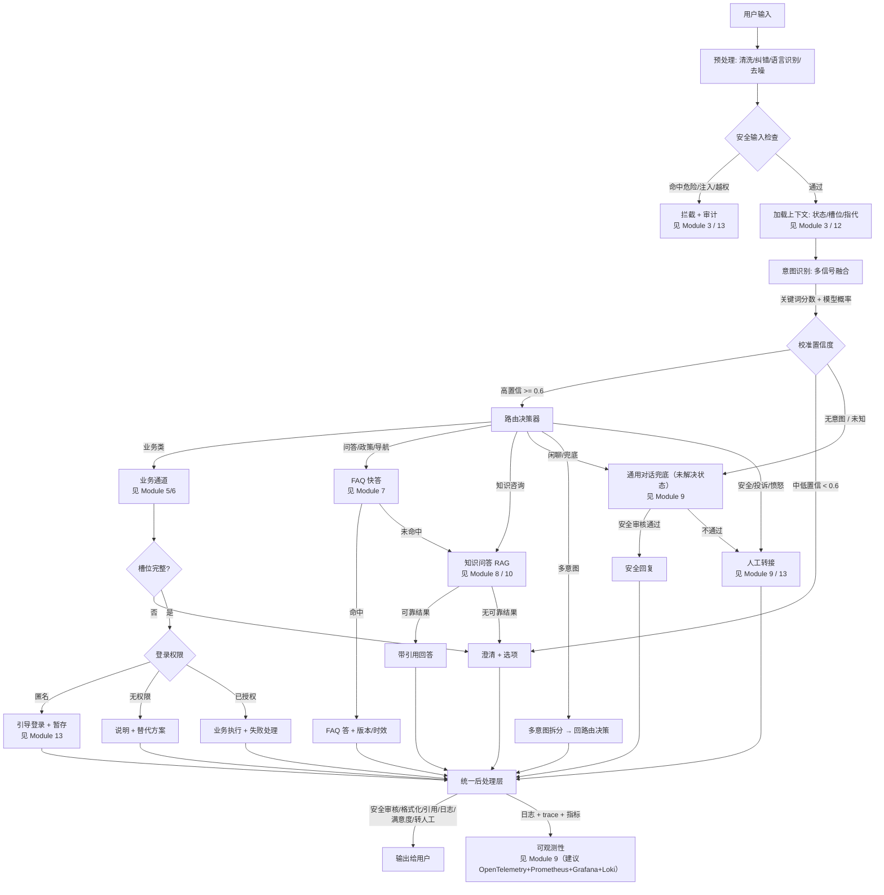

<a id="toc-17b"></a>
### 4.0.1 加权关键词分类器（意图识别第一信号）

> 4.0 的「意图识别: 多信号融合（关键词分数 + 模型概率）」里，「关键词分数」此前是未落地的黑盒。本节把它具象为**加权关键词分类器**，作为意图识别的**快路径第一信号**；模型概率作为**平等的二号信号**（落地为 **Qwen3-8B QLoRA 微调意图分类器**，🟡 设计态，见 `interview/图书馆项目事实库.md` F-P1-033/034）（补长尾、兜底 unknown、判定边界样本），二者在「多信号融合」中共同校准置信度。**该方向已用轻量分类器验证（🧪 非 QLoRA）**：字符 n-gram + 逻辑回归，300 条人工训练 → 1700 条未见改写评测 acc **0.8600** / macro-F1 **0.8589**，unknown 预测占比 **40.25% → 10.41%**、unknown precision **0.3056 → 0.9379**、**FP 559 → 11**（`eval/run_intent_probe.py`，报告 `data/eval/intent_probe_report.json`）；同分布 5 折 0.9700 属改写族泄漏，不可引用。它**不是**唯一的意图识别器——纯关键词会被同义改写 / 否定 / 口语击穿，文档 1195、1469 行已将此判为反模式，因此必须保留模型概率一路平等参与。

**识别流程（一点一点往下走）**

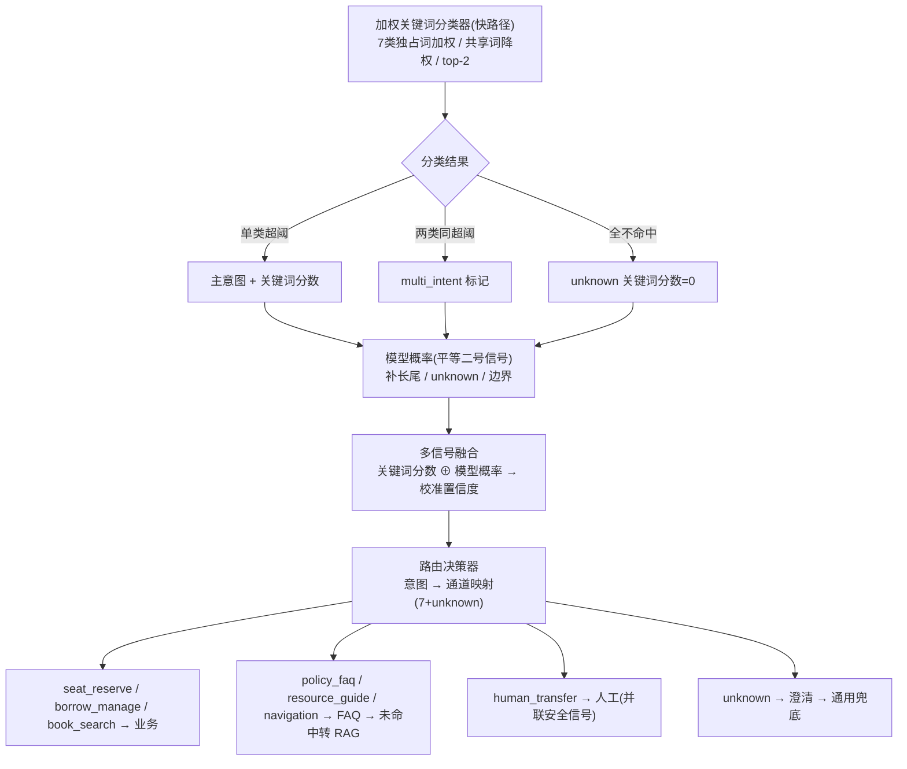

**意图清单（7 类 + unknown = 8 路）**

| # | 意图 | 触发关键词（权重思路） | 下游通道 | 易混 & 消歧 |
|---|---|---|---|---|
| 1 | `seat_reserve` | 座位、预约座位、研讨间、自习室、选座、抢座（高权重独占词） | 业务通道（Module 5） | 词面清晰，与借还不混 |
| 2 | `borrow_manage` | **我的**借阅、借书、还书、续借、欠费、罚款、逾期、取书（强调"我的 / 借还"） | 业务通道（Module 6） | 见 #3 消歧 |
| 3 | `book_search` | 有没有、馆藏、索书号、在不在、找这本书、某书在哪（强调"馆藏 / 检索"） | 业务通道（馆藏查询） | 与 #2 共享"书 / 查"→加权**低**；独占词加权**高**；两类独占词同高 → 标 `multi_intent` |
| 4 | `policy_faq` | 规定、政策、可以吗、能不能、规则、期限、上限、要求 | FAQ 快答 → 未命中转 RAG | 与 #5 按"规则 vs 资源"区分 |
| 5 | `resource_guide` | 数据库、电子书、论文、办证、借书证、WiFi、打印机、培训 | FAQ 快答 → 未命中转 RAG | 服务 / 资源导引，非位置 |
| 6 | `navigation` | 在哪、几楼、怎么走、楼层、洗手间、入口、路线 | FAQ 快答 | 纯位置，与 #5 区分 |
| 7 | `human_transfer` | 人工、客服、投诉、转接、差评（关键词 **+ Module 3 情绪 / 安全信号并联**） | 人工转接 | 非纯关键词：情绪激烈也触发 |
| 8 | `unknown` | 关键词全不命中 | 先澄清 + 选项 → 仍无 → 通用兜底 | 冷启动保护（见下） |

**相对朴素 7 类的 4 处改进**
1. **`book_search` 与 `borrow_manage` 拆干净**：用「我的 / 借还」vs「馆藏 / 有没有」两组独占高权重词隔离，共享词降权；同高则交 `multi_intent`，不再硬判。
2. **`human_transfer` 改为「关键词 + 安全信号」并联**：Module 3 的情绪 / 安全信号（愤怒、激烈）可独立触发人工，避免用户未说"投诉"却情绪激动时漏接。（情绪/安全信号建议轻量情绪分类器 BGE-M3 分类头/规则 + LLM 兜底，写入 SessionContext）
3. **RAG 显式去路**：`policy_faq` / `resource_guide` / `navigation` 先走 FAQ，未命中按 4.0 既有链路（图 `E -->|未命中| F`）下沉 RAG，开放知识咨询不被分类器污染。
4. **`unknown` 冷启动保护**：全不命中先给澄清 + 候选选项，N 轮无命中再进通用兜底；并加**关键词覆盖率监控**（建议 Prometheus 计数器，低于阈值切模型概率路），覆盖率低时把 unknown 流量优先交给模型概率路，防止上线初期模型概率路未就绪时 LLM 兜底被冲垮。

**可选增强**：加「top-2 均超中阈 → 标 `multi_intent`」直接喂给 4.0 图的 `SPLIT` 拆分节点；若需 RAG 直连，可单列第 8 个显式类 `knowledge_qa`，但会增加与 policy / resource 的边界成本，一般不推荐。

**模块划分（十个模块 ↔ 本文档章节）**
- 预处理模块（新增，并入编排前）｜安全模块（横切，见 Module 3 安全守卫 / Module 13 安全层）｜上下文模块（横切，见 Module 3 会话状态 / Module 12 查询改写）
- 意图识别模块 + 路由决策模块（本节 Module 4）
- 通道模块：业务（Module 5/6）、FAQ（Module 7）、RAG（Module 8 + 检索层 Module 10）、通用兜底（Module 9）
- 人工模块（横切，见 Module 9 人工转接）｜统一后处理模块（新增，并入 Module 14 流式响应）｜降级决策模块（见 Module 2.7 熔断降级）｜可观测性模块（见 Module 9 第九段 学习回流 / 指标）


<a id="toc-18"></a>
### 4.1 路由决策器设计（六步顺序）

1. **安全优先**：安全标签含投诉，或情感为愤怒/激烈 → 直接转人工（见 Module 9 / 13）。
2. **多意图拆分**：含多个子意图 → 返回多意图拆分，分别路由后合并结果。
3. **中低置信澄清**：置信度 < 0.6 返回澄清（带选项）；0.3–0.6 中置信澄清；< 0.3 低置信兜底。
4. **意图 → 通道映射**：映射放**配置文件**，不硬编码。意图识别（见 4.0.1 加权关键词分类器）输出 7 类 + unknown，映射到下游通道：`seat_reserve` / `borrow_manage` / `book_search` → 业务；`policy_faq` / `resource_guide` / `navigation` → FAQ（未命中转 RAG）；`human_transfer` → 人工（`human_transfer` 同时由 Module 3 安全 / 情绪信号并联触发）；`unknown` → 通用兜底；开放知识咨询由 FAQ 未命中下沉 RAG，不单列意图类。
5. **业务前置检查**：通道为业务时查槽位是否完整（不完整返回澄清）、是否需要鉴权（需且未登录返回登录+暂存）。
6. **系统健康降级**：目标通道不可用 → 走降级决策（见 Module 2.7）。

<a id="toc-19"></a>
### 4.2 四层兜底体系

兜底不是某个分支，而是包裹全局的保障体系：

1. **识别兜底**：置信度 < 0.3 澄清+选项；0.3–0.6 澄清；多意图冲突让用户选；无意图走通用兜底。
2. **通道兜底**：FAQ 未命中转 RAG；RAG 无可靠结果转澄清再转人工；业务槽位不全追问、API 失败重试→工单→人工；通用模型不可用转静态菜单/留言/人工。
3. **权限与安全兜底**：匿名转登录+暂存；已登录无权限转说明+替代；登录过期转重新登录；敏感/投诉/情绪转人工；提示注入转拒答+日志。
4. **系统兜底**：模型超时转缓存/FAQ/人工；RAG 超时转 FAQ/人工；业务故障转工单/公告；非工作时间转留言/回呼；排队过长转留言/回呼。

> 特别改动：删除原 **G → F**（通用模型不可用不应转 RAG），改为静态菜单/人工/留言。

<a id="toc-20"></a>
### 4.3 统一后处理层（替代原 K）

所有通道输出都进这里，做五件事：① 输出安全审核（幻觉/泄露/不当承诺）；② 按通道差异化（业务格式化事务结果+失败原因+工单号，FAQ 加版本时效，RAG 加引用+来源+权限过滤，通用加拒答模板+转人工判断）；③ 日志与 trace（意图/结果/安全审核）；④ 满意度预测与转人工判断；⑤ 输出最终响应。业务执行已搬入业务通道内部，K 不再是汇聚点。

<a id="toc-21"></a>
### 4.4 迁移步骤（四阶段，每阶段可回滚）

- **阶段一 加骨架不改行为**：新增意图/路由/上下文/后处理/安全空模块；IntentResult 增槽位/多意图/安全标签/是否需要澄清字段；路由决策器先透传（把原 C 输出直接映射成 RouteDecision），行为不变。
- **阶段二 拆职责**：移除 C 的通道字段，改由路由决策器计算；把 K 里的业务执行搬进业务通道；所有通道输出统一走后处理。
- **阶段三 补兜底**：加四层兜底；删 G→F，改静态菜单/人工；加澄清分支与多意图拆分。
- **阶段四 加横切**：接安全输入输出检查、上下文会话状态、可观测性日志与指标。

每阶段结束跑一次回归，保证旧行为不丢。


---

<a id="toc-22"></a>
## 5. 业务通道 —— 多轮槽位填充（以座位预约为例，重构方案）

> 原设计的病根是把座位预约当成"填表单"：线性收集槽位、强制确认、单步执行、状态在单实例内存里。真实用户是来表达**约束和偏好**的，不是来填表的。重构核心五转变：**收集约束**（硬/软/开放三分）取代收集槽位；**目标驱动**取代线性流程；**风险分级**取代强制确认；**事务化提交**取代单步执行；**状态外置 + 幂等 + 并发**取代单实例内存。

<a id="toc-23"></a>
### 5.0 目标架构总览

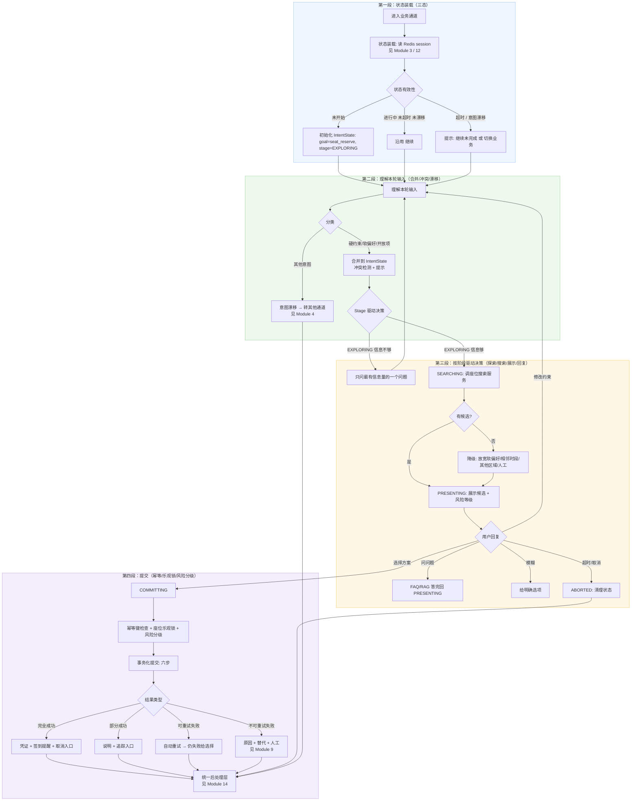

<a id="toc-24"></a>
### 5.1 阶段模型 Stage（替代两态判断）

原状态只有"是否处于槽位收集"两态。新用 `Stage` 枚举覆盖完整生命周期：

`EXPLORING`（探索/收敛约束）→ `SEARCHING`（搜索，瞬态）→ `PRESENTING`（展示候选待选）→ `COMMITTING`（事务提交）→ `COMMITTED`（提交完成待确认）→ `DONE`（完成返回凭证）→ `ABORTED`（取消/超时清理）。

**没有 SLOT_COLLECTION 阶段**：收集约束贯穿 EXPLORING 与 PRESENTING（用户可能在展示候选后说"换个区域"，也是收集约束）。

<a id="toc-25"></a>
### 5.2 流程重新设计

1. **状态装载**（第一等公民）：加载 `session:{sessionId}` 后判断三态——未开始（初始化 EXPLORING）/ 进行中未超时未漂移（沿用）/ 超时或意图漂移（提示"继续未完成"或"切换业务"，如半小时后说"我要续借"应识别为漂移）。
2. **理解本轮输入**：先分类（硬约束/软偏好/开放项/其他意图），再合并到 IntentState，新信息覆盖旧信息要提示"已从 X 改为 Y"；冲突检测以最新为准并提示；意图漂移则转其他通道（见 Module 4）。原设计直接抽实体，新设计把"理解"与"抽取"分开。
3. **Stage 驱动决策**：EXPLORING 判断硬约束是否够搜索（日期/时段通常可推断默认），不够则**只问最有信息量的一个问题**（日期 > 时段 > 区域，一次只问一个），够了进 SEARCHING；SEARCHING 调搜索服务，无候选走降级（放宽软偏好/相邻时段/其他区域/人工）；PRESENTING 展示候选（用户回复六类：选择→COMMITTING、修改约束→回理解、问问题→FAQ/RAG 后回 PRESENTING、模糊→给选项、超时/取消→ABORTED）。
4. **COMMITTING**：提交前做幂等键检查、座位乐观锁、风险分级（见 5.4 风险分级 / 5.5 状态外置与并发控制），完成后清理状态、写审计日志、进统一后处理层（见 Module 14）。

<a id="toc-26"></a>
### 5.3 约束模型

- **硬约束**（必须，需归一化）：日期（绝对/相对→归一）、时段（精确/模糊"下午"→13:00–18:00）、区域（具体馆区/模糊"安静的地方"→标签匹配）。不满足无法搜索。
- **软偏好**（加权，不追问）：环境（安静/靠窗/靠墙）、设施（插座/台灯/电脑）、位置（靠近入口/洗手间/电梯）、同伴（靠近朋友/独立）。无候选时可放宽重新搜。
- **开放项**（系统自决，不追问）：具体座位号、精确起始时间（"下午"默认 14:00）、时长（默认 2 小时）、楼层。原则：能自动决策就自动决策，用户不满意再改。

<a id="toc-27"></a>
### 5.4 风险分级（配置化，不硬编码）

- **低风险**：单次、普通座位、时长 ≤ 4 小时、非高峰、非特殊区域 → 直接提交，事后可撤销，不需显式确认。
- **中风险**：研讨间、时长 > 4 小时、高峰、特殊区域（静音/VIP）→ 展示确认摘要（区域/日期/时段/座位号/注意事项）后提交。
- **高风险**：跨天、多人、特殊权限区域、涉及费用 → 显式确认 + 二次验证（验证码/邮件链接）。

<a id="toc-28"></a>
### 5.5 状态外置与并发控制

- **状态存储**：IntentState 序列化存 Redis，key=`session:{sessionId}`，TTL 30 分钟无活动过期，**version** 每次更新递增（乐观锁）。多实例部署下任意实例可处理任意会话（状态共享）。
- **幂等**：提交幂等键 = `userId + sessionId + hash(hardConstraints + selectedCandidate)`，存 Redis TTL 24 小时；重复提交返回首次结果——用户重复点击/网络重试/跨设备并发都不会重复预约。
- **并发控制**：座位级乐观锁，搜索时返回座位版本号，提交时校验，不一致（被抢）返回替代方案；业务库有唯一约束更佳，直接在库层保证。

<a id="toc-29"></a>
### 5.6 事务化提交（六步 + 四类结果）

提交不是一步，而是：① 临时锁定座位（TTL 30 秒防抢占）→ ② 校验用户资格（登录/权限/欠款/超次）→ ③ 写预约记录 → ④ 更新座位状态 → ⑤ 发通知（短信/邮件/推送，建议 NotificationService 抽象 + 策略模式，不绑厂商）→ ⑥ 写审计日志。

结果分四类：**完全成功**（凭证 + 签到提醒 + 取消入口）/ **部分成功**（如锁了座但通知没发，说明 + 追踪入口）/ **可重试失败**（网络超时，自动重试一次仍失败给用户选择）/ **不可重试失败**（权限不足/座位被占，原因 + 替代 + 人工）。原设计只有"成功/失败"两分支，无法表达部分成功与可重试。

<a id="toc-30"></a>
### 5.7 兜底体系（八类）

- **入口兜底**：置信度低走澄清；未登录引导登录+暂存（见 Module 13）；无权限说明+替代；欠款/黑名单说明+引导处理。
- **约束兜底**：抽取失败追问；约束无效（如过去日期）提示重选；冲突以最新为准+提示；反悔支持局部修改；追问连续 3 轮超限转人工。
- **搜索兜底**：无候选→放宽软偏好→相邻时段→其他区域→人工。
- **确认兜底**：模糊给明确选项；沉默超时提醒/取消；答非所问重新识别；凭证过期重生成/取消。
- **提交兜底**：幂等命中返上次结果；乐观锁冲突给替代；可重试自动重试；不可重试说明+替代+人工。
- **结果兜底**：成功给完整凭证；部分成功给追踪入口；失败分类原因+替代+重试/人工。
- **系统兜底**：状态存储故障降级单轮；凭证服务故障简化确认；业务系统故障工单+公告（工单建议自建 human_tickets 表 + 状态机，或企业微信/飞书客服）。
- **人工兜底**：任何环节用户要求/追问超限/提交反复失败/情绪激烈 → 转人工（见 Module 9）。


---

<a id="toc-31"></a>
## 6. 业务通道 —— 续借（对象集合识别 + 逐本资格校验 + 批量事务化提交）

> **核心结论**：原设计的病根是把续借当成"识别书名 → 确认 → 执行"。真实场景里，续借应是"识别续借对象集合 → 逐本资格校验 → 展示可续/不可续 → 用户批量选择 → 事务化执行"。

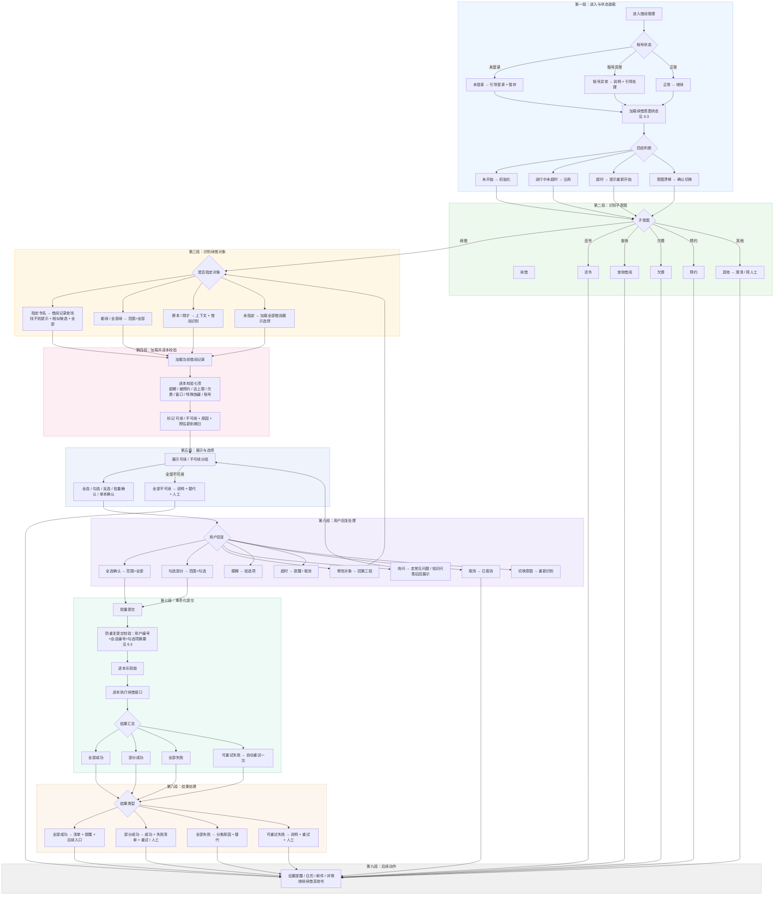


<a id="toc-32"></a>
### 6.1 阶段模型 Stage

- `EXPLORING`：识别续借对象，加载借阅列表。
- `VALIDATING`：逐本资格校验。
- `PRESENTING`：展示可续/不可续列表，让用户勾选。
- `COMMITTING`：提交续借。
- `DONE`：完成。
- `ABORTED`：取消或超时。

<a id="toc-33"></a>
### 6.2 完整流程（九段）

**第一段：进入与状态装载**
进入借阅管理，先加载状态、检查权限。账号状态：未登录 → 引导登录 + 暂存；账号异常（冻结、挂失、黑名单）→ 说明原因 + 引导处理；账号正常 → 继续。加载 `RenewIntentState`（从会话缓存），四态判断：未开始 → 初始化；进行中未超时 → 沿用；超时 → 提示重新开始；意图漂移 → 确认切换。

**第二段：识别子意图**
"续借 / 续一下 / 帮我续" → 续借流程；"还书 / 还一下" → 还书流程；"查一下借了什么 / 我的借阅" → 查询流程；"欠费 / 罚款" → 欠费流程；"预约 / 取书" → 预约流程；其他 → 澄清或转人工。

**第三段：识别续借对象**
- 明确指定书名：从借阅记录中查找（匹配书名、作者、条码号）；找不到 → 提示 + 展示相似候选 + 展示全部借阅。
- "都续 / 全部续"：加载全部借阅记录，`scope = all`。
- "续那本 / 刚才那本"：从上下文 + 借阅记录综合识别。优先级：用户明确指定 > 当前借阅中 > 上下文提到 > 历史提到。
- 未指定：加载全部借阅记录，展示让用户选，`scope` 由后续选择决定（单本或勾选）。

**第四段：加载借阅记录并逐本校验**
从借阅系统加载当前借阅记录，逐本校验七项：① 是否超期（`currentDueDate < 当前`）；② 是否被他人预约（`hasReservation`）；③ 是否达续借次数上限（`renewCount >= maxRenewCount`）；④ 是否有欠费（用户级）；⑤ 是否在续借窗口；⑥ 是否特殊馆藏（`isSpecialCollection`）；⑦ 账号是否正常。每本书输出 `renewable`、`reason`、`newDueDate`（可续时预估新到期日）。

**第五段：展示与选择**
展示候选列表，分「可续借」「不可续借」两组。每本书显示：书名、作者、条码号、当前到期日、续借后新到期日（可续时）、续借次数（如"第 1 次 / 共 2 次"）、不可续原因（不可续时）、注意事项。提供操作：全选、勾选、反选、批量确认、单本确认。若全部不可续，直接说明原因 + 替代方案 + 人工入口，不进入选择。

**第六段：用户回复处理（八类分支）**
- 全选确认：`scope = all`，提交所有可续项。
- 勾选部分：`scope = selected`，提交选中项。
- 修改对象：回到第三段，重新识别。
- 询问（如"续借后多久到期""为什么不能续"）：走常见问题或知识问答，答完回到展示。
- 模糊（如"行吧""随便"）：给明确选项 —— 1 全部续借，2 勾选，3 取消。
- 超时：2 分钟无回复，提醒或取消。
- 取消：进入 `ABORTED`。
- 切换意图：重新识别子意图。

**第七段：事务化提交**
批量提交时：① 幂等键检查（`userId + sessionId + hash(sorted(selectedItems))`，命中直接返回上次结果）；② 逐本乐观锁（检查每本书借阅记录版本号，冲突则标失败）；③ 逐本执行（调用续借接口，收集每本结果）；④ 结果汇总分四类：全部成功 / 部分成功 / 全部失败 / 可重试失败。可重试失败自动重试一次，仍失败归入失败清单。

**第八段：结果处理**
- 全部成功：返回列表，每本显示书名、原到期日、新到期日、续借次数、是否还能再续；附提醒设置入口、取消续借入口。
- 部分成功：成功清单 + 失败清单，失败标注原因 + 替代方案（如"请先还书"）；提供重试入口、人工入口。
- 全部失败：按原因分类，每类给对应方案（如全部超期 → 引导还书或缴费；全部被预约 → 说明无法续借 + 建议尽快还书）。
- 可重试失败：自动重试后仍失败，说明原因 + 重试按钮 + 人工入口。

**第九段：后续动作**
成功后可选：设置到期提醒、加入日历、发送邮件确认、查看借阅详情、继续续借其他书。

<a id="toc-34"></a>
### 6.3 状态存储 / 幂等 / 并发控制

- **状态存储**：`RenewIntentState` 序列化存会话缓存，键为 `renew:session:{sessionId}`，值存 JSON，TTL 30 分钟，每次更新递增 `version`。多实例部署下任意实例可处理任意会话（状态共享）。
- **幂等**：幂等键 = `userId:sessionId:hash(sorted(selectedItems))`，存会话缓存 TTL 24 小时；重复提交返回首次结果，用户重复点击 / 网络重试 / 跨设备并发都不会重复续借。
- **并发控制**：每本书的借阅记录有版本号，提交时校验版本号是否与加载时一致，不一致（被他人还书、系统自动续等）标记为失败，返回替代方案。

<a id="toc-35"></a>
### 6.4 对象识别优先级 / 校验顺序 / 展示话术

- **对象识别优先级**：用户明确指定书名 > 当前借阅中匹配 > 上下文提到 > 历史对话提到。注意：历史对话提到只作兜底，且必须与当前借阅记录交叉验证；若历史里提到《三体》但当前借阅没有《三体》，不采用。
- **可续性校验顺序**：先账号级（欠费、账号状态），再记录级（超期、被预约、次数、窗口、馆藏类型）。账号级不过，所有书都不可续，直接说明。
- **展示话术示例**：
  - 可续借：「《三体》刘慈欣，条码 12345，当前到期 2026-10-10，续借后到期 2026-11-10，第 1 次续借（共 2 次）。」
  - 不可续借：「《活着》余华，条码 67890，当前到期 2026-10-05，已超期，无法续借。请先还书。」

<a id="toc-36"></a>
### 6.5 兜底体系（八类）

- **入口兜底**：意图置信度低 → 澄清；未登录 → 引导登录 + 暂存；账号异常 → 说明 + 引导处理；有欠费 → 说明 + 引导缴费。
- **对象识别兜底**：未指定 → 展示借阅列表；指定但找不到 → 提示 + 相似候选 + 全部列表；历史提到多本 → 优先级规则；借阅为空 → 说明 + 引导借书。
- **资格校验兜底**：每本不过的原因都有对应话术和引导（超期 → 还书或缴费；被预约 → 说明 + 尽快还书；达上限 → 还书；欠费 → 缴费；不在窗口 → 提示何时可续；特殊馆藏 → 说明；账号异常 → 引导处理）。
- **确认兜底**：模糊 → 给选项；沉默 → 超时提醒或取消；答非所问 → 重新识别意图；修改 → 局部更新；部分确认 → 勾选处理。
- **执行兜底**：幂等命中 → 返回上次结果；乐观锁冲突 → 说明 + 重试；可重试失败 → 自动重试；不可重试失败 → 说明 + 替代 + 人工；部分成功 → 清单；系统故障 → 工单 + 人工。
- **结果兜底**：成功 → 完整信息 + 提醒 + 后续入口；部分成功 → 清单 + 追踪；失败 → 分类原因 + 替代 + 人工。
- **系统兜底**：状态存储故障 → 降级单轮；借阅系统故障 → 工单 + 公告；通知服务故障 → 静默 + 提示。
- **人工兜底**：用户要求 / 追问超限 / 反复失败 / 情绪激烈 / 规则冲突 → 转人工（见 Module 9）。


<a id="toc-37"></a>
### 6.6 一句话总结

原设计把续借当成"识别书名 → 确认 → 执行"，所以从历史对话抽书名（易张冠李戴）、单本处理（不支持批量）、无规则校验（超期 / 被预约 / 次数 / 欠费 / 窗口都没查）、单步执行（部分成功无法处理）。改成"对象集合识别 + 逐本资格校验 + 展示候选 + 批量选择 + 事务化提交 + 部分成功处理 + 状态外置 + 幂等并发 + 八类兜底"，才能从"能跑的 demo"变成"用户愿意用、能上线的业务通道"。


---

<a id="toc-38"></a>
## 7. FAQ 快答通道 + 语义缓存（重构为知识层：意图理解 + 多路召回 + 置信度驱动）

> **核心结论**：原设计的病根是把常见问题当成"缓存 + 关键词"的简单查询，所以它缓存优先、语义匹配、关键词召回、单向降级、无版本、无反馈。真实场景里，常见问题是"知识检索 + 答案生成 + 反馈优化"的闭环。

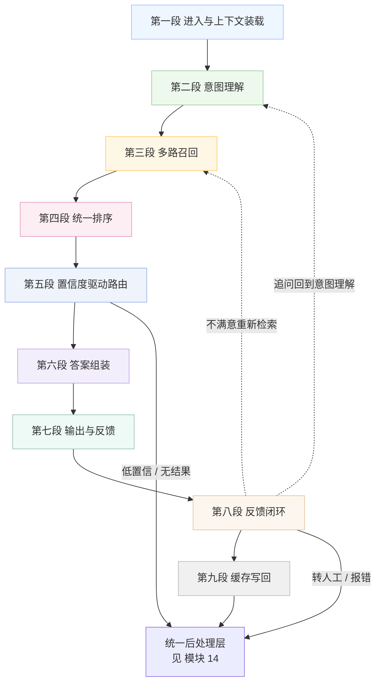

**子图 1：进入与上下文装载**

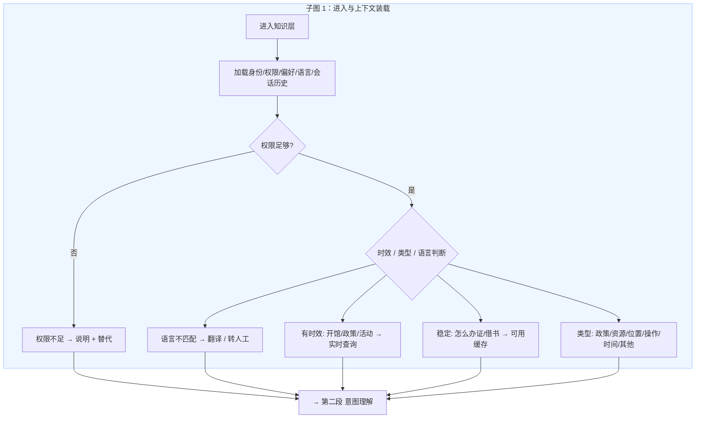

**子图 2：意图理解**

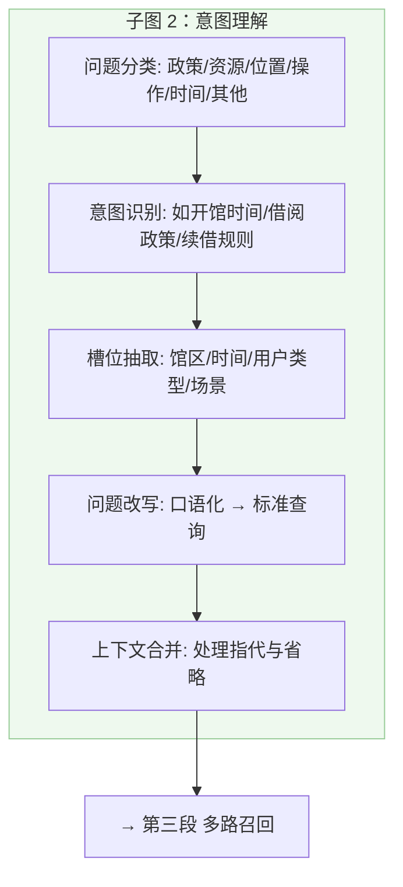

**子图 3：多路召回**

```mermaid
flowchart TD
    subgraph C3[子图 3：多路召回]
        RECALL[四路并行召回]
        CACHE[缓存召回]
        CH[高相似 ≥ 0.95 → 强候选]
        CM[中相似 0.75-0.95 → 弱候选]
        CL[低相似 < 0.75 → 未命中]
        NEG[负面缓存: 最近标未命中 → 直接跳过]
        FAQ[常见问题召回: 关键词 + Chroma向量(BGE-M3)混合]
        KB[知识库召回: 政策/资源/操作手册]
        RAG[知识问答召回: 开放知识兜底]
        CAND[各路候选带 置信度/来源/元信息]
    end
    RECALL --> CACHE
    RECALL --> FAQ
    RECALL --> KB
    RECALL --> RAG
    CACHE --> CH
    CACHE --> CM
    CACHE --> CL
    CACHE --> NEG
    CH --> CAND
    CM --> CAND
    FAQ --> CAND
    KB --> CAND
    RAG --> CAND
    CAND --> OUT3[→ 第四段 统一排序]
    style C3 fill:#fff7e6,stroke:#ffcc66,stroke-width:1px
```

**子图 4：统一排序**

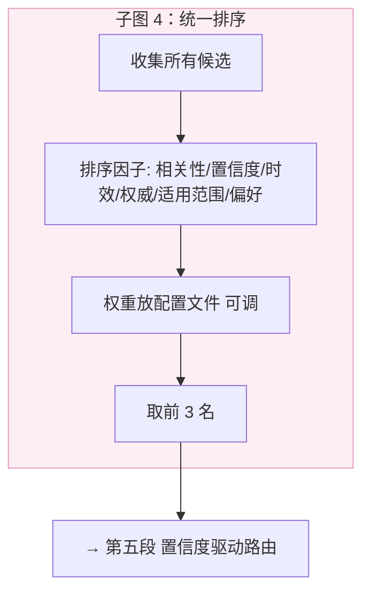

**子图 5：置信度驱动路由**

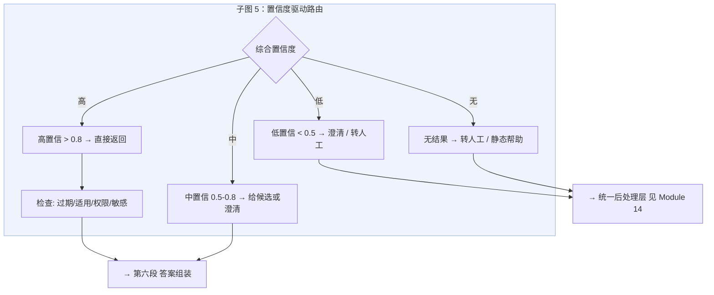

**子图 6：答案组装**

```mermaid
flowchart TD
    subgraph C6[子图 6：答案组装]
        ASM[模板 + 变量组装答案]
        META[元信息: 来源/版本/有效期/适用范围/负责部门]
        FRESH[时效提示: 截至 X 日期 以官网为准]
        CONFNOTE[中置信注明"供参考"]
    end
    ASM --> META
    ASM --> FRESH
    ASM --> CONFNOTE
    META --> OUT6[→ 第七段 输出与反馈]
    FRESH --> OUT6
    CONFNOTE --> OUT6
    style C6 fill:#f3eefc,stroke:#c2a3e6,stroke-width:1px
```

**子图 7：输出与反馈**

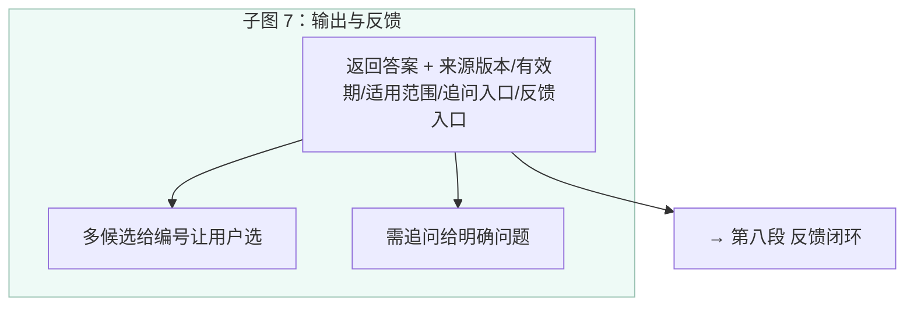

**子图 8：反馈闭环**

```mermaid
flowchart TD
    subgraph C8[子图 8：反馈闭环]
        FB{用户反馈}
        FBOK[满意 → 写回缓存 + 权重提升]
        FBNO[不满意 → 重新检索 + 记录未解决案例]
        FBERR[报错 → 人工审核 + 修正]
        FBASK[追问 → 多轮回到意图理解]
        FBHUM[转人工 → 记录原因 + 队列]
    end
    FB --> FBOK
    FB --> FBNO
    FB --> FBERR
    FB --> FBASK
    FB --> FBHUM
    FBASK -.-> LOOP2[→ 第二段 意图理解]
    FBNO -.-> LOOP3[→ 第三段 多路召回]
    FBOK --> OUT8[→ 第九段 缓存写回]
    FBERR --> POST8[→ 统一后处理层 见 Module 14]
    FBHUM --> POST8
    style C8 fill:#fcf6ee,stroke:#e6c299,stroke-width:1px
```

**子图 9：缓存写回**

```mermaid
flowchart TD
    subgraph C9[子图 9：缓存写回]
        WB[写回时机: 满意后 / 延迟 + 定期校验]
        QC[写回前质量检查: 完整性/安全/冲突]
        CNX[并发写: 原子写入（版本号控制）]
    end
    WB --> QC --> CNX
    CNX --> OUT9[→ 统一后处理层 见 Module 14]
    style C9 fill:#f0f0f0,stroke:#bbbbbb,stroke-width:1px
```


<a id="toc-39"></a>
### 7.1 完整流程（九段）

**第一段：进入与上下文装载**
进入知识层，加载用户身份、权限、历史偏好、语言、会话历史；判断问题时效敏感度（开馆时间、政策、活动等有时效；怎么办证、怎么办借书等相对稳定）；判断问题类型（政策、资源、位置、操作、时间、其他）。权限不足 → 说明并给替代；语言不匹配 → 翻译或转人工。

**第二段：意图理解**
不立即查缓存，先理解：问题分类（政策/资源/位置/操作/时间/其他）、意图识别（具体知识意图）、槽位抽取（馆区/时间/用户类型/场景）、问题改写（口语化→标准查询）、上下文合并（结合历史轮次处理指代与省略）。

**第三段：多路召回**
四路并行召回，每路返回候选：
- 缓存召回：查答案缓存，只作候选。高相似（≥0.95）作强候选；中相似（0.75–0.95）作弱候选参与排序；低相似（<0.75）视为未命中。同时检查负面缓存（最近被标记未命中的问题直接跳过缓存）。（FAQ 语义缓存建议 Redis 哈希 + 可选 Chroma 向量相似(≥0.95)）
- 常见问题召回：关键词 + Chroma向量(BGE-M3)混合检索（关键词处理同义词/纠错/权重/否定，向量处理口语化/语义相似；同义词建议 synonyms 库+自建词表，纠错建议编辑距离+拼音，分词建议 jieba）。
- 知识库召回：政策文档、资源指南、操作手册。
- 知识问答召回：开放知识，用于常见问题和知识库覆盖不到的问题。
每路都带置信度、来源、元信息。

**第四段：统一排序**
所有候选按相关性、置信度、时效性、权威性、适用范围匹配度、用户历史偏好统一排序，取前 3 名；排序权重放配置文件，可调。

**第五段：置信度驱动路由**
按前 1 名综合置信度：高置信（>0.8）直接返回；中置信（0.5–0.8）给前 3 候选让用户选或澄清；低置信（<0.5）澄清或转人工；无结果转人工或静态帮助。同时检查：答案是否过期、是否适用当前用户、是否需要权限、是否涉及敏感。

**第六段：答案组装**
答案用模板 + 变量：模板如"{馆区}的开馆时间是{时间}，{节假日说明}"；变量从结构化知识库取值并结合用户上下文。附元信息（来源/版本/生效日期/适用范围/负责部门）；有时效则加"截至 X 日期，如有变动以官网为准"；中置信注明"以下答案供参考"。

**第七段：输出与反馈**
返回答案文本、来源与版本、有效期、适用范围、追问入口、反馈入口（满意 / 不满意 / 报错）；多候选给编号让用户选；需追问给明确问题。

**第八段：反馈闭环**
满意 → 缓存写回 + 排序权重提升；不满意 → 触发重新检索 + 记录未解决案例；报错 → 人工审核 + 修正知识库；追问 → 识别为多轮继续处理；转人工 → 记录原因 + 进入人工队列。

**第九段：缓存写回**
不立即写回：用户满意后写回，或延迟写回 + 定期校验。写回带元信息（版本/有效期/适用范围/语言/场景）；写回前做质量检查（完整性/安全性/是否与已有缓存冲突）；并发写用原子写入（版本号控制）。

<a id="toc-40"></a>
### 7.2 兜底体系（八类）

- **入口兜底**：意图置信度低转澄清；问题分类失败走通用常见问题；用户身份缺失返回通用答案；时效敏感问题实时查询；权限不足说明并给替代；语言不匹配翻译或转人工。
- **缓存兜底**：命中但过期重新检索；命中但不满意重新检索；命中但适用范围不匹配重新检索；缓存服务故障直接走召回；缓存污染定期校验 + 举报机制。
- **召回兜底**：关键词失败走向量；向量失败走意图；全部失败走知识问答；知识问答失败走澄清再走人工。
- **排序兜底**：多结果冲突按置信度 + 时效 + 权威性排序；置信度都低给候选让用户选；无结果走澄清再走人工。
- **答案兜底**：不完整追问补充；有时效实时查询；需个性化结合用户身份；涉及权限鉴权后返回；过期重新检索。
- **输出兜底**：含敏感信息过滤或拒答；可能误导加免责声明；可能过期提示核实；多版本给用户选。
- **系统兜底**：缓存故障直接走召回；向量服务故障走关键词召回；知识问答故障走常见问题加人工；全部故障走静态帮助页。
- **人工兜底**：用户要求 / 追问超限 / 反复不满意 / 敏感问题 / 规则冲突 → 转人工（见 Module 9）。


<a id="toc-41"></a>
### 7.3 一句话总结

原设计把常见问题当成"缓存 + 关键词"的简单查询，所以缓存优先、语义匹配、关键词召回、单向降级、无版本、无反馈。真实场景里，常见问题是"知识检索 + 答案生成 + 反馈优化"的闭环。改成"意图理解优先 + 多路召回 + 统一排序 + 置信度驱动 + 结构化答案 + 版本管理 + 反馈闭环 + 八类兜底"，才能从"能跑的 demo"变成"用户愿意用、能上线的知识层"。


---

<a id="toc-42"></a>
## 8. 知识问答通道（RAG）+ 低置信度处理（重构为五层推理引擎：问题理解 + 策略规划 + 多源获取 + 答案合成 + 校验输出）

> **核心结论**：原设计的病根是把知识问答当成"检索 + 生成"两步管道，五个假设都不成立（问题可直接检索、知识库是文档集合、一次检索就够、模型是答案主来源、流式输出总是好的）。真实场景里，它是"问题理解 + 策略规划 + 多源知识获取 + 答案合成 + 校验输出"的推理引擎。


```mermaid
flowchart TD
    P1[第一段 进入与上下文装载] --> P2[第二段 问题理解]
    P2 --> P3[第三段 策略规划]
    P3 --> P4[第四段 知识获取（可多轮）]
    P4 --> P5[第五段 答案合成]
    P5 --> P6[第六段 校验]
    P6 --> P7[第七段 输出]
    P7 --> P8[第八段 降级链]
    P8 --> P9[第九段 反馈闭环]
    P9 --> POST[统一后处理层<br/>见 模块 14]
    P6 -.->|校验不过 降级 / 修正| P4
    P4 -.->|多轮超限 / 澄清| POST
    P9 -.->|追问回到问题理解| P2
    P9 -.->|不满意重新检索| P4
    P8 -->|转人工 / 静态帮助| POST
    P9 -->|转人工 / 报错 / 满意缓存| POST
    style P1 fill:#eef6ff,stroke:#99c2ff,stroke-width:1px
    style P2 fill:#eef9ee,stroke:#99cc99,stroke-width:1px
    style P3 fill:#fff7e6,stroke:#ffcc66,stroke-width:1px
    style P4 fill:#fdeef3,stroke:#e699c2,stroke-width:1px
    style P5 fill:#eef3fc,stroke:#99b2e6,stroke-width:1px
    style P6 fill:#f3eefc,stroke:#c2a3e6,stroke-width:1px
    style P7 fill:#eefaf6,stroke:#99c2b2,stroke-width:1px
    style P8 fill:#fcf6ee,stroke:#e6c299,stroke-width:1px
    style P9 fill:#f0f0f0,stroke:#bbbbbb,stroke-width:1px
```

**子图 1：进入与上下文装载**

```mermaid
flowchart TD
    subgraph C1[子图 1：进入与上下文装载]
        ENTER[进入知识问答通道]
        LOAD[装载身份/权限/画像/历史/语言/场景]
        PM{权限足够?}
        PERM[权限不足 → 说明 + 替代]
        LANG{语言匹配?}
        TR[语言不匹配 → 翻译 / 转人工]
    end
    ENTER --> LOAD --> PM
    PM -->|否| PERM
    PM -->|是| LANG
    LANG -->|否| TR
    LANG -->|是| OUT1[→ 第二段 问题理解]
    PERM --> OUT1
    TR --> OUT1
    style C1 fill:#eef6ff,stroke:#99c2ff,stroke-width:1px
```

**子图 2：问题理解**

```mermaid
flowchart TD
    subgraph C2[子图 2：问题理解]
        INTENT[意图识别: 查开馆时间/问续借规则/找资源]
        CLS[问题分类: 政策/操作/资源/位置/实时/计算]
        SLOT[槽位抽取: 馆区/时间/用户类型/资源类型]
        CTX[上下文补全: 处理指代与省略]
        LAN[语言识别: 决定答案语言]
    end
    INTENT --> CLS --> SLOT --> CTX --> LAN
    LAN --> OUT2[→ 第三段 策略规划]
    style C2 fill:#eef9ee,stroke:#99cc99,stroke-width:1px
```

**子图 3：策略规划**

```mermaid
flowchart TD
    subgraph C3[子图 3：策略规划]
        PLAN{按问题分类选数据源}
        M1[政策 → 结构化政策表 + 常见问题 + 文档]
        M2[操作 → 操作手册 + 常见问题 + 规则引擎]
        M3[资源 → 资源库 + 文档]
        M4[位置 → 位置库 + 实时接口]
        M5[实时 → 实时接口]
        M6[计算 → 规则引擎]
        MULTI{是否复杂? → 标记多轮}
        CLAR{信息不足? → 先澄清}
        OUTTYPE[判断输出类型: 文本/表格/列表/步骤/时间/金额/链接]
    end
    PLAN --> M1 & M2 & M3 & M4 & M5 & M6
    PLAN --> MULTI
    PLAN --> CLAR
    PLAN --> OUTTYPE
    M1 --> OUT3[→ 第四段 知识获取]
    M2 --> OUT3
    M3 --> OUT3
    M4 --> OUT3
    M5 --> OUT3
    M6 --> OUT3
    MULTI --> OUT3
    CLAR --> OUT3
    OUTTYPE --> OUT3
    style C3 fill:#fff7e6,stroke:#ffcc66,stroke-width:1px
```

**子图 4：知识获取（可多轮）**

```mermaid
flowchart TD
    subgraph C4[子图 4：知识获取（可多轮）]
        SRC[按规划调用数据源]
        D1[结构化查询: 数据库/表]
        D2[常见问题匹配: 关键词 + Chroma向量(BGE-M3)]
        D3[文档检索: Chroma向量(BGE-M3) + BM25关键词 + Cross-Encoder重排]
        D4[实时接口: 座位余量/在馆人数/借阅状态]
        D5[规则引擎: 续借到期/罚款计算]
        EVAL{第一轮后评估: 完整度/一致性/置信度}
        NEXT[不够 → 第二轮: 改写/查其他源/调其他工具]
        ROUND[最多 N 轮]
        FAIL[超限 → 澄清 / 转人工]
    end
    SRC --> D1 & D2 & D3 & D4 & D5
    D1 --> EVAL
    D2 --> EVAL
    D3 --> EVAL
    D4 --> EVAL
    D5 --> EVAL
    EVAL -->|够| OUT4[→ 第五段 答案合成]
    EVAL -->|不够| NEXT --> ROUND --> FAIL
    ROUND --> OUT4
    FAIL --> POST4[→ 统一后处理层 见 Module 14]
    style C4 fill:#fdeef3,stroke:#e699c2,stroke-width:1px
```

**子图 5：答案合成**

```mermaid
flowchart TD
    subgraph C5[子图 5：答案合成]
        SYN{按答案类型合成}
        A1[结构化答案: 直接组装 不生成]
        A2[文档引用: 引用原文条款 不改写]
        A3[计算答案: 规则引擎算 模型只解释]
        A4[生成答案: 需解释/总结/组织才生成]
        A5[混合答案: 结构化为主 生成为辅]
        CITE[每个事实对应引用]
    end
    SYN --> A1 & A2 & A3 & A4 & A5
    A1 --> CITE
    A2 --> CITE
    A3 --> CITE
    A4 --> CITE
    A5 --> CITE
    CITE --> OUT5[→ 第六段 校验]
    style C5 fill:#eef3fc,stroke:#99b2e6,stroke-width:1px
```

**子图 6：校验**

```mermaid
flowchart TD
    subgraph C6[子图 6：校验]
        V{五道校验}
        V1[幻觉: 事实是否在知识里]
        V2[引用: 每事实对应引用]
        V3[权限: 是否越权]
        V4[安全: 敏感/违法/隐私]
        V5[格式: 符合输出类型]
    end
    V --> V1 & V2 & V3 & V4 & V5
    V1 --> DEC{全通过?}
    V2 --> DEC
    V3 --> DEC
    V4 --> DEC
    V5 --> DEC
    DEC -->|是| OUT6[→ 第七段 输出]
    DEC -->|否| FIX[降级 / 修正 → 回知识获取]
    style C6 fill:#f3eefc,stroke:#c2a3e6,stroke-width:1px
```

**子图 7：输出**

```mermaid
flowchart TD
    subgraph C7[子图 7：输出]
        LVL{输出分级}
        SAFE[安全敏感/结构化/需审核 → 先审核后输出]
        STREAM[低风险/开放/闲聊 → 流式输出]
        EXTRA[带: 答案/引用(可点开)/来源/版本/时效/置信度/反馈/追问/转人工入口]
    end
    LVL --> SAFE
    LVL --> STREAM
    SAFE --> EXTRA
    STREAM --> EXTRA
    EXTRA --> OUT7[→ 第八段 降级链 / 第九段 反馈闭环]
    style C7 fill:#eefaf6,stroke:#99c2b2,stroke-width:1px
```

**子图 8：降级链**

```mermaid
flowchart TD
    subgraph C8[子图 8：降级链（模型不可用时）]
        M{模型可用?}
        BAK[备用模型]
        TPL[模板拼装知识片段 标注"摘自知识库"]
        HUM[转人工队列]
        STATIC[静态帮助页]
    end
    M -->|否| BAK
    BAK --> TPL
    TPL --> HUM
    HUM --> STATIC
    M -->|是| OUT8[→ 第九段 反馈闭环]
    STATIC --> POST8[→ 统一后处理层 见 Module 14]
    style C8 fill:#fcf6ee,stroke:#e6c299,stroke-width:1px
```

**子图 9：反馈闭环**

```mermaid
flowchart TD
    subgraph C9[子图 9：反馈闭环]
        FB{用户反馈}
        FBOK[满意 → 缓存 + 权重提升]
        FBNO[不满意 → 重新检索 + 记录未解决案例]
        FBERR[报错 → 人工审核 + 修正知识]
        FBASK[追问 → 回到问题理解]
        FBHUM[转人工 → 记录原因 + 队列]
    end
    FB --> FBOK
    FB --> FBNO
    FB --> FBERR
    FB --> FBASK
    FB --> FBHUM
    FBASK -.-> LOOP2[→ 第二段 问题理解]
    FBNO -.-> LOOP4[→ 第四段 知识获取]
    FBOK --> POST9[→ 统一后处理层 见 Module 14]
    FBERR --> POST9
    FBHUM --> POST9
    style C9 fill:#f0f0f0,stroke:#bbbbbb,stroke-width:1px
```


<a id="toc-43"></a>
### 8.1 五层架构

- **第一层 问题理解**：意图识别、问题分类、槽位抽取、上下文补全、语言识别。分类枚举：政策 / 操作 / 资源 / 位置 / 实时 / 计算。
- **第二层 策略规划**：选择数据源、生成查询、判断多轮、判断澄清、判断输出类型。输出类型枚举：文本 / 表格 / 列表 / 步骤 / 时间 / 金额 / 链接。
- **第三层 知识获取**：五类数据源各取所长——结构化查询（库/表，开馆时间、借阅规则、馆区信息）、常见问题匹配（关键词+Chroma向量(BGE-M3)，高频问答）、文档检索（Chroma向量(BGE-M3)+BM25关键词+Cross-Encoder重排，操作手册/指南/公告）、实时接口（座位余量、在馆人数、借阅状态）、规则引擎（续借到期日、罚款金额，建议自研 Python 规则函数；复杂用 Drools/durable_rules）。支持多轮，最多 N 轮。
- **第四层 答案合成**：五种方式——结构化答案（直接组装不生成）、文档引用（引用原文不改写）、计算答案（规则引擎算、模型解释）、生成答案（需解释/总结/组织才生成）、混合答案（结构化为主）。结构化答案优先，每事实对应引用。
- **第五层 校验输出**：五道校验（幻觉/引用/权限/安全/格式）；输出分级（安全敏感先审核，低风险流式）。

<a id="toc-44"></a>
### 8.2 完整流程（九段）

**第一段：进入与上下文装载**：装载身份、权限、画像、历史、语言、场景；权限不足说明并给替代；语言不匹配翻译或转人工。

**第二段：问题理解**：意图识别、问题分类（政策/操作/资源/位置/实时/计算）、槽位抽取（馆区/时间/用户类型/资源类型）、上下文补全（指代与省略）、语言识别（决定答案语言）。

**第三段：策略规划**：按分类选数据源（政策→结构化政策表+常见问题+文档；操作→操作手册+常见问题+规则引擎；资源→资源库+文档；位置→位置库+实时接口；实时→实时接口；计算→规则引擎）；判断是否需要多轮（复杂问题标记）；判断是否需要澄清（信息不足先澄清）；判断输出类型（文本/表格/列表/步骤/时间/金额/链接）。

**第四段：知识获取（可多轮）**：按规划调五类数据源——结构化查询（库/表）、常见问题匹配（关键词+向量）、文档检索（向量+关键词+重排）、实时接口、规则引擎。第一轮后评估信息完整度、来源一致性、置信度；不够则规划第二轮（改写/查其他源/调其他工具），最多 N 轮，超过则澄清或转人工。

**第五段：答案合成**：按类型合成——结构化答案（直接组装不生成，如开馆时间读表）、文档引用（引用原文条款附来源）、计算答案（规则引擎算、模型解释）、生成答案（需解释/总结/组织才生成）、混合答案（结构化为主生成为辅）。每事实对应引用（文档编号/标题/章节/页码/版本/生效日期/链接）。

**第六段：校验**：五道校验——幻觉（事实是否在知识里，NLI 或规则）、引用（每事实对应引用）、权限（是否越权，获取与合成都查）、安全（敏感/违法/隐私）、格式（符合输出类型）。任一不过走降级或修正。

**第七段：输出**：分级——安全敏感/结构化/需审核先审核后输出；低风险/开放/闲聊流式输出。输出带答案、引用（可点开/展开）、来源、版本、时效、置信度、反馈入口、追问入口、转人工入口。

**第八段：降级链**：模型不可用降级链——备用模型 → 模板拼装（标注"摘自知识库"）→ 转人工 → 静态帮助；每级明确告知用户。

**第九段：反馈闭环**：满意（缓存+权重提升）、不满意（重新检索+未解决案例）、报错（人工审核+修正知识）、追问（回到问题理解）、转人工（进入队列）；回流到优化。

<a id="toc-45"></a>
### 8.3 兜底体系（八类）

- **入口兜底**：权限不足说明并给替代；语言不匹配翻译或转人工；时效敏感实时查询；预算不足降级；身份缺失返回通用答案。
- **检索兜底**：多路全失败走澄清；查询改写失败用原始查询；重排失败用初排；检索超时返回部分结果；结构化查询失败降级到文档检索。
- **置信度兜底**：高置信直接生成；中置信生成但标注"供参考"；低置信澄清或改写重试；无结果转人工或静态帮助。
- **合成兜底**：结构化数据缺失降级到文档引用；规则引擎失败降级到生成；生成失败降级到模板拼装并标注；引用对齐失败标注"未验证"。
- **校验兜底**：幻觉失败拒答或重新检索；引用失败标注；权限失败过滤；安全失败拒答或转人工；格式失败重格式化。
- **输出兜底**：流式前缓冲一小段做安全审核；发现幻觉撤回或纠正；输出后加反馈/追问/转人工入口；输出超时给提示。
- **系统兜底**：向量故障走关键词；重排故障用初排；实时接口故障降级到缓存或说明；规则引擎故障转人工；生成服务故障走模板。
- **人工兜底**：用户要求 / 反复低置信 / 生成反复失败 / 敏感问题 / 规则冲突 → 转人工（见 Module 9）。


<a id="toc-46"></a>
### 8.4 一句话总结

原设计把知识问答当成"检索 + 生成"两步管道，所以假设问题可直接检索、知识库是文档集合、一次检索就够、模型是答案主来源、流式输出总是好的。真实场景里，它是"问题理解 + 策略规划 + 多源知识获取 + 答案合成 + 校验输出"的推理引擎。改成"五层架构 + 五类数据源 + 多轮检索 + 五种合成 + 五道校验 + 分级输出 + 反馈闭环 + 八类兜底"，才能从"能跑的 demo"变成"用户愿意用、能上线的知识推理引擎"。


---

<a id="toc-47"></a>
## 9. 通用对话兜底与人工转接（捕获 + 共情 + 承认不确定 + 安全分级 + 给出路 + 通用模型 + 转人工 + 升级判断 + 学习回流）

> **核心结论**：原设计的病根是把兜底当成"第五个通道 + 再分类 + 通用模型 + 静态菜单"，五个问题都成立（兜底通道化、循环分类、人工最后、无用户视角、无时间维度）。真实场景里，它是横切所有通道的"未解决状态处理器" + 共情 + 承认失败 + 分级出路 + 人工随时 + 时间升级 + 学习回流。

```mermaid
flowchart TD
    P1[第一段 捕获未解决状态] --> P2[第二段 共情]
    P2 --> P3[第三段 承认不确定]
    P3 --> P4[第四段 安全分级]
    P4 --> P5[第五段 给用户选择]
    P5 --> P6[第六段 通用模型（可选）]
    P6 --> P7[第七段 转人工]
    P7 --> P8[第八段 升级判断]
    P8 --> P9[第九段 学习回流]
    P9 --> POST[统一后处理层<br/>见 模块 14]
    P4 -.->|违法/投诉/隐私/用户要求| P7
    P5 -.->|用户主动选人工| P7
    P6 -.->|安全审核不过| P7
    P8 -.->|触发主动升级| P7
    P9 -.->|回流 FAQ/RAG/优化| POST
    style P1 fill:#eef6ff,stroke:#99c2ff,stroke-width:1px
    style P2 fill:#eef9ee,stroke:#99cc99,stroke-width:1px
    style P3 fill:#fff7e6,stroke:#ffcc66,stroke-width:1px
    style P4 fill:#fdeef3,stroke:#e699c2,stroke-width:1px
    style P5 fill:#eef3fc,stroke:#99b2e6,stroke-width:1px
    style P6 fill:#f3eefc,stroke:#c2a3e6,stroke-width:1px
    style P7 fill:#eefaf6,stroke:#99c2b2,stroke-width:1px
    style P8 fill:#fcf6ee,stroke:#e6c299,stroke-width:1px
    style P9 fill:#f0f0f0,stroke:#bbbbbb,stroke-width:1px
```

**子图 1：捕获未解决状态**

```mermaid
flowchart TD
    subgraph C1[子图 1：捕获未解决状态]
        ENTER[任意通道处理不了 → 进入未解决状态]
        LCAP[捕获失败原因 / 情绪 / 轮次 / 时长]
        L1[装载：原始问题 / 历史轮次 / 上游结果<br/>含意图、置信度、失败原因]
        L2[装载：用户身份 / 画像 / 权限 / 语言 / VIP 等级]
        L3[装载：会话轮次 / 时长 / 未解决次数 / 情绪状态]
    end
    ENTER --> LCAP
    LCAP --> L1 & L2 & L3
    L3 --> OUT1[→ 第二段 共情]
    style C1 fill:#eef6ff,stroke:#99c2ff,stroke-width:1px
```

**子图 2：共情**

```mermaid
flowchart TD
    subgraph C2[子图 2：共情]
        E0{情绪 / 轮次 / 时长判断}
        E1[负面情绪：抱歉让您困惑了]
        E2[轮次多：您已经问了几次了]
        E3[时长长：感谢您的耐心]
        E4[生气且多次兜底：主动升级转人工]
    end
    E0 --> E1 & E2 & E3 & E4
    E1 --> OUT2[→ 第三段 承认不确定]
    E2 --> OUT2
    E3 --> OUT2
    E4 --> HUM2[→ 第七段 转人工]
    style C2 fill:#eef9ee,stroke:#99cc99,stroke-width:1px
```

**子图 3：承认不确定**

```mermaid
flowchart TD
    subgraph C3[子图 3：承认不确定]
        A0[承认不确定：我不太确定您的问题]
        A1[不假装理解 / 不重复问 / 不瞎猜]
    end
    A0 --> A1
    A1 --> OUT3[→ 第四段 安全分级]
    style C3 fill:#fff7e6,stroke:#ffcc66,stroke-width:1px
```

**子图 4：安全分级**

```mermaid
flowchart TD
    subgraph C4[子图 4：安全分级]
        S0{安全分级判断}
        S1[警告级：礼貌回应 + 官方渠道提示]
        S2[拒答级：固定话术 + 替代方案]
        S3[转人工级：违法 / 投诉 / 隐私 → 直接转]
        S4[安全日志：级别 / 类别 / 话术 / 日志 ID]
    end
    S0 --> S1 & S2 & S3
    S1 --> S4
    S2 --> S4
    S3 --> S4
    S4 --> OUT4[→ 第五段 给用户选择]
    S3 --> HUM4[→ 第七段 转人工]
    style C4 fill:#fdeef3,stroke:#e699c2,stroke-width:1px
```

**子图 5：给用户选择**

```mermaid
flowchart TD
    subgraph C5[子图 5：给用户选择]
        C0{给出四个出路}
        C1[人工：用户要求立刻转 / 优先级 urgent]
        C2[留言：非工作时间或不可用 / 带 SLA]
        C3[常见问题：基于上游意图推荐 3 条]
        C4[静态菜单：兜底中的兜底]
    end
    C0 --> C1 & C2 & C3 & C4
    C1 --> HUM5[→ 第七段 转人工]
    C2 --> LRN5[→ 第九段 学习回流]
    C3 --> LRN5
    C4 --> LRN5
    C0 --> OUT5[→ 第六段 通用模型（可选）]
    style C5 fill:#eef3fc,stroke:#99b2e6,stroke-width:1px
```

**子图 6：通用模型（可选）**

```mermaid
flowchart TD
    subgraph C6[子图 6：通用模型（可选）]
        G0{用户不选且模型可用?}
        G1[带系统 prompt / 人格 / 边界 / 拒答规则]
        G2[输出：答案 + 建议选项 + 置信度 + 是否转人工]
        G3[安全审核不过 → 转人工]
    end
    G0 -->|是| G1
    G0 -->|否| LRN6[→ 第九段 学习回流]
    G1 --> G2
    G2 --> G3
    G2 --> OUT6[→ 第八段 升级判断]
    G3 --> HUM6[→ 第七段 转人工]
    style C6 fill:#f3eefc,stroke:#c2a3e6,stroke-width:1px
```

**子图 7：转人工**

```mermaid
flowchart TD
    subgraph C7[子图 7：转人工]
        T0[转人工：用户选人工 或 触发规则]
        T1[优先级：urgent > high > medium > low]
        T2[技能路由：general / business / policy / technical / complaint]  %% 建议自建 Redis 队列 + 技能路由规则（或企业微信/飞书/LiveAgent）
        T3[排队管理：时长提示 + 等待期推荐 FAQ]
        T4[转接失败：留言 + 回呼]
        T5[非工作时间：留言 + 回呼 + SLA 提示]
        T6[上下文传递：完整上下文，用户不用重说]
    end
    T0 --> T1 & T2 & T3 & T4 & T5 & T6
    T6 --> OUT7[→ 第八段 升级判断]
    style C7 fill:#eefaf6,stroke:#99c2b2,stroke-width:1px
```

**子图 8：升级判断**

```mermaid
flowchart TD
    subgraph C8[子图 8：升级判断]
        U0{是否触发主动升级?}
        U1[未解决次数 > 3]
        U2[会话时长 > 5 分钟]
        U3[情绪激烈 / VIP / 重复同一问题]
    end
    U0 --> U1 & U2 & U3
    U0 --> LRN8[→ 第九段 学习回流]
    U1 --> HUM8[→ 第七段 转人工 主动升级]
    U2 --> HUM8
    U3 --> HUM8
    style C8 fill:#fcf6ee,stroke:#e6c299,stroke-width:1px
```

**子图 9：学习回流**

```mermaid
flowchart TD
    subgraph C9[子图 9：学习回流]  %% 建议 feedback_log 落库 + 周期评审 + 进红队集
        R0[记录：问题 / 失败原因 / 次数 / 情绪 / 选择 / 是否解决 / 满意度]
        R1[高频问题补 FAQ / 未分类进人工分析]
        R2[模式发现问题进优化 / 新意图进模型训练]
    end
    R0 --> R1 & R2
    R1 --> POST9[→ 统一后处理层 见 Module 14]
    R2 --> POST9
    style C9 fill:#f0f0f0,stroke:#bbbbbb,stroke-width:1px
```


<a id="toc-48"></a>
### 9.1 三层架构

**第一层：未解决状态捕获层**

任何通道处理不了，进入未解决状态。捕获：原始问题、历史轮次、上游通道结果、失败原因、用户身份与画像、情绪、轮次、时长。

- 失败原因枚举：`intent_low_confidence`、`business_slot_missing`、`faq_miss`、`rag_no_result`、`system_error`。
- 情绪枚举：`neutral`、`anxious`、`confused`、`angry`。

**第二层：兜底处理层（五步处理）**

1. **共情**：先安抚，再处理。
2. **承认不确定**：不装懂，直接承认。
3. **安全分级**：警告、拒答、转人工三档。
4. **给用户选择**：人工、留言、常见问题、静态菜单四个出路。
5. **通用模型（可选）**：有边界、有人格、有安全审核。

**第三层：学习与优化层**

记录所有未解决状态，分类、优先级、回流到 FAQ、RAG、知识库、优化。

<a id="toc-49"></a>
### 9.2 完整流程（九段）

**第一段：捕获未解决状态**

任何通道处理不了，进入未解决状态。装载上下文：原始问题、历史轮次、上游通道结果（含意图、置信度、失败原因）、失败原因、用户身份、画像、权限、语言、VIP 等级、会话轮次、会话时长、未解决次数、情绪状态。

**第二段：共情**

先共情再处理：

- 情绪负面："抱歉让您困惑了""我理解您的心情"；
- 轮次多："我理解您已经问了几次了"；
- 时长长："感谢您的耐心"；
- 生气且兜底多次：主动升级"我帮您转人工"。

**第三段：承认不确定**

不装懂、不瞎猜，直接承认："我不太确定您的问题""我目前无法准确回答""这个问题我需要帮您转接"。关键：**不要假装理解，不要重复问，不要瞎猜**。

**第四段：安全分级**

- 警告级：礼貌回应 + 提示，如"这个问题我建议您咨询官方渠道"；
- 拒答级：固定话术 + 给替代，如"这个问题我不能回答，但您可以咨询 X"；
- 转人工级：违法、投诉、隐私，直接转人工；
- 安全日志记录：级别、类别、话术、日志 ID。

**第五段：给用户选择**

给四个出路：

- 人工：用户要求人工，立刻转；优先级 `urgent`；
- 留言：非工作时间或人工不可用；带 SLA；
- 常见问题：基于上游意图推荐，推荐 3 条；
- 静态菜单：兜底中的兜底，分类菜单；
- 让用户选，透明告知每个选项的后续。

**第六段：通用模型（可选）**

如果用户不选且通用模型可用，用通用模型生成：

- 系统 prompt：图书馆客服角色、知识边界、拒答规则；
- 人格：礼貌、专业、共情；
- 边界：不编政策、不承诺、不越权；
- 拒答规则：敏感、越权、不确定时拒答；
- 输出格式：答案 + 建议选项 + 置信度 + 是否建议转人工；
- 生成后做安全审核，审核不过转人工。

**第七段：转人工**

用户选人工，或触发规则：

- 优先级：urgent（投诉、安全）> high（VIP、复杂）> medium（普通）> low（咨询）；
- 技能路由：general（通用）、business（业务）、policy（政策）、technical（技术）、complaint（投诉）；
- 排队管理：时长提示、等待期间推荐 FAQ；
- 转接失败：留言 + 回呼；
- 非工作时间：留言 + 回呼 + SLA 提示；
- 上下文传递：完整上下文传给人工，用户不用重新说。

**第八段：升级判断**

每一段都判断是否需要主动升级：

- 未解决次数 > 3：主动升级；
- 会话时长 > 5 分钟：主动升级；
- 情绪激烈：主动升级；
- VIP 用户：主动升级；
- 用户重复说同一问题：主动升级。

**第九段：学习回流**

记录所有未解决状态：问题、失败原因、次数、情绪、用户选择、是否解决、满意度。分类、优先级、回流：

- 高频问题补 FAQ；
- 未分类问题进人工分析；
- 模式发现问题进优化；
- 新意图进意图识别模型训练。

<a id="toc-50"></a>
### 9.3 兜底体系（八类）

**入口兜底**

- 失败原因分类：意图低置信、业务槽位不全、FAQ 未命中、RAG 无结果、系统故障；
- 情绪识别：中性、焦虑、困惑、生气；
- 轮次计数、会话时长。

**安全兜底**

- 分级：警告、拒答、转人工；
- 分类：违法、隐私、越权、投诉、医疗、法律、其他；
- 话术分类，日志记录。

**分类兜底**

- 不做二次分类，改成推荐，告诉用户"您的问题可能是关于 X"；
- 如果必须分类，用规则 + 关键词，不用模型；失败记录回流。

**通用模型兜底**

- 系统 prompt、人格、边界、拒答规则；
- 预算：token、时间、轮次；
- 超时、熔断；
- 模型选择：主模型、备用模型；
- 安全审核。

**降级兜底**

- 模型不可用降级链：备用模型 → FAQ 兜底 → 静态话术 → 人工。

**人工转接兜底**

- 触发条件：用户要求、安全命中、轮次超限、情绪激烈、系统故障；
- 优先级：urgent、high、medium、low；
- 技能路由：general、business、policy、technical、complaint；
- 排队管理：时长提示、等待期间推荐；
- 转接失败：留言、回呼；
- 非工作时间：留言 + 回呼；
- 上下文传递：完整上下文；
- 结果兜底：四个出路（人工、留言、常见问题、静态菜单），记录用户选择，跟踪满意度。

**学习兜底**

- 记录所有未解决状态，分类、优先级、回流；
- 高频问题优先补 FAQ，未分类问题进人工分析，模式发现问题进优化。

**系统兜底**

- 全链路故障：静态帮助页 + 留言。


<a id="toc-51"></a>
### 9.4 一句话总结

原设计的病根是把兜底当成"第五个通道 + 再分类 + 通用模型 + 静态菜单"，所以它逻辑循环、人工最后、无共情、无时间维度、无学习。真实场景里，兜底是横切所有通道的未解决状态处理器 + 共情 + 承认失败 + 分级出路 + 人工随时 + 时间升级 + 学习回流。改成未解决状态 + 共情 + 承认不确定 + 安全分级 + 四个出路 + 通用模型边界化 + 人工随时 + 上下文传递 + 升级判断 + 学习回流 + 八类兜底，它才能从"能跑的 demo"变成"用户受挫时还能被接住、能持续优化的最后一道防线"。

---

<a id="toc-52"></a>
## 10. 检索层：混合检索管道重构为搜索代理（核心算法逻辑：信息需求理解 + 搜索规划 + 迭代搜索 + 推理综合 + 反思输出）

> **核心结论**：原设计的病根是把检索当成"固定管道 + 布尔开关 + 两路召回 + 两种融合 + 布尔重排"，这导致五个根本假设都不成立——检索是数据流、查询等于信息需求、召回和排序分离、融合是固定算法、检索和生成分离。真实场景里，检索是"信息需求理解 + 搜索规划 + 迭代搜索 + 推理综合 + 反思输出"的搜索代理，有计划、有迭代、有推理、有反思。

> **核心转变八个**：① 从"检索管道"到"搜索代理"；② 从"查询"到"信息需求"；③ 从"召回 + 排序"到"迭代搜索"；④ 从"固定融合"到"学习融合"；⑤ 从"检索独立"到"检索-推理-生成统一"；⑥ 从"文本召回"到"多源获取"（文档、结构化、API、规则、图）；⑦ 从"一次搜索"到"搜索 + 推理"（多跳、比较、计算）；⑧ 从"无状态"到"会话感知"。

---

<a id="toc-53"></a>
### 10.1 流程图

**主图：五层搜索代理（带迭代与反馈闭环）**

> 读图约定：**方框=处理层（谁），圆角/数据框=被处理的数据对象（谁对谁）。每条箭头都标了「输入数据 → 处理层做X → 产出数据」。**

```mermaid
flowchart TD
    U([用户发来一个问题<br/>原始问话 + 历史对话 + 用户情况]) --> P1

    subgraph P1[第一步：先搞清用户到底要什么]
        P1op[判断要哪种信息：事实/对比/计算/多跳/实时<br/>看历史聊了啥、用户是谁、把问题改写得清楚]
    end
    U -->|"原始问题进来"| P1
    P1 -->|"理清后变成"| IN[信息需求清单<br/>要什么类型 · 有哪些限制 · 时效要求<br/>权限范围 · 用什么语言]

    subgraph P2[第二步：定搜索方案]
        P2op[定搜哪些地方、要不要推理/调工具<br/>最多搜几轮、花多少力气]
    end
    IN --> P2
    P2 -->|"按需求清单排出"| SP[搜索方案<br/>数据源 · 各源怎么查 · 召回/融合/重排怎么弄<br/>推理步骤 · 调哪些工具 · 最多几轮 · 预算多少]

    subgraph P3[第三步：一轮一轮去搜（会循环）]
        P3op[从多处拿资料 → 多路召回 → 自动融合 → 精排 → 评估]
        SS[搜索进度<br/>第几轮 · 已拿到啥 · 还差啥<br/>花了多少 · 每次评估记录]
    end
    SP --> P3
    P3 -->|"按方案去搜得到"| RC[召回片段 一堆<br/>内容 · 来自哪 · 融合分 · 重排分<br/>权威度 · 新鲜度 · 权限]
    RC --> SS
    SS -->|"评估够了汇总"| RR[各轮搜到的东西]
    SS -->|"不够且超次数 → 转人工"| HUM

    subgraph P4[第四步：把资料推理成答案]
        P4op[多步推理 · 东西对比 · 算一算 · 冲突听权威/新鲜的 · 综合]
    end
    RR --> P4
    P4 -->|"得出"| SYN[综合答案 + 推理过程]

    subgraph P5[第五步：检查好不好再输出]
        P5op[看质量/把握/全不全 → 带出处和打分输出 → 收反馈]
    end
    SYN --> P5
    P5 -->|"产出"| SR[最终结果<br/>质量分 · 把握度 · 降级级别<br/>元信息 · 引用出处 · 耗时 · 花费 · 日志号]

    SR --> POST[统一收尾层 / 反馈闭环<br/>排版 · 记日志 · 预测满不满意]
    POST -->|"把反馈带回到开头"| U

    SS -.->|"不够还能搜：改问题换源再搜一轮"| P3
    P5 -.->|"质量把握太低打回第三步重搜"| P3
    P5 -.->|"用户不满意"| HUM

    HUM["人工兜底：自动搞不定的，交真人接手（最后一关）"]
    HUM --> POST

    style P1 fill:#eef6ff,stroke:#99c2ff,stroke-width:1px
    style P2 fill:#eef9ee,stroke:#99cc99,stroke-width:1px
    style P3 fill:#fff7e6,stroke:#ffcc66,stroke-width:1px
    style P4 fill:#fdeef3,stroke:#e699c2,stroke-width:1px
    style P5 fill:#eef3fc,stroke:#99b2e6,stroke-width:1px
    style HUM fill:#f3eefc,stroke:#c2a3e6,stroke-width:1px
    style POST fill:#eefaf6,stroke:#99c2b2,stroke-width:1px
```

**子图 1：信息需求理解**

```mermaid
flowchart TD
    subgraph C1[子图 1：先搞清用户到底要什么]
        A1[进入检索]
        A2[判断要哪种信息：事实/对比/计算/多跳/实时]
        A3[看会话上下文：之前聊了啥、已拿到啥、还差啥]
        A4[看用户情况：身份/偏好/权限/语言]
        A5[把问题改写得更清楚：改写/扩展/拆开]
        A6["需求兜底（对【用户问题】兜底）：问题说不清/太长/语言不对/涉敏时 → 反问澄清、截断拆分、翻译，或拒答"]
    end
    A1 --> A2 --> A3 --> A4 --> A5
    A2 -.->|"问题不合法"| A6
    A6 -.->|"澄清后重来 / 拒答"| A1
    A5 --> OUT1[→ 第二步 定搜索方案]
    style C1 fill:#eef6ff,stroke:#99c2ff,stroke-width:1px
```

**子图 2：搜索规划**

```mermaid
flowchart TD
    subgraph C2[子图 2：定搜索方案]
        B1[搜哪些地方：文档/结构化数据/接口/规则/关系图]
        B2[要不要推理：多跳/对比/计算]
        B3[要不要调工具：接口/规则引擎/数据库]
        B4[最多搜几轮、啥时候停]
        B5[花多少：算力/时间/轮次]
        B6["规划兜底（对【搜索方案】兜底）：定不下方案/预算不够/工具不可用时 → 用默认方案、少搜几轮、换数据源"]
    end
    B1 --> B2 --> B3 --> B4 --> B5
    B4 -.->|"方案/预算/工具出问题"| B6
    B5 --> OUT2[→ 第三步 一轮一轮去搜]
    style C2 fill:#eef9ee,stroke:#99cc99,stroke-width:1px
```

**子图 3：迭代搜索（每轮内部循环）**

```mermaid
flowchart TD
    subgraph C3[子图 3：一轮一轮去搜（每轮内部）]
        D0[开始这一轮]
        D1[从多处拿资料：文档/结构化/接口/规则/关系图]
        D2[多路召回：向量/关键词/结构化/图/规则]
        D3[自动融合：按情况选加权/交叉等办法合并]
        D4[精排：轻量或重量地重新打分排序]
        D5{评估：够了吗/准吗/有冲突吗}
        D6[决定：改问题/换源/再搜]
        D7[降级：搜超次数就转人工]
        R1["召回兜底（对【搜不到】兜底）：某条路子失败时换另一条，都不行转人工"]
        R2["融合兜底（对【合并不起来】兜底）：空/太少/异常时放宽门槛或退回单路"]
        R3["重排兜底（对【精排】兜底）：算不动/超时时用融合分、部分结果或轻量重排"]
        R4["系统兜底（对【底层服务】兜底）：向量/索引/重排/规则引擎挂了，换法子或转人工"]
    end
    D0 --> D1 --> D2 --> D3 --> D4 --> D5
    D2 -.->|"某路召回失败"| R1
    D3 -.->|"融合异常"| R2
    D4 -.->|"重排失败/超时"| R3
    D1 -.->|"服务故障"| R4
    R1 -.->|"接不住就转人工"| D7
    R2 -.-> D7
    R3 -.-> D7
    R4 -.-> D7
    D5 -->|够了| OUT3[→ 第四步 推理成答案]
    D5 -->|不够还能搜| D6
    D6 --> D0
    D5 -->|不够且超次数| D7
    style C3 fill:#fff7e6,stroke:#ffcc66,stroke-width:1px
```

**子图 4：推理综合**

```mermaid
flowchart TD
    subgraph C4[子图 4：把资料推理成答案]
        E1[多步推理：A→B→C 连起来想]
        E2[对比：A 和 B 比一比]
        E3[计算：用规则引擎算一算]
        E4[处理冲突：听权威的、听新鲜的来仲裁]
        E5[综合：把多来源信息拼成答案]
        E6["推理兜底（对【推不出答案】兜底）：多跳/对比/计算/冲突失败时 → 先说能说的、展示对比、算不了转人工、冲突给多版本"]
    end
    E1 --> E2 --> E3 --> E4 --> E5
    E4 -.->|"推理/冲突失败"| E6
    E6 -.->|"接不住就转人工"| OUT4
    E5 --> OUT4[→ 第五步 检查后输出]
    style C4 fill:#fdeef3,stroke:#e699c2,stroke-width:1px
```

**子图 5：反思输出**

```mermaid
flowchart TD
    subgraph C5[子图 5：检查好不好再输出]
        F1[反思：质量行不行/有几分把握/全不全]
        F2[输出：带上元信息/引用出处/质量分/把握度]
        F3[反馈：把用户反馈收回来]
        F4["反思兜底（对【答案不放心】兜底）：质量低/把握低/不全时 → 再搜、标注、说明缺啥"]
        F5["输出兜底（对【最终产物】兜底）：空/少/差/重复时 → 澄清或转人工、降门槛、标注、去重"]
    end
    F1 --> F2 --> F3
    F1 -.->|"答案不放心"| F4
    F4 -.->|"再搜"| F1
    F2 -.->|"产物不达标"| F5
    F5 -.->|"接不住就转人工"| POST
    F3 --> POST[→ 统一收尾层 / 反馈闭环]
    style C5 fill:#eef3fc,stroke:#99b2e6,stroke-width:1px
```


---

<a id="toc-54"></a>
### 10.2 五层架构

**第一层：信息需求理解层**
- 信息需求表示：需要什么类型的信息（`fact` / `comparison` / `calculation` / `multi_hop` / `realtime`）、有哪些约束（时间、地点、人物、条件）、几跳推理、什么时效、什么权限。
- 会话上下文：历史轮次、已获取信息、未解决问题。
- 用户画像：身份、偏好、权限、语言。
- 查询精炼：改写、扩展、分解。

**第二层：搜索规划层**
- 搜索策略：查什么源、怎么查、几轮。
- 推理规划：是否需要多跳、比较、计算。
- 工具规划：是否需要调 API、规则引擎、数据库。
- 轮次规划：最多几轮，什么时候停。
- 预算规划：token、时间、轮次。

**第三层：迭代搜索层**
- 多源获取：文档、结构化、API、规则、图。
- 多路召回：稠密、稀疏、结构化、图、规则。
- 自适应融合：可学习策略。
- 精排：分级重排。
- 评估：够了没、准不准、有无冲突。
- 决策：不够则精炼查询、换数据源、再搜。

**第四层：推理综合层**
- 多跳推理：`A → B → C`。
- 比较推理：`A vs B`。
- 计算推理：规则引擎。
- 冲突处理：多源冲突仲裁，以权威、新鲜为准。
- 综合：多源信息综合成答案。

**第五层：反思输出层**
- 反思：质量、置信度、完整性。
- 输出：带元信息、引用、质量分、置信度。
- 反馈：用户反馈回流。

---

<a id="toc-55"></a>
### 10.3 完整流程（五段）

**第一段：信息需求理解**
进入检索，不是立刻召回，而是先理解：信息需求表示（用户想要什么类型的信息？事实？比较？计算？多跳？实时？）；会话上下文（之前聊了什么？已获取什么？还缺什么？）；用户画像（身份、偏好、权限、语言）；查询精炼（改写、扩展、分解）。

**第二段：搜索规划**
根据信息需求规划：搜索策略（查哪些源？文档、结构化、API、规则、图）；推理规划（是否需要多跳、比较、计算？）；工具规划（是否需要调 API、规则引擎、数据库？）；轮次规划（最多几轮？什么时候停？）；预算规划（token、时间、轮次）。

**第三段：迭代搜索**
多轮搜索，每轮：多源获取（并行调用五类数据源）；多路召回（稠密、稀疏、结构化、图、规则）；自适应融合（根据查询、路数、历史学习融合策略，RRF(k=60) / 加权 / CombSUM / CombMNZ / 学习融合；当前建议 RRF 或双路加权，学习融合规划）；精排（分级重排，无 / 轻量 Cross-Encoder(bge-reranker-v2-m3) / 重量 LLM·ColBERT(ColBERTv2，规划)）；评估（够了没？准不准？有无冲突？评估维度：分数分布、结果数量、来源一致性、权威性、新鲜度、查询覆盖度）；决策（够了则进入推理；不够且未超轮次则精炼查询、换数据源、再搜；不够且超轮次则降级）。

**第四段：推理综合**
根据信息类型做推理：多跳推理（`A → B → C`）；比较推理（`A vs B`）；计算推理（规则引擎）；冲突处理（多源冲突仲裁，以权威、新鲜为准）；综合（多源信息综合成答案）。

**第五段：反思输出**
反思（质量如何？置信度多少？完整吗？）；输出（带元信息、引用、质量分、置信度）；反馈（用户反馈回流）。

---

<a id="toc-56"></a>
### 10.4 十类兜底体系

**信息需求兜底**
- 查询为空 → 澄清；查询超长 → 截断或分拆；查询语言不支持 → 翻译或转人工；查询含敏感词 → 过滤或拒答。

**搜索规划兜底**
- 规划失败 → 用默认策略；预算不足 → 降低轮次；工具不可用 → 换数据源。

**召回兜底**
- 稠密召回失败 → 稀疏召回；稀疏召回失败 → 稠密召回；两路都失败 → 结构化或规则；全部失败 → 转人工。

**融合兜底**
- 融合结果为空 → 放宽阈值重试；融合结果少 → 降低 Top-K；融合异常 → 回退单路。

**重排兜底**
- 重排失败 → 用融合分数；重排超时 → 用部分结果；重排模型不可用 → 用轻量重排。

**推理兜底**
- 多跳推理失败 → 说明已获取部分；比较推理失败 → 展示对比；计算推理失败 → 转人工；冲突无法仲裁 → 展示多版本。

**反思兜底**
- 质量低 → 再搜；置信度低 → 标注；完整性不足 → 说明缺什么。

**输出兜底**
- 结果为空 → 澄清或转人工；结果少 → 降低阈值；结果质量低 → 标注；结果重复 → 去重。

**系统兜底**
- 向量服务故障 → 关键词；索引故障 → 缓存；重排服务故障 → 融合分数；规则引擎故障 → 转人工；全链路故障 → 静态帮助。

**人工兜底**
- 反复无结果 → 转人工；用户不满意 → 转人工；复杂查询 → 转人工；多跳推理失败 → 转人工。

---


---


<a id="toc-57"></a>
### 10.5 一句话总结

原设计的病根是把检索当成"固定管道 + 布尔开关 + 两路召回 + 两种融合 + 布尔重排"，所以它单查询检索、固定参数、无迭代、无推理、无反思、无会话感知、无学习。真实场景里，检索是"信息需求理解 + 搜索规划 + 迭代搜索 + 推理综合 + 反思输出"的搜索代理。改成"信息需求 + 搜索规划 + 迭代搜索 + 多源获取 + 学习融合 + 推理综合 + 反思输出 + 会话感知 + 反馈回流 + 十类兜底"，它才能从"能跑的 demo"变成"用户愿意用、能上线的搜索代理"。

---

<a id="toc-58"></a>
## 11. 知识库索引构建（启动 / 运维流程）

> 核心转变：从"文档集合 + 启动时整体建索引"改为"多源知识网络 + 持续演化的分片索引生命周期"。索引是加速手段，不是前提；启动只是恢复状态，不是构建时机。

<a id="toc-59"></a>
### 11.1 流程图
> 读图约定：**主图**只串起十步主干与反馈回路；每一步内部"谁对谁（吃进什么 → 干啥 → 产出什么）"见下面各自的子图。每一步都挂着自己那一类兜底，接不住就经统一后处理层转人工；系统兜底、人工兜底是跨步的终极保障（全链路/部分/依赖故障降级，长期不可用/数据错误/紧急问题交真人）。

**主图：知识库索引构建（十步主干 + 反馈回路）**

```mermaid
flowchart TD
    P1[第一步 知识注册] --> P2[第二步 知识治理]
    P2 --> P3[第三步 知识存储]
    P3 --> P4[第四步 索引管理]
    P4 --> P5[第五步 增量更新]
    P5 --> P6[第六步 蓝绿重建]
    P6 --> P7[第七步 查询规划]
    P7 --> P8[第八步 持续监控]
    P8 --> P9[第九步 知识退役]
    P9 --> P10[第十步 反馈闭环]
    P10 --> POST[统一后处理层 / 反馈闭环]
    P10 -.->|"反馈驱动回到开头"| P1
    P8 -.->|"监控发现变化"| P5
    P8 -.->|"发现过期"| P9
    POST -.->|"状态回流"| P1
    style P1 fill:#eef6ff,stroke:#99c2ff,stroke-width:1px
    style P2 fill:#eef9ee,stroke:#99cc99,stroke-width:1px
    style P3 fill:#fff7e6,stroke:#ffcc66,stroke-width:1px
    style P4 fill:#fdeef3,stroke:#e699c2,stroke-width:1px
    style P5 fill:#eef3fc,stroke:#99b2e6,stroke-width:1px
    style P6 fill:#eefaf6,stroke:#99c2b2,stroke-width:1px
    style P7 fill:#eef6ff,stroke:#99c2ff,stroke-width:1px
    style P8 fill:#eef9ee,stroke:#99cc99,stroke-width:1px
    style P9 fill:#fff7e6,stroke:#ffcc66,stroke-width:1px
    style P10 fill:#fdeef3,stroke:#e699c2,stroke-width:1px
    style POST fill:#f3eefc,stroke:#c2a3e6,stroke-width:1px
```

**子图 1：知识注册**

```mermaid
flowchart TD
    subgraph C1[子图 1：知识注册]
        A0[新知识进来：来源 / 类型 / 时效 / 权限 / 责任人 / 可信度]
        A1[登记：类型、存储、检索方式、更新频率、时效、权限、责任人、可信度]
        A2[产出 知识源清单<br/>类型·存储·检索方式·更新频率·时效·权限·责任人·可信度·状态]
        A6["知识源兜底（对【知识源】兜底）：源不可用→备用源；源过期→退役；源冲突→仲裁；权限不足→过滤"]
    end
    A0 --> A1 --> A2
    A1 -.->|"源出问题"| A6
    A6 -.->|"接不住转人工"| ZH1[转人工 / 统一后处理层]
    A2 --> OUT1[→ 第二步 知识治理]
    style C1 fill:#eef6ff,stroke:#99c2ff,stroke-width:1px
```

**子图 2：知识治理**

```mermaid
flowchart TD
    subgraph C2[子图 2：知识治理]
        B0[输入 知识源清单]
        B1[审核：准确、合规、无冲突]
        B2[版本：更新产生新版本]
        B3[血缘：从哪来、经什么处理、影响什么]
        B4[质量：新鲜度/覆盖率/准确性/一致性/权威性]
        B5[冲突：按权威、新鲜仲裁]
        B6[退役 / 责任人 / 审计]
        B7[产出 质量与血缘<br/>新鲜度·覆盖率·准确性·一致性·权威性；从哪来·经什么处理·谁改的]
        B8["治理兜底（对【治理】兜底）：审核不通过→打回；版本冲突→以最新；血缘缺失→补全；质量低→标注；冲突无法仲裁→多版本"]
    end
    B0 --> B1 --> B2 --> B3 --> B4 --> B5 --> B6 --> B7
    B1 -.->|"审核/质量/冲突出问题"| B8
    B8 -.->|"接不住转人工"| ZH2[转人工 / 统一后处理层]
    B7 --> OUT2[→ 第三步 知识存储]
    style C2 fill:#eef9ee,stroke:#99cc99,stroke-width:1px
```

**子图 3：知识存储**

```mermaid
flowchart TD
    subgraph C3[子图 3：知识存储]
        C0[输入 质量与血缘]
        C1[按类型存：结构化表 / 问答条目 / 文档库 / 接口注册 / 规则库 / 图库]
        C2[产出 知识分片<br/>分片编号·所属源·版本·文档数·状态·新鲜度·覆盖率·质量]
        C3f["存储兜底（对【存储】兜底）：不可用→备用；损坏→备份恢复；超时→重试；空间不足→告警"]
    end
    C0 --> C1 --> C2
    C1 -.->|"存储出问题"| C3f
    C3f -.->|"接不住转人工"| ZH3[转人工 / 统一后处理层]
    C2 --> OUT3[→ 第四步 索引管理]
    style C3 fill:#fff7e6,stroke:#ffcc66,stroke-width:1px
```

**子图 4：索引管理**

```mermaid
flowchart TD
    subgraph C4[子图 4：索引管理]
        D0[输入 知识分片]
        D1[只对需要索引的知识建索引]
        D2[分片：按类型/时效/权限/语言/来源]
        D3[每片独立：构建/更新/验证/降级/退役]
        D4[产出 索引计划<br/>查询·查询类型·需要的源/分片·是否索引·索引类型·降级源]
        D5["分片兜底（对【分片】兜底）：分片失败→降级其他；过期→重建；冲突→蓝绿切换；权限不足→过滤"]
    end
    D0 --> D1 --> D2 --> D3 --> D4
    D2 -.->|"分片出问题"| D5
    D5 -.->|"接不住转人工"| ZH4[转人工 / 统一后处理层]
    D4 --> OUT4[→ 第五步 增量更新]
    style C4 fill:#fdeef3,stroke:#e699c2,stroke-width:1px
```

**子图 5：增量更新**

```mermaid
flowchart TD
    subgraph C5[子图 5：增量更新]
        E0[输入 索引计划]
        E1[新知识进来只更新相关分片（不重建整体）]
        E2[判断粒度：单文档 / 单分片 / 单字段]
        E3[产出 最新分片状态]
        E4["增量兜底（对【增量】兜底）：失败→全量重建；超时→中断；冲突→以最新；粒度不对→调整"]
    end
    E0 --> E1 --> E2 --> E3
    E1 -.->|"增量出问题"| E4
    E4 -.->|"接不住转人工"| ZH5[转人工 / 统一后处理层]
    E3 --> OUT5[→ 第六步 蓝绿重建]
    style C5 fill:#eef3fc,stroke:#99b2e6,stroke-width:1px
```

**子图 6：蓝绿重建**

```mermaid
flowchart TD
    subgraph C6[子图 6：蓝绿重建]
        F0[输入 最新分片状态]
        F1[建新分片：独立于旧分片，不影响服务]
        F2[校验：新分片质量校验]
        F3[切换：原子切换，新分片生效]
        F4[删旧分片：稳定后删除]
        F5[回滚：不稳则回滚到旧分片]
        F6[产出 分片就绪可用]
        F7["重建兜底（对【重建】兜底）：失败→保留旧；超时→中断；期间→旧继续服务；冲突→回滚"]
    end
    F0 --> F1 --> F2 --> F3 --> F4
    F3 -.->|"不稳"| F5
    F1 -.->|"重建出问题"| F7
    F7 -.->|"接不住转人工"| ZH6[转人工 / 统一后处理层]
    F6 --> OUT6[→ 第七步 查询规划]
    style C6 fill:#eefaf6,stroke:#99c2b2,stroke-width:1px
```

**子图 7：查询规划**

```mermaid
flowchart TD
    subgraph C7[子图 7：查询规划]
        G0[输入 分片就绪可用]
        G1[按查询类型动态决定：用哪些源 / 分片 / 检索方式 / 降级源]
        G2[查询类型：事实/对比/计算/多跳/实时/政策/操作/资源/位置]
        G3[产出 本次查询方案<br/>源·分片·是否索引·是否实时·降级源]
        G4["查询规划兜底（对【规划】兜底）：失败→默认规划；不准→回退；超时→简化；冲突→澄清"]
    end
    G0 --> G1 --> G2 --> G3
    G1 -.->|"规划出问题"| G4
    G4 -.->|"接不住转人工"| ZH7[转人工 / 统一后处理层]
    G3 --> OUT7[→ 第八步 持续监控]
    style C7 fill:#eef6ff,stroke:#99c2ff,stroke-width:1px
```

**子图 8：持续监控**

```mermaid
flowchart TD
    subgraph C8[子图 8：持续监控]
        H0[输入 本次查询方案]
        H1[每个源/分片：健康·新鲜度·覆盖率·质量·延迟·命中率]
        H2[异常告警]
        H3[产出分支：发现变化→回到增量更新；发现过期→知识退役]
        H4["监控兜底（对【监控】兜底）：失败→默认阈值；异常→告警；缺失→补全；延迟→异步"]
    end
    H0 --> H1 --> H2 --> H3
    H1 -.->|"监控出问题"| H4
    H4 -.->|"接不住转人工"| ZH8[转人工 / 统一后处理层]
    H3 --> OUT8a[→ 第五步 增量更新（变化）]
    H3 --> OUT8b[→ 第九步 知识退役（过期）]
    style C8 fill:#eef9ee,stroke:#99cc99,stroke-width:1px
```

**子图 9：知识退役**

```mermaid
flowchart TD
    subgraph C9[子图 9：知识退役]
        I0[输入 过期知识（来自监控）]
        I1[标记：过期知识标记]
        I2[归档：归档]
        I3[清理：清理]
        I4[产出 归档 / 下线]
        I5["退役兜底（对【退役】兜底）：失败→标记+告警；冲突→人工审核；误判→恢复"]
    end
    I0 --> I1 --> I2 --> I3 --> I4
    I1 -.->|"退役出问题"| I5
    I5 -.->|"接不住转人工"| ZH9[转人工 / 统一后处理层]
    I4 --> OUT9[→ 第十步 反馈闭环]
    style C9 fill:#fff7e6,stroke:#ffcc66,stroke-width:1px
```

**子图 10：反馈闭环**

```mermaid
flowchart TD
    subgraph C10[子图 10：反馈闭环]
        J0[输入 用户反馈 + 归档/下线]
        J1[补充知识]
        J2[修正知识]
        J3[退役知识]
        J4[反馈驱动：回到开头重新注册]
        J5["反馈兜底（对【反馈】兜底）：失败→记录+重试；冲突→人工审核；异常→告警"]
    end
    J0 --> J1 --> J2 --> J3 --> J4
    J1 -.->|"反馈出问题"| J5
    J5 -.->|"接不住转人工"| ZH10[转人工 / 统一后处理层]
    J4 --> OUT10[→ 第一步 知识注册（反馈驱动）]
    style C10 fill:#fdeef3,stroke:#e699c2,stroke-width:1px
```


<a id="toc-60"></a>
### 11.2 六层架构

> 注：本六层对应 11.3 十段中的注册 / 治理 / 存储 / 索引管理 / 查询规划 / 持续监控（可观测）六段；增量更新、蓝绿重建、知识退役、反馈闭环属建索引与运维时的操作步骤，单列于 11.3，二者并非一一映射。

第一层：知识注册层
注册所有知识源，声明类型、存储、检索方式、更新频率、时效、权限、责任人、来源可信度。

知识类型枚举：结构化、问答条目、文档、接口、规则、图谱。

检索方式枚举：结构化查询、向量、关键词、图谱、接口、规则。

更新频率枚举：实时、每小时、每天、每周、手动。

第二层：知识治理层
审核、版本、血缘、质量、冲突、退役、责任人、审计。

第三层：知识存储层
按类型存储：结构化表、问答条目、文档库、接口注册表、规则库、图数据库。

第四层：索引管理层
只对需要索引的知识建索引。分片管理：按类型、时效、权限、语言、来源分片。每个分片独立构建、更新、验证、降级、退役。

第五层：查询规划层
根据查询类型，动态决定用哪些知识源、用哪些分片、是否需要索引、是否需要实时查、降级源是什么。

第六层：可观测层
每个知识源、每个分片的健康、新鲜度、覆盖率、质量、延迟、命中率。

---


<a id="toc-61"></a>
### 11.3 完整流程（十段）
第一段：知识注册
新知识源注册：类型、存储、检索方式、更新频率、时效、权限、责任人、来源可信度。注册后进入治理流程。

第二段：知识治理
审核：新知识进入前审核，确认准确、合规、无冲突。
版本：每条知识有版本，更新产生新版本。
血缘：记录知识从哪来、经过什么处理、影响什么。
质量：计算新鲜度、覆盖率、准确性、一致性、权威性。
冲突：检测多源冲突，按权威、新鲜仲裁。
退役：过期知识标记、归档、清理。
责任人：每条知识有责任人。
审计：谁在什么时候改了什么，可追溯。

第三段：知识存储
按类型存储：
结构化表：开馆时间、借阅规则、馆区信息；
问答条目：高频问答；
文档库：操作手册、指南、公告；
接口注册表：实时数据接口；
规则库：计算型知识；
图数据库：知识图谱（建议 Neo4j，Cypher）。

第四段：索引管理
只对需要索引的知识建索引。分片管理：
按类型分片：结构化、问答条目、文档、接口、规则、图谱各自分片。
按时效分片：实时、日常、长期。
按权限分片：公开、内部、受限。
按语言分片：中文、英文、其他。
按来源分片：不同来源分片。
每个分片独立：构建、更新、验证、降级、退役。

第五段：增量更新
新知识进来，只更新相关分片。不重建整个索引。
判断增量粒度：单文档、单分片、单字段。

第六段：蓝绿重建
分片重建时：
建新分片：独立于旧分片，不影响服务。
校验：新分片质量校验。
切换：原子切换，新分片生效。
删旧分片：确认新分片稳定后删除旧分片。
回滚：新分片不稳定，回滚到旧分片。

第七段：查询规划
根据查询类型，动态决定：
用哪些知识源、用哪些分片、是否需要索引、是否需要实时查、降级源是什么。
查询类型枚举：事实、对比、计算、多跳、实时、政策、操作、资源、位置。

第八段：持续监控
每个知识源、每个分片：健康、新鲜度、覆盖率、质量、延迟、命中率。
异常时告警。

第九段：知识退役
过期知识退役：标记、归档、清理。

第十段：反馈闭环
用户反馈回流：补充知识、修正知识、退役知识。


<a id="toc-62"></a>
### 11.4 十二类兜底体系
知识源兜底
源不可用 → 备用源；源过期 → 退役；源冲突 → 仲裁；源权限不足 → 过滤。

治理兜底
审核不通过 → 打回；版本冲突 → 以最新为准；血缘缺失 → 补全；质量低 → 标注；冲突无法仲裁 → 展示多版本。

存储兜底
存储不可用 → 备用存储；存储损坏 → 从备份恢复；存储超时 → 重试；存储空间不足 → 告警。

分片兜底
分片失败 → 降级其他分片；分片过期 → 重建；分片冲突 → 蓝绿切换；分片权限不足 → 过滤。

增量兜底
增量失败 → 全量重建；增量超时 → 中断；增量冲突 → 以最新为准；增量粒度不对 → 调整。

重建兜底
重建失败 → 保留旧分片；重建超时 → 中断；重建期间 → 旧分片继续服务；重建冲突 → 回滚。

查询规划兜底
规划失败 → 用默认规划；规划不准 → 回退；规划超时 → 简化；规划冲突 → 澄清。

监控兜底
监控失败 → 用默认阈值；监控异常 → 告警；监控缺失 → 补全；监控延迟 → 异步。

退役兜底
退役失败 → 标记 + 告警；退役冲突 → 人工审核；退役误判 → 恢复。

反馈兜底
反馈失败 → 记录 + 重试；反馈冲突 → 人工审核；反馈异常 → 告警。

系统兜底
全链路故障 → 静态帮助；部分故障 → 降级；依赖故障 → 备用。

人工兜底
长期不可用 → 人工介入；数据错误 → 人工修正；紧急问题 → 人工处理。


<a id="toc-63"></a>
### 11.5 一句话总结
原设计的病根是把知识库当成"文档集合"，把索引当成"必要前提"，把索引构建当成"启动时做一次的技术流程"，所以它同质化处理、整体索引、全量重建、无治理、无版本、无质量、无血缘。
真实场景里，知识库是多源知识网络，索引是加速手段，索引构建是持续演化的生命周期。
改成知识注册 + 知识治理 + 分片索引 + 增量更新 + 蓝绿重建 + 查询规划 + 持续监控 + 反馈闭环 + 十二类兜底，它才能从"能跑的技术流程"变成"能治理、能演化、能上线的知识系统"。

---

<a id="toc-64"></a>
## 12. 查询改写与多轮指代消解

> 核心转变：从"查询改写模块（预处理）"重构为"查询理解代理（与下游协同的认知中枢）"。指代消解是语义推理而非文本还原，改写输出结构化查询意图而非文本，改写与指代统一为一次迭代理解，并与下游双向协同、从反馈学习。
>
> **模块复用原则（本模块不重复造轮子）**：意图识别由 **Module 4** 负责，本模块直接消费其 `IntentResult`（主意图 / 多意图子意图列表 / 改写查询 / 槽位 / 置信度），**不再重新识别意图**；会话状态由 **Module 3** 的 `SessionContext`（历史轮次 / 累积槽位 / 上一轮意图·通道）提供，本模块在其上做指代消解，**不自建会话状态**；所有兜底与转人工统一交给 **Module 9**（通用对话兜底 + 人工转接）。本模块由 Module 3（编排）、Module 8（RAG）调用。

<a id="toc-65"></a>
### 12.1 上次分析的局限与本次定位
上次分析把查询改写当成"预处理模块"来优化（统一查询理解层 + 按需改写 + 多信号融合 + 迭代精炼 + 多候选 + 全链路校验 + 会话状态管理 + 反馈闭环），但那次仍然停留在"优化查询改写"层面，没有质疑"查询改写"这个定位本身。

本次重构直接换定位：它不再是预处理，而是**查询理解代理**——与下游协同的认知中枢。原先那些结构性不合理（预处理化、文本还原、两个任务、文本输出、无协同反馈、无多意图拆分、无扩展分解、无去向预判、无用户画像与场景、无日志学习与版本审计、无降级链与安全对接）已在 12.2 的"九步流程 + 各步兜底"中逐条落地解决，此处不再重复罗列。


<a id="toc-66"></a>
### 12.2 从"查询改写模块"到"查询理解代理"

**核心思想**
原设计的本质是预处理模块：进入通道之前改写一下、消解一下，交给下游。新设计的本质是查询理解代理：它是认知过程中的中枢，理解意图、识别指代、改写查询、预判去向、与下游协同、从反馈学习。


**新的数据结构**
理解上下文（QueryUnderstandingContext）：原文、归一化文本、会话状态（含历史、已消解实体、未解决问题）、用户画像（含身份、偏好、权限、语言、场景）、上游信号（含意图、置信度、失败原因）。

意图图（IntentGraph）：主意图、子意图列表（多意图拆分）、意图关系（顺序、条件、并列）、槽位、实体、约束。（意图图/指代图存储建议 Neo4j，Cypher）

指代图（CoreferenceGraph）：显性指代、隐性指代、省略、确认性指代、操作性指代、话题延续、消解结果（含多候选、置信度）。

结构化查询意图（StructuredQueryIntent）：意图图、指代图、改写候选列表、扩展词、分解子查询、去向预判（业务/问答/知识/通用/澄清/人工）、按去向生成的查询、综合置信度、版本、日志号。

**新的阶段模型**
上下文装载（CONTEXT_LOAD，读取 Module 3 的 SessionContext）；意图理解（INTENT_UNDERSTANDING，消费 Module 4 的 IntentResult，含多意图拆分）；指代消解（COREFERENCE_RESOLUTION，含六类，基于 SessionContext）；改写扩展分解（REWRITE_EXPAND_DECOMPOSE，在 Module 4 改写查询基础上，建议 LLM(DeepSeek) 为主 + 规则词典兜底）；去向预判（TARGET_PREDICTION）；按去向生成（CHANNEL_SPECIFIC_GENERATION）；校验（VALIDATION）；与下游协同（COLLABORATION）；反馈闭环（FEEDBACK）。

**新的流程**
第一段：上下文装载（读取 Module 3 的 SessionContext + Module 4 的 IntentResult）
装载理解上下文：会话状态来自 Module 3 的 `SessionContext`（历史轮次 / 累积槽位 / 上一轮意图·通道）；上游信号来自 Module 4 的 `IntentResult`（主意图 / 多意图子意图列表 / 改写查询 / 置信度）；再加上原文、归一化文本、用户画像。

第二段：意图理解消费与多意图拆分（输入 = Module 4 的 IntentResult）
不再重新识别意图，直接消费 Module 4 的 `IntentResult`：主意图已给出；若是多意图则按其子意图列表拆分，确定意图关系（顺序、条件、并列），并补全槽位 / 实体 / 约束。

第三段：指代消解
识别六类指代：显性指代（这、那、它、他、她、其、此、该、本）；隐性指代（没有指代词，但隐含指代，如"好的"隐含确认上一个问题）；省略（句子成分省略，如"周末呢"省略"开馆时间"）；确认性指代（对上一个问题的确认，如"是的""对"）；操作性指代（指代上一个操作，如"再帮我查一本"的"再"）；话题延续（延续上一个话题，如连续问"开馆时间""周末呢""节假日呢"）。消解后输出多候选、置信度。

第四段：改写 + 扩展 + 分解（在 Module 4 的改写查询基础上）
改写：在 Module 4 的 `IntentResult.改写查询` 基础上，同义、结构化、口语化精修。扩展：同义词、相关词、上位词、下位词、缩写。分解：复杂查询分解成子查询。输出多候选。（同义词/上位词表建议 synonyms 库 + 自建词表）

第五段：去向预判
根据意图图、指代图、改写候选，预判去向：业务类、问答类、知识类、通用类、需澄清、转人工。

第六段：按去向生成查询
不同去向生成不同查询：业务类→槽位型查询；问答类→关键词型查询；知识类→自然语言型查询 + 过滤条件 + 推理步骤；通用类→自然语言；需澄清→澄清问题；转人工→上下文摘要。

第七段：校验
校验：意图是否变化；指代是否合理；改写是否保留原意；扩展是否过度；分解是否完整；去向是否合理；是否含敏感词。不通过则回滚或再处理。

第八段：与下游协同
进入下游通道。下游处理结果回流：检索召回低 → 触发再改写、再扩展；业务槽位不全 → 触发追问；生成缺信息 → 触发再检索；用户不满意 → 触发重新理解。

第九段：反馈闭环
记录每次查询理解的结果和下游反馈。分类、优化：改写成功的策略固化；改写失败的进 badcase；规则和 prompt 持续优化；用 A/B 测试验证新策略。（A/B 测试建议网关 userId 分流 + Prometheus/Grafana，或 PostHog）

**新的流程图**
> 读图约定：**主图**只串起九步主干与反馈回路；每一步内部"谁对谁（吃进什么 → 干啥 → 产出什么）"见下面各自的子图。每一步都挂着自己那一类兜底，接不住就经统一后处理层转人工；系统兜底、人工兜底是跨步的终极保障（模型/规则/服务故障换法子，自动搞不定的交真人）。

**主图：查询理解代理（九步主干 + 反馈回路）**

```mermaid
flowchart TD
    P0([用户发来一句话 / 会话上下文]) --> P1
    P1[第一步 上下文装载] --> P2[第二步 意图理解 + 多意图拆分]
    P2 --> P3[第三步 指代消解（六类指代）]
    P3 --> P4[第四步 改写 + 扩展 + 分解]
    P4 --> P5[第五步 去向预判]
    P5 --> P6[第六步 按去向生成查询]
    P6 --> P7[第七步 校验]
    P7 --> P8[第八步 与下游协同]
    P8 --> P9[第九步 反馈闭环]
    P9 --> POST[统一后处理层 / 反馈回流]
    P9 -.->|"反馈驱动回到开头"| P1
    P7 -.->|"校验不过 / 需澄清"| P1
    P8 -.->|"下游问题触发再理解"| P2
    POST -.->|"状态回流"| P0
    style P1 fill:#eef6ff,stroke:#99c2ff,stroke-width:1px
    style P2 fill:#eef9ee,stroke:#99cc99,stroke-width:1px
    style P3 fill:#fff7e6,stroke:#ffcc66,stroke-width:1px
    style P4 fill:#fdeef3,stroke:#e699c2,stroke-width:1px
    style P5 fill:#eef3fc,stroke:#99b2e6,stroke-width:1px
    style P6 fill:#eefaf6,stroke:#99c2b2,stroke-width:1px
    style P7 fill:#eef6ff,stroke:#99c2ff,stroke-width:1px
    style P8 fill:#eef9ee,stroke:#99cc99,stroke-width:1px
    style P9 fill:#fff7e6,stroke:#ffcc66,stroke-width:1px
    style POST fill:#f3eefc,stroke:#c2a3e6,stroke-width:1px
```

**子图 1：上下文装载（读取 Module 3 的 SessionContext + Module 4 的 IntentResult）**

```mermaid
flowchart TD
    subgraph C1[子图 1：上下文装载]
        A0[Module 4 的 IntentResult: 主意图/多意图子意图列表/改写查询/置信度]
        A0b[Module 3 的 SessionContext: 历史轮次/累积槽位/上一轮意图·通道]
        A1[装载: 原文 / 归一化文本 / 会话状态 / 用户画像 / 上游信号]
        A2[产出 理解上下文<br/>原文·归一化·会话状态·用户画像·上游信号]
        A6["输入兜底（对【原始输入】兜底）：空/太长/语言不对/涉敏/无法解析 → 反问、拆分、翻译、拒答（见 Module 9）"]
    end
    A0 --> A1
    A0b --> A1
    A1 --> A2
    A1 -.->|"输入不合法"| A6
    A6 -.->|"接不住转人工"| ZH1[转人工 / 统一后处理层 见 Module 9]
    A2 --> OUT1[→ 第二步 意图理解]
    style C1 fill:#eef6ff,stroke:#99c2ff,stroke-width:1px
```

**子图 2：意图理解消费 + 多意图拆分（输入 = Module 4 的 IntentResult）**

```mermaid
flowchart TD
    subgraph C2[子图 2：意图理解消费 + 多意图拆分]
        B0[输入 Module 4 的 IntentResult: 主意图/多意图子意图列表/槽位/改写查询]
        B1[消费意图: 主意图已定，不再重识别]
        B2[多意图拆分: 按子意图列表拆，定意图关系（顺序·条件·并列）]
        B3[产出 意图图<br/>主意图·子意图·意图关系·槽位·实体·约束]
        B6["意图兜底（对【意图理解】兜底）：置信低/多意图冲突 → 澄清、以主意图、转 Module 9"]
    end
    B0 --> B1 --> B2 --> B3
    B1 -.->|"意图出问题"| B6
    B6 -.->|"接不住转人工"| ZH2[转人工 / 统一后处理层 见 Module 9]
    B3 --> OUT2[→ 第三步 指代消解]
    style C2 fill:#eef9ee,stroke:#99cc99,stroke-width:1px
```

**子图 3：指代消解（六类指代）**

```mermaid
flowchart TD
    subgraph C3[子图 3：指代消解（六类指代）]
        C0[输入 意图图 + 会话状态]
        C1[识别六类：显性/隐性/省略/确认/操作/话题]
        C2[多候选 + 置信度]
        C3o[产出 指代图<br/>六类指代·多候选·置信度·消解结果]
        C6["指代兜底（对【指代消解】兜底）：指代不清/多候选冲突/零指代 → 多候选、追问、以话题"]
    end
    C0 --> C1 --> C2 --> C3o
    C1 -.->|"指代出问题"| C6
    C6 -.->|"接不住转人工"| ZH3[转人工 / 统一后处理层]
    C3o --> OUT3[→ 第四步 改写扩展分解]
    style C3 fill:#fff7e6,stroke:#ffcc66,stroke-width:1px
```

**子图 4：改写 + 扩展 + 分解**

```mermaid
flowchart TD
    subgraph C4[子图 4：改写 + 扩展 + 分解]
        D0[输入 意图图 + 指代图]
        D1[改写：同义 / 结构化 / 口语化改标准]
        D2[扩展：同义词 / 相关词 / 上位词 / 下位词 / 缩写]
        D3[分解：复杂查询拆成子查询]
        D4[产出 改写候选 + 扩展词 + 分解子查询（多候选）]
        D6["改写兜底（对【改写扩展分解】兜底）：改写失败/扩展过度/分解不全 → 退回原文本、简化扩展、补分解"]
    end
    D0 --> D1 --> D2 --> D3 --> D4
    D1 -.->|"改写/扩展/分解出问题"| D6
    D6 -.->|"接不住转人工"| ZH4[转人工 / 统一后处理层]
    D4 --> OUT4[→ 第五步 去向预判]
    style C4 fill:#fdeef3,stroke:#e699c2,stroke-width:1px
```

**子图 5：去向预判**

```mermaid
flowchart TD
    subgraph C5[子图 5：去向预判]
        E0[输入 意图图 + 指代图 + 改写候选]
        E1[预判去向：业务类 / 问答类 / 知识类 / 通用类 / 需澄清 / 转人工]
        E2[产出 去向预判]
        E6["去向兜底（对【去向预判】兜底）：预判不出/去向错/需澄清 → 默认问答类、澄清、降级"]
    end
    E0 --> E1 --> E2
    E1 -.->|"去向出问题"| E6
    E6 -.->|"接不住转人工"| ZH5[转人工 / 统一后处理层]
    E2 --> OUT5[→ 第六步 按去向生成查询]
    style C5 fill:#eef3fc,stroke:#99b2e6,stroke-width:1px
```

**子图 6：按去向生成查询**

```mermaid
flowchart TD
    subgraph C6[子图 6：按去向生成查询]
        F0[输入 改写候选 + 去向]
        F1[业务类 → 槽位型查询]
        F2[问答类 → 关键词型查询]
        F3[知识类 → 自然语言型查询 + 过滤条件 + 推理步骤]
        F4[通用类 → 自然语言；需澄清 → 澄清问题；转人工 → 上下文摘要]
        F5[产出 按去向生成的查询]
    end
    F0 --> F1 --> F2 --> F3 --> F4 --> F5
    F5 --> OUT6[→ 第七步 校验]
    style C6 fill:#eefaf6,stroke:#99c2b2,stroke-width:1px
```

**子图 7：校验**

```mermaid
flowchart TD
    subgraph C7[子图 7：校验]
        G0[输入 意图图 + 指代图 + 改写候选 + 去向]
        G1[校验：意图是否变化 / 指代是否合理 / 改写是否保留原意]
        G2[校验：扩展是否过度 / 分解是否完整 / 去向是否合理 / 是否含敏感词]
        G3[通过 → 进入下游；不通过 → 回滚或再处理]
        G6["校验兜底（对【校验】兜底）：校验不通过/敏感词/意图漂移 → 回滚、再处理、拒答"]
    end
    G0 --> G1 --> G2 --> G3
    G1 -.->|"校验出问题"| G6
    G6 -.->|"接不住转人工"| ZH7[转人工 / 统一后处理层]
    G3 --> OUT7[→ 第八步 与下游协同]
    style C7 fill:#eef6ff,stroke:#99c2ff,stroke-width:1px
```

**子图 8：与下游协同**

```mermaid
flowchart TD
    subgraph C8[子图 8：与下游协同]
        H0[输入 结构化查询意图（进入下游通道）]
        H1[下游回流：召回低 → 触发再改写 / 再扩展]
        H2[下游回流：槽位不全 → 触发追问]
        H3[下游回流：缺信息 → 触发再检索]
        H4[下游回流：不满意 → 触发重新理解]
        H5[产出 协同结果回流]
        H6["协同兜底（对【与下游协同】兜底）：召回低/槽位不全/缺信息/不满意 → 再改写、追问、再检索、重新理解"]
    end
    H0 --> H1 --> H2 --> H3 --> H4 --> H5
    H1 -.->|"协同出问题"| H6
    H6 -.->|"接不住转人工"| ZH8[转人工 / 统一后处理层]
    H5 --> OUT8[→ 第九步 反馈闭环]
    style C8 fill:#eef9ee,stroke:#99cc99,stroke-width:1px
```

**子图 9：反馈闭环**

```mermaid
flowchart TD
    subgraph C9[子图 9：反馈闭环]
        I0[输入 每次查询理解结果 + 下游反馈]
        I1[记录：成功策略固化 / 失败进 badcase]
        I2[优化：规则、prompt 持续优化]
        I3[验证：A/B 测试新策略]
        I4[反馈驱动：回到开头重新理解]
    end
    I0 --> I1 --> I2 --> I3 --> I4
    I4 --> OUT9[→ 第一步 上下文装载（反馈驱动）]
    style C9 fill:#fff7e6,stroke:#ffcc66,stroke-width:1px
```


<a id="toc-67"></a>
### 12.3 一句话总结
原设计的病根是把查询理解当成"预处理 + 文本还原 + 两个独立任务 + 文本输出 + 无去向 + 无协同"，所以它只做低置信改写、只找显性指代、不拆多意图、不扩展、不分解、不预判去向、不与下游协同。
真实场景里，查询理解是与下游协同的认知中枢：理解意图、推理指代、改写扩展分解、预判去向、按去向生成、校验、与下游协同、从反馈学习。
改成协同中枢 + 语义推理 + 统一理解 + 结构化意图 + 多意图拆分 + 改写扩展分解 + 去向预判 + 下游协同 + 反馈闭环 + 九类兜底，它才能从"能跑的 demo"变成"用户愿意用、能上线的查询理解代理"。

---

<a id="toc-68"></a>
## 13. 安全层、权限层与登录升级

> 核心转变：从"编排层里再画一个简化版安全+权限小图"，重构为"安全裁决消费 + 全链路脱敏 + 多维授权 + 登录升级 + 审计回流"的访问控制中枢。注入检测不再自己造，直接消费 **Module 3.1 四层安全守卫** 的裁决；令牌签发校验不再自己做，直接复用 **Module 2（网关层）**；会话状态不自建，直接消费 **Module 3** 的 SessionContext；兜底与转人工统一交给 **Module 9**。
>
> **模块复用原则（本模块不重复造轮子）**：注入/内容安全由 **Module 3.1**（L1 正则 / L2 向量 / L3 分类器 / L4 大模型）负责，本模块直接消费其裁决结果（拦截/放行/灰区复核 + 命中层 + 类别 + 置信度），**不再自己造注入检测**；认证与令牌（签发/校验/刷新/白名单/防暴力破解/SSO）由 **Module 2** 负责，本模块复用其认证结果与 2.5 的签发刷新、**不重新实现 JWT**；会话状态由 **Module 3** 的 SessionContext（历史轮次/累积槽位/阶段）提供，本模块在其上做登录升级的暂存与恢复、**不自建会话**；敏感脱敏调用支撑层 **安全脱敏（S5）** 的字段级能力、本模块只编排策略；所有兜底与转人工统一交给 **Module 9**（通用对话兜底 + 人工转接）。本模块由 Module 3（编排）在进入各通道前调用。


<a id="toc-69"></a>
### 13.1 从"简化示意"到"访问控制中枢"

**核心思想**
原设计是编排层里一个简化小图。新设计是访问控制中枢：消费安全裁决、全链路脱敏、多维授权、登录升级带生命周期、字段级最小化、全程审计告警、每步兜底可降级。


**新的流程**

第一段：安全裁决消费（输入 = Module 3.1 的 SecurityVerdict）
直接消费 Module 3.1 四层守卫的裁决：拦截 → 转拦截动作 + 审计；放行 → 继续；灰区已由 3.1 自行复核完（L4 超时按 3.1 既定"放行但记录"）。本模块不重跑检测。

第二段：输入侧脱敏
按 MaskingPolicy 对用户输入做字段级脱敏（密码/身份证/卡号），再进后续处理与日志；业务确需真值时走可逆脱敏 + 豁免白名单。（字段级脱敏建议正则+词典处理结构化字段，自由文本用 Microsoft Presidio）

第三段：会话与身份装载
会话状态来自 Module 3 的 SessionContext（历史轮次/累积槽位/阶段）；身份与认证状态来自 Module 2（已解析的用户编号/角色/令牌白名单状态）；记录设备类型（个人/公共一体机）。

第四段：多维授权
按权限矩阵判定五维：角色维 + 归属维（是否本人会话，复用 Module 2.1.2）+ 功能维（该功能是否需登录/管理员）+ 字段维（哪些字段可见）+ 操作维（是否需二次验证/审批）。产出授权决策。（五维授权建议 pycasbin RBAC+ABAC 策略引擎）

第五段：缺失条件处理
按授权决策的缺失条件分流：需登录 → 走登录升级；需管理员 → 拒绝 + 审计告警；需归属本人 → 拒绝 + 越权告警（同一用户多次则提风险等级）；需二次验证 → 发起验证码/邮件链接；需审批 → 进审批流。

第六段：登录升级
暂存请求（先脱敏、带过期时间）→ 引导登录（密码/短信(NotificationService 抽象，不绑厂商)/SSO/一体机扫码，复用 Module 2.5 签发与 2.9 SSO）→ 登录完成恢复暂存请求 → 继续原流程；超时/取消/失败 → 清理暂存 + 走 Module 9 兜底话术。权限变更（改密/注销/降权）时同步失效（对齐 Module 2.5 白名单）。

第七段：字段级过滤（数据最小化）
执行前按字段级可见范围过滤：只取该用户该角色需要的字段；禁止整条记录返回；跨用户查询必须带归属校验。

第八段：输出侧脱敏 + 会话隔离
输出按 MaskingPolicy 脱敏后再返回；公共设备（一体机）启用更短超时、切用户自动清除、防窥展示。

第九段：审计与回流
记录审计事件（谁/何时/做什么/结果/设备/风险）；越权/拦截/管理员操作触发告警；失败与 badcase 回流优化权限矩阵；接不住的经统一后处理层转 Module 9 人工。（审计存储建议 audit_log 表 + Kafka 异步写 + OpenSearch 检索）

**新的流程图**
> 读图约定：**主图**只串起九步主干与反馈回路；每一步内部"谁对谁（吃进什么 → 干啥 → 产出什么）"见下面各自的子图。每一步都挂着自己那一类兜底，接不住就经统一后处理层转人工；系统兜底、人工兜底是跨步的终极保障（模型/规则/服务故障换法子，自动搞不定的交真人）。

**主图：访问控制中枢（九步主干 + 反馈回路）**

```mermaid
flowchart TD
    P0([用户输入 / Module 3.1 安全裁决结果]) --> P1
    P1[第一步 安全裁决消费] --> P2[第二步 输入侧脱敏]
    P2 --> P3[第三步 会话与身份装载]
    P3 --> P4[第四步 多维授权]
    P4 --> P5[第五步 缺失条件处理]
    P5 -->|"无需补条件"| P7[第七步 字段级过滤]
    P5 -->|"需登录"| P6[第六步 登录升级]
    P6 -->|"登录成功恢复"| P7
    P6 -.->|"超时 / 取消 / 失败"| POST
    P7 --> P8[第八步 输出侧脱敏 + 会话隔离]
    P8 --> P9[第九步 审计与回流]
    P9 --> POST[统一后处理层 / 反馈回流 见 Module 9]
    P9 -.->|"越权告警 / 权限变更驱动重判"| P4
    P1 -.->|"裁决为拦截"| BLK[拦截 + 审计 → 统一后处理层]
    BLK --> POST
    POST -.->|"状态回流"| P0
    style P1 fill:#eef6ff,stroke:#99c2ff,stroke-width:1px
    style P2 fill:#eef9ee,stroke:#99cc99,stroke-width:1px
    style P3 fill:#fff7e6,stroke:#ffcc66,stroke-width:1px
    style P4 fill:#fdeef3,stroke:#e699c2,stroke-width:1px
    style P5 fill:#eef3fc,stroke:#99b2e6,stroke-width:1px
    style P6 fill:#eefaf6,stroke:#99c2b2,stroke-width:1px
    style P7 fill:#eef6ff,stroke:#99c2ff,stroke-width:1px
    style P8 fill:#eef9ee,stroke:#99cc99,stroke-width:1px
    style P9 fill:#fff7e6,stroke:#ffcc66,stroke-width:1px
    style POST fill:#f3eefc,stroke:#c2a3e6,stroke-width:1px
```

**子图 1：安全裁决消费（消费 Module 3.1 的 SecurityVerdict）**

```mermaid
flowchart TD
    subgraph C1[子图 1：安全裁决消费]
        A0[输入 Module 3.1 的 SecurityVerdict: 裁决/命中层/类别/置信度]
        A1[转动作: 拦截 → 拦截+审计；放行 → 继续]
        A2[产出 裁决动作 + 审计事件]
        A6["裁决兜底：裁决缺失/守卫服务不可用 → 按 3.1 既定降级（放行但记录）+ 告警，不重复检测"]
    end
    A0 --> A1 --> A2
    A1 -.->|"裁决出问题"| A6
    A6 -.->|"接不住转人工"| ZH1[转人工 / 统一后处理层 见 Module 9]
    A2 --> OUT1[→ 第二步 输入侧脱敏]
    style C1 fill:#eef6ff,stroke:#99c2ff,stroke-width:1px
```

**子图 2：输入侧脱敏（调用支撑层 S5）**

```mermaid
flowchart TD
    subgraph C2[子图 2：输入侧脱敏]
        B0[输入 脱敏后原文 + MaskingPolicy]
        B1[字段级识别: 密码/身份证/手机号/卡号/借书证号]
        B2[执行: 掩码 / 可逆脱敏 / 业务豁免白名单]
        B3[产出 脱敏后输入（供处理与日志使用）]
        B6["脱敏兜底：脱敏失败/误伤业务/含高危敏感 → 拒答敏感项、降级处理、转 Module 9"]
    end
    B0 --> B1 --> B2 --> B3
    B1 -.->|"脱敏出问题"| B6
    B6 -.->|"接不住转人工"| ZH2[转人工 / 统一后处理层 见 Module 9]
    B3 --> OUT2[→ 第三步 会话与身份装载]
    style C2 fill:#eef9ee,stroke:#99cc99,stroke-width:1px
```

**子图 3：会话与身份装载（来自 Module 3 + Module 2）**

```mermaid
flowchart TD
    subgraph C3[子图 3：会话与身份装载]
        C0[Module 3 的 SessionContext: 历史轮次/累积槽位/阶段]
        C0b[Module 2 的认证结果: 用户编号/角色/令牌白名单状态]
        C1[装载: 会话状态 + 身份 + 设备类型（个人/公共一体机）]
        C2[产出 访问上下文<br/>会话·身份·角色·设备类型]
        C6["装载兜底：会话丢失/身份不明/公共设备残留 → 当匿名、重建会话、强制清除"]
    end
    C0 --> C1
    C0b --> C1
    C1 --> C2
    C1 -.->|"装载出问题"| C6
    C6 -.->|"接不住转人工"| ZH3[转人工 / 统一后处理层 见 Module 9]
    C2 --> OUT3[→ 第四步 多维授权]
    style C3 fill:#fff7e6,stroke:#ffcc66,stroke-width:1px
```

**子图 4：多维授权（五维判定）**

```mermaid
flowchart TD
    subgraph C4[子图 4：多维授权]
        D0[输入 权限矩阵 + 访问上下文]
        D1[角色维: 匿名/登录/馆员/区域管理员/超级管理员]
        D2[归属维: 是否本人会话（复用 Module 2.1.2 归属校验）]
        D3[功能维 + 字段维 + 操作维: 是否需登录/管理员/二次验证/审批]
        D4[产出 授权决策<br/>是否放行·缺失条件·风险等级]
        D6["授权兜底：矩阵缺失/权限服务挂 → 默认最小权限（拒绝受限功能）+ 告警，不放行"]
    end
    D0 --> D1 --> D2 --> D3 --> D4
    D1 -.->|"授权出问题"| D6
    D6 -.->|"接不住转人工"| ZH4[转人工 / 统一后处理层 见 Module 9]
    D4 --> OUT4[→ 第五步 缺失条件处理]
    style C4 fill:#fdeef3,stroke:#e699c2,stroke-width:1px
```

**子图 5：缺失条件处理**

```mermaid
flowchart TD
    subgraph C5[子图 5：缺失条件处理]
        E0[输入 授权决策的缺失条件]
        E1[需登录 → 走登录升级]
        E2[需管理员 → 拒绝 + 审计告警]
        E3[需归属本人 → 拒绝 + 越权告警，多次则提风险等级]
        E4[需二次验证 → 验证码/邮件链接；需审批 → 审批流]
        E5[产出 处置动作]
        E6["处置兜底：无法判定/条件互斥 → 拒绝 + 转 Module 9 人工"]
    end
    E0 --> E1 --> E2 --> E3 --> E4 --> E5
    E1 -.->|"处置出问题"| E6
    E6 -.->|"接不住转人工"| ZH5[转人工 / 统一后处理层 见 Module 9]
    E5 --> OUT5[→ 第六步 登录升级 / 第七步 字段级过滤]
    style C5 fill:#eef3fc,stroke:#99b2e6,stroke-width:1px
```

**子图 6：登录升级（暂存 → 引导 → 签发 → 恢复）**

```mermaid
flowchart TD
    subgraph C6[子图 6：登录升级]
        F0[输入 暂存请求（先脱敏）+ 登录方式]
        F1[暂存: 写入 LoginUpgradeContext，带过期时间]
        F2[引导: 密码 / 短信 / SSO / 一体机扫码（复用 Module 2.5 + 2.9）]
        F3[签发: 复用 Module 2.5 签发与刷新、白名单]
        F4[恢复: 登录完成后恢复暂存请求，继续原流程]
        F5[清理: 超时/取消/失败 → 清暂存 + 兜底话术]
        F6["升级兜底：SSO 挂/验证码发不出/重试超限 → 降级登录方式、清理、转 Module 9"]
    end
    F0 --> F1 --> F2 --> F3 --> F4
    F1 -.->|"超时/取消/失败"| F5
    F2 -.->|"升级出问题"| F6
    F5 --> ZH6[转人工 / 统一后处理层 见 Module 9]
    F6 -.->|"接不住转人工"| ZH6
    F4 --> OUT6[→ 第七步 字段级过滤]
    style C6 fill:#eefaf6,stroke:#99c2b2,stroke-width:1px
```

**子图 7：字段级过滤（数据最小化）**

```mermaid
flowchart TD
    subgraph C7[子图 7：字段级过滤]
        G0[输入 业务数据 + 字段级可见范围]
        G1[按角色与归属过滤: 只取该用户该角色需要的字段]
        G2[禁止整条记录返回；跨用户查询必带归属校验]
        G3[产出 最小化数据]
        G6["过滤兜底：字段策略缺失/越权字段 → 按最小可见集返回、拒绝整条返回"]
    end
    G0 --> G1 --> G2 --> G3
    G1 -.->|"过滤出问题"| G6
    G6 -.->|"接不住转人工"| ZH7[转人工 / 统一后处理层 见 Module 9]
    G3 --> OUT7[→ 第八步 输出侧脱敏 + 会话隔离]
    style C7 fill:#eef6ff,stroke:#99c2ff,stroke-width:1px
```

**子图 8：输出侧脱敏 + 会话隔离**

```mermaid
flowchart TD
    subgraph C8[子图 8：输出侧脱敏 + 会话隔离]
        H0[输入 待输出内容 + 设备类型]
        H1[输出脱敏: 按 MaskingPolicy 掩码后再返回]
        H2[公共设备策略: 更短超时 / 切用户自动清除 / 防窥展示]
        H3[产出 安全输出]
        H6["隔离兜底：隔离失效/公共设备残留 → 强制退出 + 清缓存 + 转 Module 9"]
    end
    H0 --> H1 --> H2 --> H3
    H1 -.->|"隔离出问题"| H6
    H6 -.->|"接不住转人工"| ZH8[转人工 / 统一后处理层 见 Module 9]
    H3 --> OUT8[→ 第九步 审计与回流]
    style C8 fill:#eef9ee,stroke:#99cc99,stroke-width:1px
```

**子图 9：审计与回流**

```mermaid
flowchart TD
    subgraph C9[子图 9：审计与回流]
        I0[输入 各类安全/授权/登录事件]
        I1[记录审计: 谁/何时/做什么/结果/设备/风险]
        I2[告警: 拦截 / 越权 / 管理员操作 / 高危操作]
        I3[回流: 失败与 badcase 优化权限矩阵与脱敏策略]
        I4[驱动: 越权告警与权限变更触发重新授权]
        I6["审计兜底：审计写失败 → 本地暂存重试，审计不可丢"]
    end
    I0 --> I1 --> I2 --> I3 --> I4
    I1 -.->|"审计出问题"| I6
    I6 -.->|"接不住转人工"| ZH9[转人工 / 统一后处理层 见 Module 9]
    I4 --> OUT9[→ 第四步 多维授权（驱动重判）]
    style C9 fill:#fff7e6,stroke:#ffcc66,stroke-width:1px
```

<a id="toc-70"></a>
### 13.2 一句话总结
原设计的病根是把访问控制当成"再画一遍注入检测 + 角色三级 + 三箭头登录升级"的示意小图，所以它重复造了 Module 3.1 的检测、丢掉了 Module 2.1.2 的归属校验、把脱敏当成一个动作、把登录升级当成必然成功、全程没有兜底与审计。
真实场景里，访问控制是与 Module 3.1 / Module 2 / Module 3 / Module 9 协同的中枢：消费安全裁决、全链路脱敏、五维授权、登录升级带生命周期、字段级最小化、全程审计告警。
改成"消费裁决 + 全链路脱敏 + 多维授权 + 登录升级带生命周期 + 数据最小化 + 会话隔离 + 审计回流 + 九类兜底 + 配置化矩阵与灰度开关"，它才能从"能看的示意图"变成"能上线、可审计、可降级的访问控制中枢"。

---

<a id="toc-71"></a>
## 14. 流式响应事件模型

> 核心转变：从"把生成文本切成块发出去的管道"，重构为"多路异构事件的流式编排层"。它不再是某一层的输出工具，而是**贯穿全链路的事件协议与传输中枢**：会话、路由、进度、增量、富媒体、确认、终止各有独立事件，统一编号、可重放、可中断、可降级。
>
> **模块复用原则（本模块不重复造轮子）**：会话阶段由 **Module 3** 的 SessionContext 提供，会话事件直接消费其"当前阶段"、**不自建会话**；意图与通道由 **Module 4** 的 IntentResult 与通道路由提供，路由事件直接消费、**不重新识别意图**；各通道内容由业务通道（Module 5/6）、FAQ（Module 7）、RAG（Module 8）、通用兜底（Module 9）产出，本模块**只负责包装成事件、不产生内容**；输出侧的脱敏与字段级过滤复用 **Module 13**（安全层）的能力，**不在本模块另写脱敏**；来源与引用由 **Module 10**（检索层）提供；确认凭证与业务事务由 **Module 5/6** 生成，本模块只负责事件化；所有兜底与转人工统一交给 **Module 9**。本模块由 Module 3（编排）在进入各通道后调用。

<a id="toc-72"></a>
### 14.1 上次分析的局限
上次把流式响应写成一张时序图：会话事件 → 生成循环里发路由事件和增量事件 → 可选确认事件 → 可选来源事件 → 完成事件 → 断开时记断点。那次分析停留在"把文本分块推给前端"的层面，没有质疑"流式响应"这个定位本身。这次重新看，发现五个更底层的不合理，它们是结构性的，不是补事件类型能解决的。


<a id="toc-73"></a>
### 14.2 从"文本分块管道"到"流式事件编排层"

**核心思想**
原设计是"生成文本的分块传输"。新设计是**流式事件编排层**：统一事件信封、七类事件、严格顺序、序号幂等、心跳背压、双向可中断、终止一等公民、全链路可观测与降级。


**新的流程**

第一段：连接与能力协商
建立事件流，协商协议版本与客户端能力（是否支持卡片/确认/续传），开启心跳与超时上限；不支持流式则直接降级为一次性完整响应。

第二段：会话事件
消费 Module 3 的 SessionContext，发出会话编号与当前阶段；会话丢失则新建并告知客户端，不静默。

第三段：路由事件
消费 Module 4 的 IntentResult 与通道路由，发出通道、意图、置信度；路由未知则发兜底路由（通用通道）并走 Module 9。

第四段：阶段进度事件
安检、检索、业务执行、生成、提交各阶段发进度事件，让客户端始终知道系统在哪一步；阶段卡住发进度超时事件。

第五段：内容产出与脱敏
调用对应通道产出内容；发出前经 Module 13 的输出侧脱敏与字段级过滤；脱敏失败则拒发该片段并转 Module 9。

第六段：增量事件
按序号分片发送，带幂等键；受背压控制（客户端慢则降速或暂停）；支持合并策略（减少极小事件开销）；生成中断则降级为完整响应或转 Module 9。

第七段：富媒体与来源事件
来源事件携带可点开、可验证的引用（来自 Module 10）；卡片/表格/按钮按客户端能力发送；来源缺失则明确标注"无来源"而非省略。

第八段：确认事件
需确认场景发出确认凭证、动作、参数、过期时间（消费 Module 5/6）；用户确认/取消回传；凭证过期或超时则取消并清理事务。

第九段：终止收尾与可观测回流
按终止类型（完成/取消/错误/超时/断开）发终止事件，带原因与已生成位置；释放生成资源、写审计；断开时记录断点支持按序号续传（断点状态建议存 Redis，key=stream_offset:{sessionId}）；采集事件延迟/丢包/错误率/重连率并回流优化。

**新的流程图**
> 读图约定：**主图**只串起九步主干与终止回路；每一步内部"谁对谁（吃进什么 → 干啥 → 产出什么）"见下面各自的子图。每一步都挂着自己那一类兜底，接不住就经统一后处理层转人工；系统兜底、人工兜底是跨步的终极保障（流式/生成/通道故障换法子，自动搞不定的交真人）。

**主图：流式事件编排层（九步主干 + 终止回路）**

```mermaid
flowchart TD
    E0([用户输入 / 各通道产出]) --> E1
    E1[第一步 连接与能力协商] --> E2[第二步 会话事件]
    E2 --> E3[第三步 路由事件]
    E3 --> E4[第四步 阶段进度事件]
    E4 --> E5[第五步 内容产出与脱敏]
    E5 --> E6[第六步 增量事件]
    E6 --> E7[第七步 富媒体与来源事件]
    E7 --> E8[第八步 确认事件]
    E8 --> E9[第九步 终止收尾与可观测回流]
    E9 --> POST[统一后处理层 / 反馈回流 见 Module 9]
    E1 -.->|"建流失败 / 协议不支持"| POST
    E6 -.->|"背压 / 生成中断"| POST
    E8 -.->|"确认超时 / 凭证过期"| POST
    E9 -.->|"断开 → 断点事件，按序号续传"| E6
    POST -.->|"状态回流"| E0
    style E1 fill:#eef6ff,stroke:#99c2ff,stroke-width:1px
    style E2 fill:#eef9ee,stroke:#99cc99,stroke-width:1px
    style E3 fill:#fff7e6,stroke:#ffcc66,stroke-width:1px
    style E4 fill:#fdeef3,stroke:#e699c2,stroke-width:1px
    style E5 fill:#eef3fc,stroke:#99b2e6,stroke-width:1px
    style E6 fill:#eefaf6,stroke:#99c2b2,stroke-width:1px
    style E7 fill:#eef6ff,stroke:#99c2ff,stroke-width:1px
    style E8 fill:#eef9ee,stroke:#99cc99,stroke-width:1px
    style E9 fill:#fff7e6,stroke:#ffcc66,stroke-width:1px
    style POST fill:#f3eefc,stroke:#c2a3e6,stroke-width:1px
```

**子图 1：连接与能力协商**

```mermaid
flowchart TD
    subgraph C1[子图 1：连接与能力协商]
        A0[建立事件流 + 协商协议版本与客户端能力]
        A1[开启心跳保活 + 超时上限]
        A2[产出 可用事件流（含能力清单）]
        A6["连接兜底：建流失败/协议不支持/网关不支持流式 → 降级为一次性完整响应，转 Module 9"]
    end
    A0 --> A1 --> A2
    A1 -.->|"连接出问题"| A6
    A6 -.->|"接不住转人工"| ZH1[转人工 / 统一后处理层 见 Module 9]
    A2 --> OUT1[→ 第二步 会话事件]
    style C1 fill:#eef6ff,stroke:#99c2ff,stroke-width:1px
```

**子图 2：会话事件（消费 Module 3）**

```mermaid
flowchart TD
    subgraph C2[子图 2：会话事件]
        B0[Module 3 的 SessionContext: 会话编号 / 当前阶段]
        B1[发会话事件: 会话编号 + 当前阶段 + 事件序号 + 幂等键]
        B2[产出 会话事件]
        B6["会话兜底：会话丢失/阶段未知 → 新建会话编号并告知客户端，不静默"]
    end
    B0 --> B1 --> B2
    B1 -.->|"会话出问题"| B6
    B6 -.->|"接不住转人工"| ZH2[转人工 / 统一后处理层 见 Module 9]
    B2 --> OUT2[→ 第三步 路由事件]
    style C2 fill:#eef9ee,stroke:#99cc99,stroke-width:1px
```

**子图 3：路由事件（消费 Module 4）**

```mermaid
flowchart TD
    subgraph C3[子图 3：路由事件]
        C0[Module 4 的 IntentResult + 通道路由: 通道 / 意图 / 置信度]
        C1[发路由事件: 必须在增量事件之前]
        C2[产出 路由事件]
        C6["路由兜底：意图/通道未知 → 发兜底路由（通用通道）+ 转 Module 9"]
    end
    C0 --> C1 --> C2
    C1 -.->|"路由出问题"| C6
    C6 -.->|"接不住转人工"| ZH3[转人工 / 统一后处理层 见 Module 9]
    C2 --> OUT3[→ 第四步 阶段进度事件]
    style C3 fill:#fff7e6,stroke:#ffcc66,stroke-width:1px
```

**子图 4：阶段进度事件**

```mermaid
flowchart TD
    subgraph C4[子图 4：阶段进度事件]
        D0[输入 各阶段状态: 安检 / 检索 / 业务执行 / 生成 / 提交]
        D1[按阶段发进度事件: 阶段名 + 进度 + 状态]
        D2[产出 进度事件流]
        D6["进度兜底：阶段卡住 / 无进度回报 → 发进度超时事件，触发降级或转 Module 9"]
    end
    D0 --> D1 --> D2
    D1 -.->|"进度出问题"| D6
    D6 -.->|"接不住转人工"| ZH4[转人工 / 统一后处理层 见 Module 9]
    D2 --> OUT4[→ 第五步 内容产出与脱敏]
    style C4 fill:#fdeef3,stroke:#e699c2,stroke-width:1px
```

**子图 5：内容产出与脱敏（复用 Module 13）**

```mermaid
flowchart TD
    subgraph C5[子图 5：内容产出与脱敏]
        E0[输入 通道产出内容（Module 5/6/7/8/9）]
        E1[输出侧脱敏: 复用 Module 13 的脱敏策略，不另写]
        E2[字段级过滤: 只发该用户该角色可见字段]
        E3[产出 可发送内容]
        E6["脱敏兜底：脱敏失败/含高危敏感 → 拒发该片段 + 转 Module 9"]
    end
    E0 --> E1 --> E2 --> E3
    E1 -.->|"脱敏出问题"| E6
    E6 -.->|"接不住转人工"| ZH5[转人工 / 统一后处理层 见 Module 9]
    E3 --> OUT5[→ 第六步 增量事件]
    style C5 fill:#eef3fc,stroke:#99b2e6,stroke-width:1px
```

**子图 6：增量事件（分片 + 背压 + 幂等）**

```mermaid
flowchart TD
    subgraph C6[子图 6：增量事件]
        F0[输入 已脱敏内容]
        F1[按序号分片 + 幂等键 + 合并策略（减少极小事件）]
        F2[背压控制: 客户端慢则降速或暂停]
        F3[产出 增量事件流]
        F6["增量兜底：生成中断/积压超限 → 降级为一次性完整响应、或转 Module 9"]
    end
    F0 --> F1 --> F2 --> F3
    F1 -.->|"增量出问题"| F6
    F6 -.->|"接不住转人工"| ZH6[转人工 / 统一后处理层 见 Module 9]
    F3 --> OUT6[→ 第七步 富媒体与来源事件]
    style C6 fill:#eefaf6,stroke:#99c2b2,stroke-width:1px
```

**子图 7：富媒体与来源事件**

```mermaid
flowchart TD
    subgraph C7[子图 7：富媒体与来源事件]
        G0[输入 来源（Module 10）+ 卡片/表格/按钮]
        G1[来源事件: 可点开、可验证、定位到原文片段]
        G2[按客户端能力发送富媒体，不支持则降级为纯文本]
        G3[产出 富媒体与来源事件]
        G6["来源兜底：来源缺失/引用失效 → 明确标注无来源，不伪造引用"]
    end
    G0 --> G1 --> G2 --> G3
    G1 -.->|"来源出问题"| G6
    G6 -.->|"接不住转人工"| ZH7[转人工 / 统一后处理层 见 Module 9]
    G3 --> OUT7[→ 第八步 确认事件]
    style C7 fill:#eef6ff,stroke:#99c2ff,stroke-width:1px
```

**子图 8：确认事件（消费 Module 5/6）**

```mermaid
flowchart TD
    subgraph C8[子图 8：确认事件]
        H0[Module 5/6 的确认凭证: 动作 / 参数 / 过期时间]
        H1[发确认事件: 凭证 + 动作 + 参数 + 过期时间]
        H2[接收回传: 用户确认 / 取消 / 修改]
        H3[产出 确认结果事件]
        H6["确认兜底：凭证过期/确认超时/无回传 → 取消并清理事务 + 转 Module 9"]
    end
    H0 --> H1 --> H2 --> H3
    H1 -.->|"确认出问题"| H6
    H6 -.->|"接不住转人工"| ZH8[转人工 / 统一后处理层 见 Module 9]
    H3 --> OUT8[→ 第九步 终止收尾]
    style C8 fill:#eef9ee,stroke:#99cc99,stroke-width:1px
```

**子图 9：终止收尾与可观测回流**

```mermaid
flowchart TD
    subgraph C9[子图 9：终止收尾与可观测回流]
        I0[输入 终止类型: 完成 / 取消 / 错误 / 超时 / 断开]
        I1[发终止事件: 原因 + 已生成位置 + 清理动作]
        I2[释放生成资源 + 写审计（发了什么给谁）]
        I3[断开时记录断点，支持按事件序号续传]
        I4[采集指标: 事件延迟 / 丢包率 / 错误率 / 重连率 → 回流优化]
        I6["终止兜底：清理失败/审计写失败 → 本地暂存重试，审计不可丢"]
    end
    I0 --> I1 --> I2 --> I3 --> I4
    I1 -.->|"终止出问题"| I6
    I6 -.->|"接不住转人工"| ZH9[转人工 / 统一后处理层 见 Module 9]
    I4 --> OUT9[→ 第一步（下次连接）/ 反馈回流]
    style C9 fill:#fff7e6,stroke:#ffcc66,stroke-width:1px
```

<a id="toc-74"></a>
### 14.3 一句话总结
原设计的病根是把流式响应当成"生成文本的分块传输管道"，所以它只在生成循环里发事件、全程无序号无幂等、不能中断、没有心跳背压与超时、内容裸发不脱敏、完成即终点。
真实场景里，流式响应是**贯穿全链路的多路异构事件编排层**：连接协商、会话、路由、进度、内容产出与脱敏、增量、富媒体与来源、确认、终止九个阶段各有独立事件，统一编号可重放、可背压可中断、终止一等公民、全程可观测可降级。
改成"事件协议 + 九步编排 + 序号幂等 + 心跳背压 + 双向可中断 + 脱敏过滤后再发 + 终止资源清理 + 断点续传 + 九类兜底 + 降级链"，它才能从"能推文本"变成"可上线、可观测、可降级的流式事件层"。

---

<a id="toc-75"></a>
## 15. 全链路一图总览（名词版）

```mermaid
flowchart TD
    U[用户<br/>Web / 触屏一体机 / 公共设备模式] --> G[接入网关层<br/>认证鉴权 · 限流 IP级/用户级 · CORS · 熔断降级 · 统一异常]
    G --> O[对话编排引擎 ChatServiceV2]

    O --> SEC[安全守卫 四层防御<br/>L1 正则 → L2 语义向量 → L3 轻量分类 → L4 大模型复核]
    SEC -->|命中| BLK[拦截响应 + 审计]
    SEC -->|放行| ST[会话状态判定 多轮 DST<br/>显式 Stage · 状态外置]
    ST -->|collecting / confirming| SLOT[多轮状态机<br/>槽位补齐 / 确认处理]
    ST -->|空闲| CLS[意图识别 多信号融合<br/>加权关键词(快路径) ⊕ 模型概率(二号信号)<br/>7 类 + unknown = 8 路]
    CLS --> QE[查询理解代理<br/>改写 / 扩展 / 分解 + 指代消解 + 去向预判]
    QE --> RT[路由决策器<br/>六步顺序 · 四层兜底 · 意图→通道映射(配置化)]

    RT --> BUS[业务处理通道 business<br/>座位预约 / 续借 / 查书]
    RT --> FAQ[FAQ 快答通道 faq_fast<br/>知识块匹配 + 语义缓存]
    RT --> RAG[知识问答通道 RAG<br/>五层推理引擎]
    RT --> CHATLLM[LLM 闲聊兜底 chat_llm<br/>unknown + LLM 可用]
    RT --> HUM[人工转接 human_transfer<br/>关键词 + 情绪/安全信号并联]

    BUS --> BS[业务服务层<br/>馆藏 / 借阅 / 座位 + 权限/登录升级]
    FAQ --> KB[知识块匹配 + FAQ 语义缓存]
    KB -->|未命中| RET
    RAG --> RET[检索层 混合检索<br/>BM25 + Chroma向量(BGE-M3) + Cross-Encoder 重排]
    RET --> GEN[生成层<br/>大模型 / 模板 · 降级链]
    CHATLLM --> GEN
    RAG -->|低置信无文档| FBTXT[固定兜底文案]
    HUM --> M9[通用兜底与人工转接<br/>未解决状态捕获 · 五步兜底 · 升级判断 · 学习回流]

    BUS --> POST
    KB --> POST
    GEN --> POST
    CHATLLM --> POST
    FBTXT --> POST
    M9 --> POST
    SLOT --> POST
    POST[统一后处理层<br/>输出安全审核 · 按通道差异化 · 日志/trace · 满意度与转人工判断]
    POST --> OUT[流式响应事件编排层<br/>七类事件 · 九步编排 · 序号幂等 · 心跳背压 · 可中断 · 断点续传]
    OUT --> U

    BS --> STORE[(关系库 + 全文)]
    RET --> VDB[(Chroma 向量库 · BGE-M3)]
    GEN --> VDB
    ST -.-> CACHE[(Redis 会话 / 限流 / 断点)]
    KB -.-> CACHE

    DEG[降级横切<br/>熔断 → 四层兜底 → 转人工] -.-> G
    DEG -.-> RT
    OBS[可观测横切<br/>日志 / trace / 指标 / badcase 回流] -.-> POST
    OBS -.-> M9
```

> 与上一版差异（本版按当前设计校正）：① 安全守卫由单点 `check_injection` 展开为四层防御（L1 正则 → L2 语义向量 → L3 轻量分类 → L4 大模型复核，Module 3.1）；② 意图识别补全为"多信号融合"（加权关键词快路径 ⊕ 模型概率二号信号，Module 4.0.1），并拆出"查询理解代理"（改写/扩展/分解 + 指代消解 + 去向预判，Module 12）与"路由决策器"（六步顺序 + 四层兜底，Module 4.1/4.2）两个独立环节；③ 人工转接 `human_transfer` 单列为通道出口（关键词 + 情绪/安全信号并联，Module 9），不再只挂在业务通道内；`chat_llm`（unknown + LLM 可用）与 RAG 低置信固定兜底文案两个兜底出口保留；④ 所有通道出口先汇聚"统一后处理层"（Module 4.3），再进"流式响应事件编排层"（七类事件 · 九步编排 · 序号幂等 · 心跳背压 · 可中断 · 断点续传，Module 14），替代旧版裸"流式响应 SSE"；⑤ 网关补"熔断降级"（Module 2.7），存储层补全 Redis（会话/限流/断点），并标出降级、可观测两条横切。

---


<a id="toc-76"></a>
## 16. 模块关系与职责边界总表


<a id="toc-77"></a>
### 16.1 模块职责与调用关系总表

| 编号 | 模块 | 所属层 | 被谁调用（上游） | 调用谁（下游） | 一句话职责 | 横切 |
|------|------|--------|----------------|----------------|------------|------|
| 0 | 系统总体分层 | 总览 | 全文引用 | — | 全链路分层视角 | 否 |
| 1 | 一次对话生命周期 | 总览 | — | — | 单次对话端到端时序 | 否 |
| 2 | 接入网关层 | 接入层 | 客户端 | 编排层(3)、会话归属存储 | 认证/限流/跨域/异常兜底（含传输安全） | 含传输安全切面 |
| 3 | 对话编排主流程 | 编排层 | Module 2 | Module 4(路由)、12(改写)、13(登录升级)、通道 5–9、含 3.1 安全守卫 | 安检→状态→识别→改写→路由，总调度 | 含输入安全横切(3.1) |
| 4 | 意图识别与路由 | 编排核心 | Module 3 | 通道 5–9、2.7(降级)、9(人工) | 意图融合(IntentResult) + 路由决策 + 四层兜底 + 统一后处理 | 否（编排大脑） |
| 5 | 业务通道（座位预约）| 通道层 | Module 4 | 业务服务层(关系库)、13(权限) | 多轮槽位 + 业务执行 | 否 |
| 6 | 业务通道（续借）| 通道层 | Module 4 | 业务服务层(关系库)、13(权限) | 续借二次确认 + 执行 | 否 |
| 7 | FAQ 快答通道 | 通道层 | Module 4 | 缓存(语义缓存)、8(RAG 降级) | 政策/资源/导航快答 | 否 |
| 8 | 知识问答 RAG | 通道层 | Module 4 | 检索层(10)、生成层 | 检索 + 生成 + 引用 | 否 |
| 9 | 通用对话兜底与人工 | 横切层（未解决状态处理器）| Module 4 | 生成层、13(人工/登录)、2.7(降级) | 未解决状态捕获 + 五步兜底 + 八类兜底 + 人工转接 + 升级判断 + 学习回流 | 是（人工/输出安全/学习） |
| 10 | 检索层（搜索代理）| 支撑层 | Module 8(RAG) | Chroma向量库(BGE-M3)/全文库/结构化库/API/规则引擎/图(存储) | 信息需求理解 + 搜索规划 + 迭代搜索 + 推理综合 + 反思输出（**读**） | 否 |
| 11 | 知识库索引构建 | 支撑层(离线) | 系统启动/运维 | Chroma向量库(BGE-M3)/全文库(存储) | 切块/向量化/建索引（**写**） | 否（离线） |
| 12 | 查询理解代理（查询改写与指代消解）| 支撑层/横切 | Module 3、4、8、9 | Module 4(IntentResult)·Module 3(SessionContext) | 消费 IntentResult + 读 SessionContext → 指代消解 + 改写扩展分解 + 去向预判 + 下游协同 + 反馈闭环（兜底转 Module 9） | 是（上下文/意图） |
| 13 | 安全/权限/登录升级 | 支撑层/横切 | Module 3、4、各通道 | 认证/权限存储 | 身份权限 + 登录升级 + 会话隔离 | 是（权限安全） |
| 14 | 流式响应事件模型 | 输出层 | 各通道(经后处理) | 客户端 | 事件流输出 | 否（含统一后处理归属） |
| 15 | 全链路一图总览 | 总览 | — | — | 名词版总览 | 否 |
| 16 | 模块关系与职责边界总表 | 总览/职责 | — | — | 模块职责、调用关系、分层与边界总表 | 否 |

<a id="toc-78"></a>
### 16.2 分层与包含关系

```mermaid
flowchart TD
    subgraph 纵向分层
        L0[客户端层] --> L2[接入网关层 Module 2]
        L2 --> L3[编排层 Module 3 + 4]
        L3 --> L5[通道层 Module 5/6/7/8/9]
        L5 --> L10[支撑层 Module 10/11/12/13]
        L10 --> LST[存储层: Chroma向量库(BGE-M3) / 关系库+全文=PostgreSQL / 缓存=Redis / 图库=Neo4j]
    end

    SEC[安全横切: 3输入 / 13权限 / 9输出 / 2传输] -.穿过.-> L2
    SEC -.-> L3
    SEC -.-> L5
    CTX[上下文横切: 3状态机 / 12改写] -.-> L3
    CTX -.-> L5
    HUM[人工横切: Module 9] -.-> L5
    DEG[降级横切: 2.7 / 4 / 9] -.-> L5
    OBS[可观测: Module 9] -.-> L5
```

- **谁中有谁**：编排层(Module 3) 内含安全守卫(3.1)、会话状态机、改写调用(12)、路由调用(4)；它是总调度，把别的模块串起来。通道层(Module 5–9) 被 Module 4 分派，每个通道内部再去调支撑层（检索/生成/业务服务）。支撑层(Module 10–13) 被通道调，最终落到存储层。
- **横切层**（不归某一层，穿过每一层）：安全、上下文、人工、降级、可观测。

<a id="toc-79"></a>
### 16.3 横切层清单

| 横切能力 | 落点模块 | 负责内容 |
|----------|----------|----------|
| 安全 | Module 3（输入/内容）、13（权限）、9（输出）、2（传输） | 注入/泄露/越权 全链路防护 |
| 上下文 | Module 3（会话状态机）、12（查询改写） | 跨轮槽位保持 + 指代还原 |
| 人工 | Module 9（人工转接） | 排队/留言/工单/回呼，全局可调用 |
| 降级 | Module 2.7（基础设施熔断）、4/9（业务降级） | 模型/知识库/业务/登录故障兜底 |
| 可观测 | Module 9（第九段 学习回流）、16（自查）、15（总览） | 日志/trace/badcase/满意度 |

<a id="toc-80"></a>
### 16.4 看似重复、实则不同切面（不是冗余）

| 能力 | 出现位置 | 各自切面 | 是否真重复 |
|------|----------|----------|------------|
| 安全 | Module 3 L1–L4（输入）、13（权限）、9.3（输出）、2.10（传输） | 内容安全 / 权限安全 / 输出安全 / 传输安全 | 否，四个切面 |
| 上下文 | Module 3 状态机、12 改写 | 结构状态 / 语义还原 | 否，分工 |
| 检索 | Module 10（读）、11（写） | 运行时召回 / 启动期建索引 | 否，读写两半 |
| 兜底/降级 | Module 4.3 四层、8 低置信、7 降级、13（登录升级兜底）、2.7 熔断 | 识别层 / 通道层 / 权限安全层 / 系统层 | 否，分层下沉；须统一优先级 |
| 生成层 | Module 8、9 共用支撑层 S2 | 同一能力被多通道复用 | 否，共享 |
| 可观测 | Module 9、16、15 | 指标 / 自查 / 总览 | 否，视角不同 |

<a id="toc-81"></a>
### 16.5 需重点对齐的两处边界

1. **安全的衔接缝隙**：输入安全(Module 3)、输出安全(Module 9)、权限安全(Module 13) 三者边界与交集是否闭合——尤其"输出审核是否覆盖所有通道""权限变更是否实时生效""匿名→登录后暂存恢复的隐私合规"。
2. **兜底优先级一致性**：识别层(Module 4) → 通道层(各通道) → 系统层(Module 2.7) 的兜底，是否与全局优先级「安全/人工 > 业务 > FAQ > RAG > 通用兜底」一致，避免某通道私自绕过统一后处理或安全护栏。

> 这两处正是第 4 节重构方案要理顺的：把横切能力（安全、上下文、兜底、人工、降级）从各通道里抽出来统一，防止"每个通道各写一遍兜底和安全"。

---

<a id="toc-82"></a>
## 附录 C：技术选型建议清单（推荐技术 / 选型理由 / 实现要点）

> 本附录把全文中「只写机制、未点名具体技术」的点补上推荐选型，并区分状态：
> - ✅ **已落地选型**：与当前代码一致，可直接落地。
> - 🟡 **预设建议**：设计包含、当前未落地，给出推荐技术待实施。
> - 🔮 **规划建议**：更远目标，给出技术方向。
>
> **已与用户确认的决策**：RAG 稠密向量库 = **Chroma**（BGE-M3，已写进正文）；关系库 + 全文检索 = **PostgreSQL**（全文用自带 FTS，pgvector 暂不起用）；图库 = **Neo4j**；通知 = **`NotificationService` 抽象 + 策略模式**（不绑厂商）；L3 分类器 = **字符 n-gram TF-IDF + 逻辑回归**（轻量、可解释、零预训练权重依赖；RoBERTa-wwm 微调版仅作可选升级位）；意图图/指代图/知识图谱 = **Neo4j**。
> 已明确点名且选型清楚者（Chroma、BGE-M3、FAISS、Redis、JWT/RS256、OIDC/SAML、FastAPI、pybreaker/tenacity、SSE）不再重复列。

### C.1 检索 / 向量 / 重排层

| 点（位置） | 推荐技术 | 选型理由 | 实现要点 | 状态 |
|----------|----------|----------|----------|------|
| BM25 落地库（M0/M8/M10） | `rank_bm25` | 轻量零依赖，10 万级知识块足够；与中文分词 jieba 配合即可 | `app/rag/bm25.py` 已存在，接 jieba 分词后 `BM25Okapi` 建索引 | ✅ |
| Cross-Encoder 重排模型（M0/M8/M10） | `BAAI/bge-reranker-v2-m3` | 与 BGE-M3 同源、中英双语、不依赖向量维度 | `sentence-transformers` 本地加载，对 BM25+Chroma Top-20 重排取 Top-3，批处理+GPU 缓存 | ✅ |
| 多路融合算法（M10.3） | 双路加权（已落地）+ **RRF(k=60)**；学习融合规划 | RRF 不依赖分数量纲、稳；学习融合需标数据 | 召回分数 min-max 归一后加权；跨轮/多源用 RRF 融合 | ✅/🟡 |
| 精排 ColBERT（M10.3，规划） | `ColBERTv2`（经 `RAGatouille`） | 迟交互检索效果好，但索引大、慢 | 先用 bge-reranker 顶替，规划期再评估 | 🔮 |
| 全文库（M10/M11） | **PostgreSQL 自带 FTS** | 与关系库同库，运维最少；10 万级够用 | `tsvector` + 中文分词（jieba/zhparser）；需要时用 `websearch_to_tsquery` | 🟡 |
| 结构化库 / 关系库 | **PostgreSQL** | 单库覆盖关系+全文，运维最简 | 已有 `users/sessions/...` 等表设计，直接落地 PG | ✅ |
| 图库 / 知识图谱（M11/M10） | **Neo4j**（Cypher） | 用户指定；多跳推理成熟生态 | 原型先用 networkx 验证，再迁 Neo4j；分片关系建模为节点/边 | 🔮 |

### C.2 生成层大模型（含 L4 安全自检）

| 点（位置） | 推荐技术 | 选型理由 | 实现要点 | 状态 |
|----------|----------|----------|----------|------|
| 生成层主模型（M0/M8/M9） | **DeepSeek-V3**（线上）+ **Qwen2.5-72B-Instruct**（私有化备选） | 与项目 DeepSeek 体系一致；Qwen 中文强可本地 | 经 dsh `deepseek-official` provider 调用；私有化用 vLLM 部署 Qwen | ✅/🟡 |
| L4 自检大模型（M3.1 L4） | **Qwen2.5-7B-Instruct**（本地） | 灰区复核只需判注入/越权，7B 够；本地避免输入外传 | 本地 vLLM 部署，延迟 1–3s | 🟡 |
| L4 推理引擎（M3.1 L4） | **vLLM**（生产）+ **Ollama**（开发） | PagedAttention 显存利用率高、连续批处理 | 生产 vLLM 暴露 OpenAI 兼容接口；本地开发用 Ollama | 🟡 |
| L3 分类器实现（M3.1 L3） | **字符 2–4gram TF-IDF + 逻辑回归** | 中文免分词、训练秒级、推理亚毫秒、约 5MB、可看 n-gram 权重排障 | `char_wb` + `LogisticRegression(class_weight=balanced)`，joblib 落盘，双阈值 0.90/0.85 | ✅ |
| L3 可选升级位（M3.1 L3） | RoBERTa-wwm 四分类头 + ONNX（可选） | 语义泛化更强，适合数据量上来后替换 | 接口保持一致（`predict_proba` 四类），换实现不动流水线；当前未实跑 | 🔮 |
| 生成备用模型（M8/M9） | 降级链 DeepSeek→本地 Qwen→模板拼装 | 保证生成层可用 | 统一后处理层加 fallback 顺序，模板兜底已落地 | ✅ |
| L3 多语言（M3.1 L3） | 字符 n-gram（已覆盖 ASCII）/ 可选多语言分类头 | 现有特征天然覆盖中英混写 | 英文攻击走同一套字符特征，无需额外模型 | ✅/🔮 |
| L3 数据增强（M3.1 L3） | **同义替换规则表**（已落地）/ 可选 LLM 生成更多变体 | 零成本、可控、不引入生成噪声 | 忽略↔无视、指令↔规则、之前↔上面…扩充模板与训练集 | ✅/🔮 |

### C.3 安全守卫横切（M3.1）

| 点（位置） | 推荐技术 | 选型理由 | 实现要点 | 状态 |
|----------|----------|----------|----------|------|
| L4 语义缓存防投毒（M3.1） | **Chroma 集合**（相似度 ≥0.98） | 复用 RAG 向量设施，零新增组件 | query 嵌入近邻命中即复用裁决 | 🟡 |
| 红队集 / 回归评测（M3.1） | `pytest` + 攻击集 JSONL + **Ragas / DeepEval** | 语义评测标准化，CI 可跑 | 攻击召回降>5% 或误报>3% 自动告警 | 🟡 |
| 监控告警（M3.1/全局） | **Prometheus + Grafana + Alertmanager** | 云原生标准，与 FastAPI 无缝 | `prometheus-fastapi-instrumentator` 暴露指标 | 🟡 |
| 灰度发布（M3.1/全局） | 网关 `userId` 哈希百分比分流（FastAPI 中间件） | 每层独立开关、小流量灰度 | 异常一键回退到双层（L1+L2） | 🟡 |
| 重训 pipeline（M3.1 L3） | **脚本重训** `scripts/build_guard_assets.py`（可选升级 MLflow） | 训练秒级，不需要独立调度平台 | 发布流程里跑脚本 → 产出 joblib + 指标 json → 版本化 | ✅ |
| 日志回流 / 审核队列（M3.1 L2） | **PostgreSQL 表** + 定时任务（量大改 **Kafka**） | 先简单表，量大再上 MQ | `L2_REVIEW`/`L2_BLOCK` 输入落表，定期审核 | 🟡 |
| 情绪 / 安全信号（M4/M9） | 轻量情绪分类器（BGE-M3 分类头 / 规则）+ LLM 兜底 | 并联触发人工，低延迟 | 信号写入 SessionContext，激烈情绪独立触发 human_transfer | 🟡 |

### C.4 意图识别 / 路由（M4）

| 点（位置） | 推荐技术 | 选型理由 | 实现要点 | 状态 |
|----------|----------|----------|----------|------|
| 意图「模型概率」二号信号（M4.0.1） | **Qwen3-8B QLoRA 微调意图分类器**（4bit NF4 量化，r=16/alpha=32，merge+vLLM 部署） | 比纯关键词鲁棒、比逐条调 LLM 快；本地小模型替代逐条调大模型做意图 | 输出 7+unknown 概率，与加权关键词融合；🟡 QLoRA 未实跑，但**方向已用轻量分类器验证**：300 人工训 → 1700 未见改写评 acc 0.8600、unknown 预测 40.25%→10.41%、FP 559→11（S-P1-005） | 🟡 |
| 关键词覆盖率监控（M4） | **Prometheus 计数器** | 低级监控，复用可观测栈 | 命中/未命中 ratio，低于阈值切 LLM 概率路 | 🟡 |

### C.5 业务通道 / 规则引擎（M5/M6/M8/M10）

| 点（位置） | 推荐技术 | 选型理由 | 实现要点 | 状态 |
|----------|----------|----------|----------|------|
| 规则引擎（M6/M8/M10：续借/罚款/规则冲突） | **自研 Python 规则函数**（配置化）；复杂用 Drools / durable_rules | 罚款/到期是确定性计算，自研最省事 | 规则以字典/函数注册表组织，配置化不硬编码 | 🟡 |
| 通知服务（短信/邮件/推送，M5/M6） | **`NotificationService` 抽象 + 策略模式**（不绑厂商，用户指定） | 部署时再定厂商，接口稳定 | 短信/邮件/推送各实现策略；故障静默+重试+转公告 | 🟡 |
| 工单 / 公告系统（M5/M6/M9） | 自建 `human_tickets` 表 + 状态机（或企业微信/飞书客服） | 先轻量自研验证流程 | 状态机驱动工单生命周期 | 🟡 |

### C.6 FAQ（M7）

| 点（位置） | 推荐技术 | 选型理由 | 实现要点 | 状态 |
|----------|----------|----------|----------|------|
| 同义词 / 纠错 / 分词（M7） | 分词 **jieba**；同义词 **synonyms 库 + 自建词表**；纠错 **编辑距离 + 拼音**（python-pinyin） | FAQ 高频问答，词典+轻量模型性价比最高 | 权重/否定用规则+依存分析 | 🟡 |
| FAQ 语义缓存 faq_cache（M7） | **Redis**（哈希）+ 可选 **Chroma 向量相似（≥0.95）** | 热问答命中即答降成本；向量相似兜底长尾 | 先 Redis 哈希，长尾再走 Chroma 近邻 | 🟡 |

### C.7 RAG 内部（M8）

| 点（位置） | 推荐技术 | 选型理由 | 实现要点 | 状态 |
|----------|----------|----------|----------|------|
| 槽位抽取 / 语言识别（M8.1） | 槽位 **LLM 结构化输出（DeepSeek + JSON schema）** + 正则/词典；语言识别 **fasttext-langdetect / langid** | 槽位半结构化，LLM 抽取准；语言识别轻量 | 抽取失败回退正则 | 🟡 |
| 生成备用模型 | 见 C.2 降级链 | — | — | ✅ |

### C.8 兜底 / 人工 / 可观测（M9，横切）

| 点（位置） | 推荐技术 | 选型理由 | 实现要点 | 状态 |
|----------|----------|----------|----------|------|
| 人工坐席 / 技能路由 / 排队（M9） | 自建 **Redis 队列 + 技能路由规则**（或企业微信/飞书/LiveAgent） | 先轻量自研验证，后接商业客服 | 技能路由按 general/business 分发 | 🟡 |
| 学习回流 badcase（M9） | `feedback_log` 落库 + 周期评审 + 进红队集 | 闭环改进 | 周期拉 badcase 评审，补充攻击/问答集 | 🟡 |
| 可观测（指标/trace/日志，M9/全局） | **OpenTelemetry**（trace）+ **Prometheus/Grafana**（指标）+ **Loki / ELK**（日志）+ **Alertmanager** | OTel 与 FastAPI/Chroma 有 instrumentation，统一 trace_id | 全链路 trace_id 串联 | 🟡 |
| 安全日志 / 审计存储（M9/M13） | `audit_log` 表 + **Kafka**（异步写）+ **OpenSearch**（检索） | 审计不可丢、可检索 | 写失败本地暂存重试 | 🟡 |

### C.9 知识索引（M11，规划）

| 点（位置） | 推荐技术 | 选型理由 | 实现要点 | 状态 |
|----------|----------|----------|----------|------|
| 分片 / 增量更新 / 蓝绿重建（M11.3） | **Chroma 按 shard 建独立 collection** + upsert 增量 + 版本集合切换 | 复用现有 Chroma，无需新引擎 | 分片维度（类型/时效/语言/权限）映射 collection 或 metadata 过滤；蓝绿切版本号 | 🔮 |

### C.10 查询理解（M12）

| 点（位置） | 推荐技术 | 选型理由 | 实现要点 | 状态 |
|----------|----------|----------|----------|------|
| 意图图 / 指代图存储（M12） | **Neo4j**（Cypher，用户指定） | 用户指定；图遍历多跳 | 指代消解用 LLM + 图遍历 | 🔮 |
| 同义词 / 上位词表（M12） | **synonyms 库 + 自建词表**（见 C.6） | 复用 FAQ 词表 | 领域词典维护 | 🟡 |
| A/B 测试（M12/M7） | 网关 `userId` 分流 + Prometheus/Grafana（或 **PostHog**） | 先网关层灰度即可 | 指标对比验证改写效果 | 🟡 |
| 查询理解落地 LLM vs 规则（M12） | **LLM（DeepSeek）为主 + 规则词典兜底** | 语义推理靠 LLM，确定性靠规则 | 改写/扩展/分解走 prompt，指代消解消费 SessionContext | 🟡 |

### C.11 安全权限（M13）

| 点（位置） | 推荐技术 | 选型理由 | 实现要点 | 状态 |
|----------|----------|----------|----------|------|
| 字段级脱敏（M13.1） | 正则+词典（结构化字段）+ **Microsoft Presidio**（自由文本 NER） | 结构化字段正则最稳，自由文本用 Presidio | 输出侧 MaskingPolicy 统一 | 🟡 |
| 短信验证码服务商（M13.1） | 见 C.5 `NotificationService` 抽象 | 不绑厂商 | 策略模式注入 | 🟡 |
| 审计事件存储 / 告警（M13.1） | 见 C.8（audit_log + Kafka + OpenSearch + Alertmanager） | 统一审计栈 | — | 🟡 |
| 五维授权策略引擎（M13.1） | **pycasbin**（RBAC+ABAC） | 模型即配置、易改，契合 Python | 权限矩阵用 Casbin 模型文件描述 | 🟡 |

### C.12 流式（M14）

| 点（位置） | 推荐技术 | 选型理由 | 实现要点 | 状态 |
|----------|----------|----------|----------|------|
| 断点续传状态存储（M14） | **Redis**（偏移 key `stream_offset:{sessionId}`） | 复用 Redis，断线重连续传游标 | 游标随 SSE 推进更新 | 🟡 |
